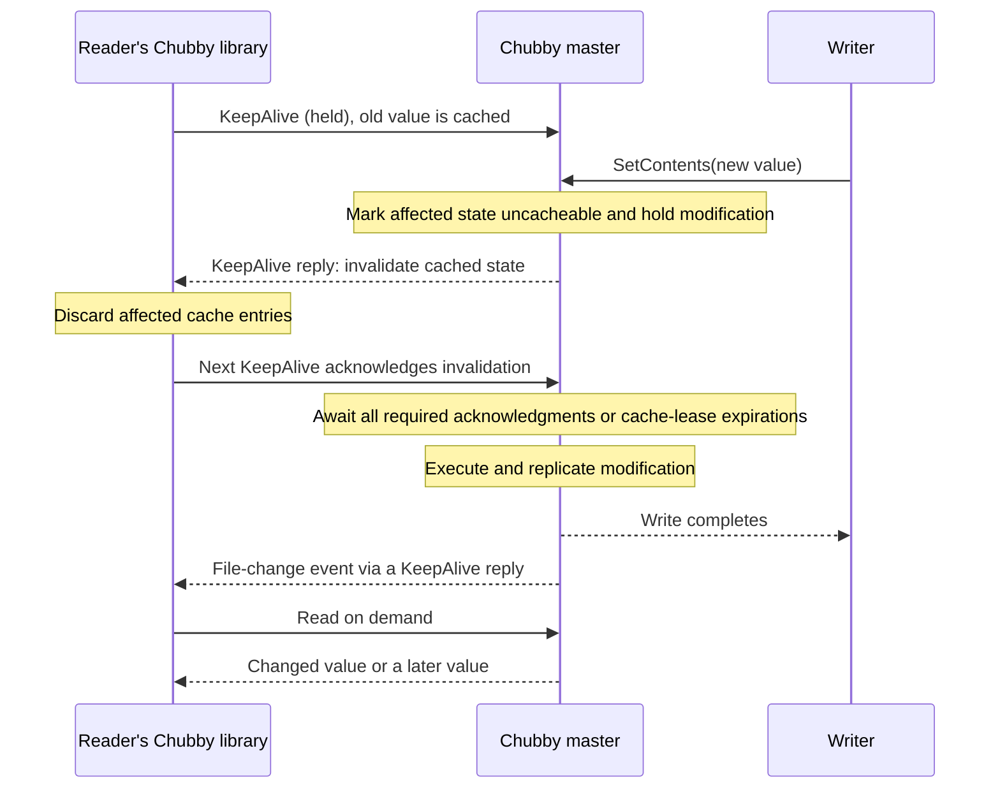

# Chubby perspectives: sessions, KeepAlives, cache coherence, and coordination

**Investigation dates:** 2026-11-01; expanded on 2026-11-02 after independently checking leads from the Claude and Antigravity analyses. Appendix A records adoption, qualification, and rejection decisions.

**Versions analyzed:** Chubby as described by Burrows, OSDI 2006, including the revised failover design in the paper's §4.4; etcd server and Go client `v3.7.3` (`0a173d0410a9`); jetcd `jetcd-0.8.7` (`23b61f1499a5`). Chubby source code and its present implementation were not available for inspection.

**Upstream references:** See the linked issue and PR list in [Appendix C](#appendix-c-verification-record).

**Confidence review:** 2026-11-06. Claim-level ratings reassessed against the cited evidence, including targeted rereading of the Chubby protocol and pinned leasing-cache paths. Earlier investigation and issue-status dates remain unchanged; no new runtime results are claimed.

## Scope

Evaluate how Chubby's session and KeepAlive protocol supports cache coherence and coordination, and which etcd lease and watch problems that design could prevent or simplify.

## Summary

**High confidence in the described protocol:** Chubby ties continued session validity to the client work needed to keep cached data consistent. A client cannot indefinitely retain its cache rights by renewing its session while ignoring invalidation requests. **Moderate confidence — architectural assessment:** this is the strongest supported version of the design hypothesis.

- **High confidence — protocol guarantee:** before modifying cached state, the master waits until affected clients acknowledge invalidation or lose permission to use their caches. Conservative client timeouts make expiration safe to rely on. An independently renewed etcd lease supplies no equivalent cache guarantee.
- **Moderate confidence — simpler coordination:** one session connects handles, locks, cache validity, and recovery. Applications have fewer independent signals to reconcile. The client library and server still have substantial correctness obligations.
- **High confidence — coupling matters more than transport:** the paper itself proposes a separate `GetEvent()` RPC while retaining acknowledgment requirements through KeepAlive. Long polling is a way to implement the dependency; it is not the guarantee by itself.
- **Moderate confidence — workload-dependent performance benefit:** invalidating and rereading current state can avoid unnecessary update delivery, replay, and buffering. The cost is that writers depend on readers' acknowledgments or expiration. No general throughput advantage over etcd has been measured here.
- **High confidence in code; Moderate in unexecuted failure scenarios:** etcd's `client/v3/leasing` demonstrates the composition costs directly. Its independent renewal can sustain a writer stall, its local validity check can outlast server ownership, and its invalidation protocol adds replicated transactions. The detailed audit is in Appendix B.
- **High confidence — limits:** the guarantee covers Chubby's managed cache, not arbitrary application copies or callback completion. External effects still need fencing. File-change events follow writes; invalidations precede them. Ephemeral-file lifetime depends on open handles, and twelve seconds is a default lease extension rather than a universal failure deadline.

Sections 1–3 explain the protocol and its cache guarantee. Sections 4–7 assess coordination, known defects, performance, and failover. Sections 8–9 draw design lessons and identify the remaining tests. Appendices retain the peer-review decisions, detailed code audit, and dated verification record; the document closes with [Conclusions](#conclusions).

## 1. KeepAlive couples renewal to required client work

Chubby lets a client keep using session-associated state only while the client participates in the protocol that keeps that state valid. The key example is cache invalidation: **a client cannot keep renewing its session indefinitely while ignoring a request to discard cached data**.

A client library normally leaves a KeepAlive RPC outstanding at the master, Chubby's term for the leader. The master completes that RPC to extend the session lease or deliver an event or invalidation. The library processes the reply and promptly sends another KeepAlive. After an invalidation, that next call acknowledges that the old cached state has been discarded. The paper explicitly makes this acknowledgment a condition of maintaining the session.

**Evidence — Verified, High confidence:** Chubby §§2.7–2.8, pp. 6–7; `doc/chubby-osdi06.md:229–263`.

This gives the master a useful combination:

1. A normally available route for delivering information without initiating a connection to the client.
2. A subsequent request that can acknowledge the client's required response.
3. A lease boundary after which a nonresponding client's cached state is no longer entitled to be used.
4. One session context tying those exchanges to handles, locks, and cache validity.

**Inference, High confidence:** long polling gives the master a ready way to contact the client, but correctness depends on checking the acknowledgment. A stream could carry the same protocol. A held RPC that accepts renewal without enforcing the invalidation obligation would lose the guarantee.

Here, “alive” means that the client library is participating in the protocol. It does not mean that the application is making useful progress. Likewise, expiration withdraws the client's rights; it does not prove that a partitioned or paused process has died.

## 2. The session contract and its limits

### 2.1 KeepAlive is per session, and the master controls reply timing

A session is a relationship between one client and a Chubby cell. It has an associated lease; Chubby therefore does have leases internally. The difference is that the paper does not expose independently attachable lease objects as the ordinary application abstraction. Handles, locks, and cached data normally share the session's validity. **Verified, High confidence:** Chubby §2.8, p. 7; `doc/chubby-osdi06.md:253–257`.

The master typically holds a KeepAlive until the preceding lease interval is near expiration. It advances the session lease timeout when replying, and can reply early to deliver events or invalidations. The client immediately sends the next call. Thus the request is almost always waiting at the master, rather than being sent only after a client-side sleep. The exchange also confirms that the client received the preceding response. **Verified, High confidence:** §2.8, `doc/chubby-osdi06.md:259–261`.

The default extension is twelve seconds, but this is not a fixed upper bound on a writer's wait. The master may grant a longer extension, including under load, and a reply carrying an invalidation can itself extend the session lease. A writer must respect the lease promise already given to the client. It cannot simply count twelve seconds from the arrival of the write. Failover can extend the wait further.

**Evidence — Verified facts and direct inference, High confidence:** Chubby §§2.8–2.9 and §3, pp. 7–10; `doc/chubby-osdi06.md:257–265`, `:285–313`, `:352`.

### 2.2 Ephemeral files are related to sessions through open handles

The analogy between an etcd lease-attached key and a Chubby ephemeral file is useful, but not exact. The paper says an ephemeral node is deleted when **no client has it open**; an ephemeral directory must also be empty. Another client's open handle can therefore keep a file present after the creator loses its session. Parent-directory events allow monitoring an ephemeral child without incrementing that child's open-reference count. **Verified, High confidence:** Chubby §§2.3 and 2.5, pp. 4–5; `doc/chubby-osdi06.md:118`, `:166`.

**High confidence — conditional on the stated open-handle pattern:** For the common pattern in which a process is the only opener of its presence file, losing the session can remove the file. That is a conditional application pattern, not the complete deletion rule. In contrast, an etcd lease revocation deletes its attached keys regardless of how many clients have read or watched them (`server/lease/lessor.go:326–361 @ v3.7.3`).

**High confidence — consequence of the documented lifetime rules:** This distinction matters operationally: observing a Chubby ephemeral file by opening it can inadvertently prolong its lifetime. The paper also records delayed ephemeral-file cleanup after failover while handles are reconstructed (§2.9, p. 9; `doc/chubby-osdi06.md:313`). Neither system's presence record proves instantaneous process health.

### 2.3 Sessions provide lifetime; file names identify coordination objects

Algorithms use **session-associated handles and ownership**. The application names a file or lock; it need not choose or publish a human-readable session name. `Open()` takes a node name and creates a handle, which subsequent API operations use. That handle refers to a particular node instance: deleting and recreating the same pathname does not revive the old handle. **Verified, High confidence:** Chubby §§2.3 and 2.6, pp. 4–6; `doc/chubby-osdi06.md:131–135`, `:186–217`.

The session is the common lifetime context. That does not force every election to use ephemeral files. The paper's election example opens a lock file, acquires its lock, and writes the winner's identity into it. The file can be permanent while the held lock depends on the winning session. **Verified, High confidence:** §2.6, `doc/chubby-osdi06.md:225`; §2.8, `:253`.

### 2.4 Invalidation and file-change notification are different messages

The master tracks what each client **may have cached**, including metadata and information that a name does not exist. It sends invalidations to those clients, rather than simply to every session with the file open. The modification waits until each relevant cache is invalidated or its cache lease expires.

While waiting, the master treats the node as uncacheable. Reads can still proceed, but they cannot create new cached copies of the old state and force another invalidation round. **Verified, High confidence:** Chubby §2.7, pp. 6–7; `doc/chubby-osdi06.md:229–247`.

An application file-change event, by contrast, is delivered **after** the corresponding change. A subsequent read returns the changed data or something newer. This is not the same acknowledgment as the pre-write invalidation, and the paper does not say that a writer waits for arbitrary application event callbacks to finish. **Verified, High confidence:** Chubby §2.5, pp. 5–6; `doc/chubby-osdi06.md:163–182`.

### 2.5 Event delivery can use a separate RPC

Chubby §4.6 reports that TCP retransmission/backoff behavior conflicted with session deadlines during congestion, leading to lost sessions. The implementation described in the paper moved KeepAlives to UDP. The authors then proposed a TCP `GetEvent()` RPC, held in the same manner, for normal event and invalidation delivery. KeepAlive replies would retain a list of unacknowledged events so that acknowledgment remained necessary. **Verified, High confidence:** Chubby §4.6, p. 14; `doc/chubby-osdi06.md:542–546`.

**High confidence — interpretation of the stated proposal:** The proposal preserves the acknowledgment requirement while changing the delivery channel. It supports the interpretation in §1: separate channels can retain Chubby's guarantee if renewal still depends on completing the required work. The paper presents this as future work, so it establishes neither deployment nor a complete specification of retransmission and acknowledgment rules.

**Moderate confidence — transport/scheduling assessment, not an etcd comparison result:** The transport experience also limits the performance argument. Combining urgent lifetime maintenance and potentially bulky event traffic creates scheduling demands. UDP does not guarantee deadlines under arbitrary congestion, and this historical report does not establish that present etcd HTTP/2 performs worse. That comparison would need a controlled test. The useful lesson is to preserve the dependency while allowing appropriate transport and scheduling for each kind of traffic.

## 3. How invalidation makes cached reads consistent

### 3.1 Invalidate first, modify second, notify afterward

The following illustrates the ordering described in the paper's §§2.5, 2.7, and 2.8. It is a schematic execution, not a trace of Chubby's implementation or a specification of undocumented wire fields.



The diagram shows one possible ordering of the final deliveries; it does not assert that the writer must receive its reply before another client receives the event. The required facts are that invalidation clears the way for modification, and the modification precedes its application event.

**Inference, High confidence:** A read concurrent with the pending write can still return the previous value. That is compatible with consistency because the operations overlap. What the protocol prevents is serving that previous cached value as a new read after the write has completed, assuming the cache and timing rules are correctly implemented.

### 3.2 The condition every write must satisfy

Let `MayCache(S, x)` mean that session `S` may still use a cached version of object `x` that predates a proposed modification. A sufficient condition for permitting that modification is:

```text
For every session S for which MayCache(S, x) holds:
    S has acknowledged discarding the old cached state
    OR S's entitlement to use that cached state has expired.

While establishing this condition:
    do not grant a new entitlement to cache the old state.
```

This condition expresses the paper's invalidation barrier; it is not a formal proof. The master may safely overestimate which clients hold cached data. It must not omit a cache that the client can still use. A TCP acknowledgment, receipt of bytes, or unrelated successful RPC does not prove that the cache has been invalidated.

A live session can owe an acknowledgment while the writer waits. The rule applies when the master permits the modification: it does not require instantaneous delivery or acknowledgment of every invalidation. Renewal must prevent the client from bypassing the obligation indefinitely.

The client's timeout is essential. Chubby uses a **conservative** local approximation of the master's lease timeout, accounting for time in flight and a bound on relative clock rates. When its local timeout expires, the library clears and disables its cache. During the ensuing grace period it blocks application API calls while trying to recover the session. The grace period preserves an opportunity to recover; it does not authorize continued cached reads. **Verified, High confidence:** Chubby §§2.8–2.9, pp. 7–8; `doc/chubby-osdi06.md:263–289`.

Thus, when the server eventually relies on lease expiration instead of an acknowledgment, a conforming client has already ceased to use the cache. The server need not know whether the process is dead. It needs the process to have lost permission to serve those cached values.

**Conditions under which this reasoning fails:** the client acknowledges before making invalidation effective; it serves cached data after its conservative timeout; the stated clock-rate assumptions fail; the server forgets a still-valid cache holder; or failover permits a write before old cache rights have been accounted for. The paper's §4.4 reports an actual example of the last two hazards, discussed here in §7.

### 3.3 A concrete contrast with an etcd watch-backed cache

Consider a client that uses an etcd lease for its ownership record and watches a configuration key into its own cache:

1. It has cached `x = old`.
2. Its watch stops delivering, while its lease keepalive path continues working.
3. Another client successfully writes `x = new`.
4. The first client uses `old`, reasoning that its lease remains healthy.

**High confidence — protocol-level possibility, not a reproduced incident:** etcd does not couple the lease renewal to consumption of that watch. A keepalive request identifies a lease; watch requests create, cancel, or request progress, without an application-processing acknowledgment. The server responds to a renewal without first invalidating reader caches. Sources: `api/etcdserverpb/rpc.proto:761–768`, `:924–927`; `server/etcdserver/api/v3rpc/lease.go:111–147 @ v3.7.3`.

This execution need not violate etcd's contract. Watch delivery has no finite latency guarantee, and watches are not linearizable reads. Retained-history continuity and a progress watermark are different from permission to use a current local cache. [etcd v3.7 API guarantees](https://etcd.io/docs/v3.7/learning/api_guarantees/#watch-apis).

For Chubby's **library-managed cache**, the corresponding execution is excluded by the stated protocol: either the writer is still waiting, the cache has already been invalidated, or the cache has become unusable through expiration. A separate liveness exchange cannot keep stale cache rights alive indefinitely while bypassing invalidation.

This conclusion does **not** extend automatically to an application's copy of data previously returned by Chubby. If the application retains that copy independently and ignores change or jeopardy notifications, Chubby cannot revoke bytes already handed to it. The comparison is between Chubby's managed cache contract and an etcd application cache that has not supplied an equivalent validity protocol.

## 4. Consequences for election, locking, and recovery

### 4.1 One session connects ownership, reads, and recovery

The paper's election procedure combines a named lock, a session-associated handle, publication of the winner's identity, consistent reads, and optional file-change notifications. Session validity supplies a common context for ownership and access. The programmer does not have to infer “the cache is current” from the continued renewal of an unrelated object. **Verified mechanism; Moderate confidence in the simplification judgment:** Chubby §2.6, p. 6; `doc/chubby-osdi06.md:225`, and §§2.7–2.8.

There is a further useful rule: if an operation on a handle fails because its session expired, subsequent operations on that handle also fail, except cleanup operations. The paper explains how this prevents an arbitrary subsequence of operations from surviving session loss and supports a final write marking a sequence as committed. This is an ordering aid; it is not a general multi-object transaction. **Verified, High confidence:** Chubby §2.8, p. 8; `doc/chubby-osdi06.md:281`.

Jeopardy, safe, and expired notifications make uncertainty explicit. During jeopardy, the client can suspend work that depends on the session and resume if the same session survives. Centralizing that behavior in a library reduces the recovery logic each application must supply. The application remains responsible for suspending its own external activity correctly. **High confidence in the described protocol; Moderate in the inferred reduction of application recovery work:** §§2.8–2.9, `doc/chubby-osdi06.md:265–289`.

### 4.2 etcd does support sessions and locks, but through composition

etcd provides a Lock RPC and a Go session abstraction through composition. Its Go `concurrency.Session` grants or adopts a lease and drains a keepalive channel; `Done()` follows that channel's termination. The mutex implementation uses lease-attached candidate keys, creation revisions, transactions, and watches for predecessor deletion. The server's Lock RPC itself delegates to this implementation. **Verified, High confidence:** `client/v3/concurrency/session.go:40–97`; `client/v3/concurrency/mutex.go:75–129`; `server/etcdserver/api/v3lock/lock.go:35–49 @ v3.7.3`.

**High confidence — scope of the inspected session implementation:** The architectural distinction is that this session does not establish a server-enforced relationship between all of the client's reads, watches, local caches, and renewal. Merely adopting one lease per process does not add Chubby's invalidation or uncertainty rules.

The distinction also affects lock waiters. Chubby exposes acquisition on a session-associated handle, including cancellation of outstanding `Acquire()` calls. The application does not maintain a watch on the previous lock holder's key or track that watch's replay position. etcd's concurrency library also hides much of this work, but internally it waits on that watch and then checks whether the contender's own key still exists.

**Evidence — High confidence in the described mechanisms:** §2.6, `doc/chubby-osdi06.md:199`, `:209`; §2.7, `:247`; `client/v3/concurrency/mutex.go:87–105 @ v3.7.3`. **Moderate confidence — design consequence:** making ownership and acquisition server operations can reduce the independently failing mechanisms involved. This does not establish fewer internal races or lower acquisition latency in Chubby; its implementation is unavailable and its session and lock delays still apply.

**High confidence — transaction-level reasoning:** Composition can nevertheless be correct. For protected changes inside etcd, an ownership comparison can be included in the same transaction as the change; `Mutex.IsOwner()` supplies a creation-revision comparison (`client/v3/concurrency/mutex.go:152–153 @ v3.7.3`). **Moderate confidence — design assessment:** Chubby's advantage is a more integrated default coordination contract, not unique computational ability.

### 4.3 Neither session liveness nor a lock stops delayed external requests

Suppose a holder sends a storage write, loses its session, and a new holder acquires the lock. The old request can arrive afterward. A perfectly implemented KeepAlive protocol does not retract that packet or stop a paused process from resuming.

Chubby explicitly addresses this with **sequencers** containing lock identity, mode, and generation. The external recipient must validate the sequencer or enforce a suitable monotonic fencing rule. A recipient that only compares against the greatest token it has already seen prevents an old operation after observing a newer token; it does not independently discover an unseen ownership change. The paper separately describes lock-delay as an imperfect accommodation for services that cannot check sequencers. **Verified, High confidence:** Chubby §§2.1 and 2.4, pp. 2 and 5; `doc/chubby-osdi06.md:44`, `:155–159`.

Session loss releases ownership under the coordination protocol; it does not make an external service safe by itself. Likewise, a successful Chubby read followed by an external action can race a later change. Consistent cached reads simplify obtaining current information; they do not turn read-then-act into an atomic distributed operation.

**High confidence — documented lock-delay behavior:** Lock acquisition after failure can also be delayed beyond session expiration by lock-delay. Normal explicit release does not incur that delay. Therefore “the lock is taken away after twelve seconds” is not an adequate takeover-latency model.

### 4.4 Lock waiting and stale unlocks need different remedies

**Waiting after the contender's session expires — High confidence in the code, Moderate in an unexecuted schedule.** `Mutex.Lock` passes the caller's context to `waitDeletes`; the latter watches predecessor keys and does not also wait on the contender's session or key. If the caller uses a context that remains live after its own lease is lost, a predecessor that keeps holding its lock can keep that call waiting. Only after predecessor deletion does the mutex read its own key and return `ErrSessionExpired`. Sources: `client/v3/concurrency/mutex.go:87–105`; `client/v3/concurrency/key.go:25–63 @ v3.7.3`. [Issue #19597](https://github.com/etcd-io/etcd/issues/19597) describes the same missing early termination.

This is a progress problem. It does not establish that the expired contender acquires the lock. Supplying a session-cancelled context can end the wait in the Go path; the default `Lock(ctx)` API does not automatically substitute one. A first-class session-bound acquisition can make that lifetime relationship part of the contract, as Chubby does. The paper does not specify an exact bound for cancellation of every pending `Acquire()`.

**Stale unlock after reacquisition in the same session — High confidence in the mechanism.** The key name includes the lease ID, while `Unlock()` deletes by name without comparing the recorded creation revision. This permits the following sequence:

1. An unlock commits, but its reply is lost. The old mutex retains its key and revision.
2. A new mutex using the same lease and prefix reacquires the lock, recreating that key at a later revision.
3. Retrying the old unlock deletes the new acquisition.

**Evidence:** `client/v3/concurrency/mutex.go:111–153 @ v3.7.3`; [issue #22082 and its proposed reproduction](https://github.com/etcd-io/etcd/issues/22082). The reproduction was read but not executed.

This is an acquisition-identity problem **within one live session**. It needs a generation comparison at the mutation, such as the existing creation-revision ownership predicate, rather than better KeepAlive delivery. A native lock service can centralize that check, but merely naming a session cannot supply it. Chubby's handle-instance and lock-generation concepts are relevant precedents; the paper does not prove its `Release()` implementation immune to every delayed retry.

**High confidence — source-derived delegation and setup behavior:** jetcd uses the same composed server implementation. `LockImpl` calls the Lock and Unlock RPCs; the server invokes an in-process Go client through adapters. It creates a session wrapper and immediately orphans its renewal before waiting. This adds internal session-management work, but does not establish a new network connection or even a renewal packet per call: subscriptions and transport are shared, and cancellation can race sending. Language bindings therefore inherit the server implementation's semantics without implementing the lock algorithm themselves.

**Evidence:** `jetcd-core/src/main/java/io/etcd/jetcd/impl/LockImpl.java:60–86 @ jetcd-0.8.7`; `server/embed/serve.go:148–150`; `server/etcdserver/api/v3client/v3client.go:27–40`; `server/etcdserver/api/v3lock/lock.go:35–57 @ v3.7.3`.

## 5. Which lease and watch problems the design addresses

The findings below connect to [the lease analysis](leases-codex.md) and [the watch analysis](watchers-codex.md). Some problems disappear because Chubby supplies a stronger protocol. Others disappear only because its managed cache does not promise delivery of every historical mutation. Those are different benefits.

| Existing problem or risk | Effect of the Chubby design | Remaining limit |
|---|---|---|
| Lease renewal continues while observation stalls | Renewal cannot bypass outstanding cache invalidation acknowledgments in the described protocol. This prevents the particular stale-managed-cache execution in §3.3. **High.** | It does not prove application callbacks or external work progressed. |
| A delayed keepalive reply makes local status optimistic | Conservative local timeout and cache shutdown provide an explicit validity boundary. **High.** | Correct clock assumptions and implementation are required; arbitrary external actions still need fencing. |
| An application treats a live watch or transport as proof its cache is current | Cache validity is supplied by the invalidation protocol rather than inferred from stream health. **High.** | An application-owned derived cache needs its own rules. |
| Resume cursors, progress, and compaction become a complicated recovery protocol | Invalidation plus rereading current state can avoid reconstructing every historical mutation for cache coherence. **High for the distinction; Moderate for engineering benefit.** | Chubby permits event loss across failover and asks applications to rescan. It does not replace a reliable mutation history. |
| Slow consumers accumulate updates | Once data is invalidated, the cache does not need every subsequent value until it is read again. **High.** | The paper does not establish bounded memory for every Chubby event queue; invalidation barriers can delay writers. |
| Catch-up scans contend with writes | The managed-cache protocol has no need to replay an MVCC event interval merely to restore a current cached value. **Moderate architectural benefit.** | Writes now depend directly on invalidation completion; rescans and cache misses can still overload the master. |
| Lease TTL restarts or extends on leadership changes | Chubby also conservatively extends session leases during failover. **High.** | It does not solve absolute retention deadlines or rapid takeover under continuing failures. |
| Checkpoint clear reports success despite a failed replicated operation | The particular etcd checkpoint path is not described in Chubby. **High about this distinction.** | A held KeepAlive does not itself prevent false acknowledgment of server state; the reply must reflect an actually installed promise. |
| A stalled old leader makes invalid renewal or expiry decisions | Chubby's master lease, client epochs, and recovery barrier contribute to a fuller authority protocol. **High about the described mechanisms.** | Transport coupling alone does not fence obsolete internal work. The paper is insufficient to prove all such races absent. |
| Session/lease loss triggers large amounts of cleanup | Grouping state under a session can reduce renewal bookkeeping. **Moderate.** | Locks, handles, and ephemeral files still require cleanup. A common failure boundary can concentrate that work. |

### 5.1 A renewal deadline is not a cache-validity deadline

The Go client sets its deadline to response receipt time plus the returned TTL and normally schedules the next renewal at approximately TTL/3 (`client/v3/lease.go:542–556 @ v3.7.3`). jetcd similarly uses receipt-time wall-clock arithmetic (`jetcd-core/src/main/java/io/etcd/jetcd/impl/LeaseImpl.java:249–266 @ jetcd-0.8.7`). **Verified, High confidence.**

**High confidence — consequence of the deadline arithmetic:** A reply delayed in transit can therefore leave the client with a later deadline than the leader's actual expiry. These are client renewal-management deadlines, not conservative certificates of current lock ownership or cache validity. Chubby expressly requires the latter kind of conservative reasoning for cached reads (§2.8, p. 7; `doc/chubby-osdi06.md:263`).

**Inference, High confidence:** Implementing Chubby-like cached-read safety would require changing the interpretation and calculation of validity, not simply directing both APIs to the same endpoint. This observation does not prove ordinary etcd KV operations incorrect, and it does not by itself establish that the etcd clients violate a documented promise of Chubby-style cache safety.

### 5.2 Reading current state can avoid replay; consuming every change cannot

The current Go watch client can append responses to an uncapped per-watch buffer while the application is slow. On the server, a watcher catching up on history scans an unlimited backend range while holding the watchable-store mutex. Delivery batching limits matching revisions only after that scan, and write completion needs the same mutex. These mechanisms support the pressure reported in #22264 and #16839.

**Evidence — Verified code, High confidence; production severity unmeasured here:** `client/v3/watch.go:818–880 @ v3.7.3`; `server/storage/mvcc/watchable_store.go:346–435`; `server/storage/mvcc/watcher_group.go:25–39`; `server/storage/mvcc/watchable_store_txn.go:41–46 @ v3.7.3`.

**High confidence — described cache protocol:** Chubby invalidates rather than updating a cache on every modification. After invalidation, a client that never reads again need not receive every replacement value. This avoids an unbounded stream of unnecessary **cache updates**, exactly the motivation in §2.7, p. 7 (`doc/chubby-osdi06.md:243`). It does not establish that all notifications are coalesced or that all server memory is bounded.

jetcd's watch-resume cursor provides another example. `WatchImpl` raises its resume revision to the revision in the watch-creation response before historical events necessarily arrive. If the connection then fails before the first replay response, a retry can omit part of the requested history. The first event response can reset the cursor to the delivered revision plus one, so the timing window matters.

**Evidence:** `jetcd-core/src/main/java/io/etcd/jetcd/impl/WatchImpl.java:256–267 @ jetcd-0.8.7`; cursor reset at `:313–315`. The code fact is **High confidence**; the end-to-end schedule remains **Moderate confidence**, not newly reproduced here.

An invalidate-and-reread design need not track that historical cursor to restore current state. But an application that must process every transition still needs a delivery/replay protocol. It cannot claim the cursor problem has been solved merely by switching to an API that does not promise those transitions.

**High confidence — reported protocol limits:** Chubby's own file-change events may be lost during failover; a failover event requests rescanning (§2.5, p. 5; §2.9, p. 9; `doc/chubby-osdi06.md:167`, `:309`). The paper explicitly reports that its event mechanism is inefficient for all but trivial publish/subscribe uses (§4.5, pp. 13–14; `doc/chubby-osdi06.md:516–524`).

### 5.3 Server authority and renewal promises still need enforcement

etcd's default failover behavior refreshes surviving leases from their granted TTL unless a positive remaining-TTL checkpoint exists (`server/lease/lessor.go:480–491`; `server/lease/lease.go:75–88 @ v3.7.3`). Chubby likewise pauses authoritative session timing during master absence and reconstructs conservative lease bounds (§2.9, pp. 8–9; `doc/chubby-osdi06.md:285–307`). **Verified, High confidence.** Preserving sessions across failures is a shared tradeoff, not evidence that one system has eliminated renewal uncertainty.

With checkpointing enabled, etcd #22649 exposes a mismatch between the server's state and its promise to the client. The production checkpointer discards a Raft request's error. Renewal may then use a shorter saved duration while returning the full TTL. A Chubby-style exchange would also be unsafe if it acknowledged an extension the server had failed to install.

**Evidence — High confidence in the conditional mechanism:** `server/etcdserver/server.go:392–402`; `server/lease/lessor.go:433–455`; `server/lease/lease.go:75–88 @ v3.7.3`. Checkpointing defaults off (`server/features/etcd_features.go:94–95 @ v3.7.3`).

The historical stalled-leader problem #15247 has a merged fix, #16822, present in `v3.7.3`. The current paths check leadership before direct renewal and automatic expiry processing (`server/etcdserver/v3_server.go:496–529`; `server/etcdserver/server.go:858–885 @ v3.7.3`). The separate delayed-revocation schedule in the lease analysis remains a source-derived candidate, not an established current reproduction. It must not be counted as a demonstrated defect eliminated by Chubby.

Chubby's master lease, epoch checks on client calls, and recovery barrier are relevant to avoiding obsolete authority. However, rejecting a client's old epoch does not, by itself, prove that delayed internal expiry work cannot execute after leadership changes. That needs a corresponding server invariant. The paper does not expose enough implementation detail to audit that invariant.

## 6. Performance benefits and costs

### 6.1 Repeated reads of rarely changed state are a good fit

**Moderate confidence — analytical argument, not benchmark evidence.** When many clients repeatedly read a small set of rarely changed files, Chubby can amortize validity over a session, serve unchanged values locally, and use an already pending KeepAlive reply to initiate invalidation. The reader does not need an independent poll merely to learn that its cached value is unusable. After invalidation, rereading is demand-driven.

This matches the paper's intended use: coarse-grained locking, small metadata, naming, and predominantly read traffic (§§1, 2.1, and 2.7; `doc/chubby-osdi06.md:20–22`, `:74–80`, `:229–247`). The benefit is less communication for the application's required semantics, not just faster processing of an individual RPC.

For a symbolic comparison, let `S` be the number of active sessions, `L` the number of independently renewed etcd leases, and `T` their common nominal lease duration or extension:

| System | Approximate renewal rate | Assumption |
|---|---|---|
| Chubby | Proportional to `S/T` | No early replies to deliver events |
| etcd Go client | Proportional to `3L/T` | Healthy TTL/3 renewal scheduling |

These are **Moderate-confidence message-rate approximations under the table's assumptions**, not throughput predictions. They omit RPC overhead, batching, scheduling, network delay, and event traffic.

**High confidence in the mechanisms; comparative cost unmeasured:** The comparison also depends on object grouping. etcd can attach many keys to one lease and can multiplex lease renewals on one stream (`client/v3/lease.go:585–606`; `server/lease/lessor.go:347–350 @ v3.7.3`). If applications already use one lease per intended session, Chubby does not gain a factor equal to the number of keys. Its early event replies can increase KeepAlive turnover substantially. Long-poll exchanges and streaming messages also have different costs.

**High confidence — consequence of the documented extension policy:** Chubby's ability to lengthen lease extensions under load reduces renewal frequency, but also lengthens the period for which an unresponsive holder may retain rights. This is explicit load control with a failure-recovery tradeoff, not a free performance gain (§3, p. 10; `doc/chubby-osdi06.md:352`).

The paper's name-service discussion makes the amortization argument especially clear: absent changes, a session's renewal traffic can maintain many cached names without polling each name separately. It also reports startup bursts that still overwhelmed the master and motivated batching related names. **Verified, High confidence:** Chubby §4.3, p. 12; `doc/chubby-osdi06.md:468–472`. Thus fewer steady-state polls do not eliminate cold-cache or correlated-restart load.

**Moderate confidence — redesign assessment grounded in the following sender-loop behavior:** Adopting server-controlled pacing in etcd would require changes at both ends. The Go sender advances `nextKeepAlive` when it receives a response. Once that time is overdue, it can send again on later passes through the sender loop while still awaiting a response. Holding replies therefore does not establish one outstanding request per session. Delaying the server's receive/renew/send loop can also delay other lease IDs on the same stream.

Longer server-granted lifetimes would need to remain valid through failover. The existing grant-time load-control TODO identifies the opportunity, but does not establish that delaying replies or returning a larger TTL is safe.

**Evidence — Moderate confidence in the redesign implications:** `client/v3/lease.go:542–556`, `:585–617 @ v3.7.3`; `server/etcdserver/api/v3rpc/lease.go:111–147 @ v3.7.3`; load-control TODO at `server/lease/lessor.go:290–291 @ v3.7.3`.

### 6.2 Writers depend on the slowest relevant reader

For a healthy, stable master, define `d_i` as the time until affected cache holder `i` either acknowledges invalidation or loses its applicable cache entitlement. Ignoring concurrent-write scheduling, the barrier component is approximately:

```text
invalidation wait = max(d_i over affected cache holders)
write completion includes invalidation wait + replicated modification work
```

**Moderate confidence in this simplified timing model:** it describes the dependency, not measured latency. Invalidation work can proceed concurrently, so the wait need not be the sum of all round trips. Nevertheless, a single unavailable reader can make the writer wait for lease expiration. No finite bound follows under arbitrary repeated failures or continuing lease extensions.

**Inference, High confidence:** Reader failures become part of write availability. Read-only clients that hold cached data matter even when they hold no locks. The library's conservative timeout makes that dependence safe; it does not make it cheap. Frequent writes to widely cached data can cause repeated invalidation, acknowledgments, uncached reads, and refills.

**High confidence — protocol distinction and inspected contention path:** etcd writes do not have a protocol requirement to wait for every watching application to acknowledge consumption. This preserves a useful form of independence between writes and observers. Its implementation can still couple them through resource contention, as the catch-up mutex shows. The two designs therefore have different intentional dependencies as well as different implementation risks.

### 6.3 Session integration concentrates state and failures

The master must track possible cache holders and outstanding obligations. One process's session may encompass many handles, locks, and cached objects. Losing that session can invalidate all of them together; a library stalled on required invalidation work can lose more than a single subscription. This is a useful common failure boundary when the resources belong together, and an availability cost when unrelated activities share it. **Inference, Moderate confidence.**

**High confidence in the cleanup mechanisms; relative cost unmeasured:** Similarly, fewer renewal objects do not imply constant-time expiration. Chubby must release locks and clean up session-associated state, including eligible ephemeral files. etcd explicitly deletes all attached keys during revocation (`server/lease/lessor.go:343–361 @ v3.7.3`). Neither the paper nor this inspection supplies an equivalent measured cleanup-cost comparison.

**Moderate confidence — unmeasured performance hypothesis:** The resulting performance hypothesis is workload-specific: **for coordination workloads whose required result is a valid current view, a session-bound invalidation protocol can avoid work that a general mutation stream performs and an application must then interpret.**

### 6.4 A simpler application needs a more capable library

Chubby's Java discussion reports a delicate C++ client library comparable in size to its server. Rather than maintain a separate Java implementation or omit caching, Java applications used a protocol-conversion server exposing simpler RPCs corresponding to the client API. **Verified, High confidence:** Chubby §4.2, p. 12; `doc/chubby-osdi06.md:454–458`.

**Moderate confidence — architectural cost assessment:** The simpler application contract moves responsibility into the library or intermediary. Supporting another language requires reproducing that behavior or depending on the intermediary, which adds deployment and availability costs. jetcd's server-delegated locks illustrate partial reuse of an implementation (§4.4); its independent lease and watch code still needs separate scrutiny.

**Moderate confidence — design hypothesis:** A shared session lifecycle can make the rules for expiration easier to specify and test. It does not make complex clients inherently safer or background-renewal bugs impossible.

## 7. Failover must account for every usable cache

The initial failover design reconstructs recorded sessions, extends their leases, accepts KeepAlives, sends a failover event that flushes caches, and waits for acknowledgment or expiry before permitting ordinary operations. It also changes the client epoch and rejects older-epoch requests. **Verified, High confidence:** Chubby §2.9, pp. 8–9; `doc/chubby-osdi06.md:285–315`.

This illustrates how deeply the session protocol matters. Re-electing a master and recovering durable file contents is not sufficient. The new master must also reconcile the cache rights granted by its predecessor before allowing writes that would make those caches stale.

The paper then reports an optimization that delayed recording read-only sessions. An unrecorded session could retain valid cached data across failover while the new master, having heard from all *recorded* sessions, resumed operations too soon. The result could be stale reads. Its revised design reconstructs sessions without storing them on disk and requires a full worst-case lease wait before normal operation resumes. **Verified, High confidence:** Chubby §4.4, pp. 12–13; `doc/chubby-osdi06.md:478–490`.

The bug supports the architectural argument while showing its limit:

- **The invariant identifies the error:** the recovery barrier omitted a client that could still use its cache. The session design makes the missing obligation explicit.
- **The implementation still failed:** fixing the consistency bug imposed an availability cost. A pending KeepAlive did not ensure correct bookkeeping.

**High confidence — described proxy mechanism:** The revised design in the paper's §4.4 also changes proxy behavior. Proxies can manage sessions that the master does not know individually and can transfer associations during recovery (`doc/chubby-osdi06.md:492`). A process therefore need not always have its own RPC blocked directly at the master. A trusted intermediary can maintain that relationship, provided it preserves each client's invalidation and lifetime obligations.

**Assessment, Moderate confidence:** Chubby simplifies the application's contract by accepting substantial responsibility in the client library, master, and recovery protocol. It reduces the number of independently interpreted signals at the application boundary. It does not abolish the distributed state that makes those signals meaningful.

## 8. Design lessons for etcd

### 8.1 Define the session and cache contract together

A design inspired by Chubby would specify which rights a session grants, what client processing renews those rights, how uncertainty disables their use, and how a new leader accounts for old rights. Useful obligations include:

1. **One defined validity context:** ownership and managed caches that should fail together share a session generation.
2. **Acknowledged processing:** renewal acknowledges completed invalidation work, with ordering that prevents a delayed or unrelated message from satisfying the wrong obligation.
3. **Conservative client validity:** clients stop serving protected cached state before the server can treat its rights as expired.
4. **Explicit recovery:** jeopardy disables unsafe use; resumption either reestablishes the same valid context or reports irreversible expiration.
5. **Authority at the server:** renewal replies, automatic termination, and leader recovery must agree about which promises remain valid.
6. **Fencing at external resources:** a session cannot recall old requests, so the protected service must reject obsolete ownership where required.

These are **design implications, Moderate confidence**, not a proposed wire-compatible patch. A bidirectional gRPC stream could carry such a protocol. Leaving lease renewal independent and adding another notification type would not establish it.

### 8.2 The existing leasing cache exposes the cost of composition

etcd already includes a cooperative cache layer, `client/v3/leasing`. It uses lease-attached ownership keys, watches, and transactions to coordinate local cached reads with writes. That makes it a concrete test of the design comparison: it supplies an invalidation protocol above the core KV API, but renewal remains independent of invalidation progress.

The source audit supports five findings; each row separates code evidence from any unexecuted consequence.

| Finding | Why it matters | Detailed evidence |
|---|---|---|
| **High confidence — source-verified:** each auxiliary ownership key belongs to one cache owner's lease. | This differs from Chubby's tracking of multiple reader sessions; all writers must cooperate with the cache protocol. | [Appendix B.1](#b1-ownership-and-invalidation-protocol) |
| **High confidence in the independent paths:** renewal can continue while the owner fails to acknowledge invalidation. | **Moderate confidence — unexecuted schedule:** a writer can remain blocked indefinitely unless its deadline or another recovery action ends the wait. | [Appendix B.2](#b2-a-stalled-invalidation-can-block-a-writer-indefinitely) |
| **High confidence in the asynchronous check:** the local session check can remain open after server ownership expires. | **Moderate confidence — unexecuted schedule:** a new cached read after a competing write may return stale data. The timing conditions matter. | [Appendix B.3](#b3-local-cache-validity-can-outlast-server-ownership) |
| **High confidence — source-verified:** cache acquisition and invalidation add replicated transactions. | **Moderate confidence in the unexecuted combined path:** one traced nonowner `Put` performs five transaction calls, including two identical data puts. This is a specific code path, not a general cost ratio. | [Appendix B.4](#b4-a-nonowner-put-can-perform-five-transaction-calls) |
| **High confidence — source-verified:** `EvictRange` uses the range-start key instead of the loop key. | **Moderate confidence — unexecuted schedule:** a lost reply after a committed range deletion can leave affected entries cached. This is a repairable implementation defect. | [Appendix B.5](#b5-evictrange-can-leave-affected-entries-cached) |

These findings show both the reach and the limits of composition. etcd's primitives can express cache coherence, but the layer must separately enforce renewal deadlines, invalidation progress, and correct eviction. Chubby puts those obligations into its session contract. Neither approach makes its implementation immune to bugs.

### 8.3 Separate current-state reads, mutation history, and expiration

Three needs should be evaluated independently:

| Requirement | Natural focus of the protocol |
|---|---|
| Read current small coordination state from a local cache | Invalidation, acknowledgment, conservative cache validity, and recovery barriers |
| Consume every relevant retained mutation | Revision cursors, ordered replay, compaction handling, bounded buffering, and consumer processing position |
| Expire stored records at a deadline | Retention semantics across failover, cleanup progress, and explicit limits on lifetime extension |

**Moderate confidence — architectural assessment:** Chubby's session design is particularly compelling for the first requirement and integrates ownership with it. etcd exposes primitives used for all three. Problems arise when an application assumes that satisfying one requirement—for example, continuing lease renewal—satisfies another.

**Moderate confidence — design assessment:** Independent leases retain useful choices about object lifetimes and failure domains. The design question is which higher-level guarantees the system and its supported libraries should provide together, and which combinations they should make difficult to misuse. Chubby demonstrates a particularly coherent choice for coordination; evaluating that choice separately from a general-purpose TTL facility makes the comparison more useful.

**High confidence in the service distinction; Moderate in the untested repeated-failover consequence:** Preserving a session through a leader outage and deleting a passive record at its original deadline are different service objectives. Chubby omits a general passive-TTL API, so it avoids combining those promises. It still needs to release a failed owner's locks and files eventually; repeated recovery extensions can postpone that work too.

A separately persisted expiration deadline could clarify a TTL API. It would still require clock assumptions, an authority check, replicated deletion, and recovery rules. Moving expiration into a garbage-collection facility would not remove cleanup bursts or expiration bugs. **Moderate confidence — design assessment based on §§2.2 and 5.3.**

### 8.4 A progress watermark cannot authorize future cached reads

A session could carry leader-verified revision watermarks while watches remain asynchronous and writers proceed independently. Such a watermark says that the observer should have processed changes through a particular revision. The client could obtain that revision, wait for its application state to catch up, and report uncertainty if it cannot. This would help **detect stalled observation** without automatically discarding a usable replay cursor. **Moderate confidence — proposed design, not implemented or tested here; provenance is recorded in Appendix A.**

It does not supply Chubby's contract for arbitrary later cache reads. Consider:

```text
t0: A leader-verified heartbeat reports revision R; the cache has processed R.
t1: Another client completes a write at R+1; its watch event is delayed.
t2: Before the next heartbeat, a new cache read returns the old value.
```

The client can still report “safe” at `t2`, even though the read began after the write completed. A watermark describes a past revision. Signing it, associating it with a term, or carrying it in a valid session does not make it authorize old cached values after future writes. Chubby excludes this execution by requiring the write to invalidate the cache first.

Without writer participation, a linearizable cached read needs a freshness barrier after the read begins: obtain an authoritative revision and process changes through it before answering. Suitable concurrent reads may share that work. Periodic sampling can instead support a specified staleness bound if its timing and failure assumptions hold. **High confidence in the counterexample and distinction.**

etcd's current keepalive header does not provide that freshness barrier. The serving member fills it before renewal, including before a follower forwards the request. An ordinary watch progress response also reports local progress rather than quorum-verified freshness. The check that can suppress an explicit progress response examines the requesting stream's watchers, not every watcher on the member.

**Evidence — High confidence in the header and progress paths:** `server/etcdserver/api/v3rpc/lease.go:127–147 @ v3.7.3`; `server/etcdserver/api/v3rpc/watch.go:395–399`; `server/storage/mvcc/watchable_store.go:511–539 @ v3.7.3`. These limits constrain the proposed design; they do not remove its value for detecting a stalled observer.

This also narrows the Kubernetes comparison. Adding invalidation barriers to API-server caches would make writes depend on the **actual caches of the affected keys**, and on the relevant timeout policy. A claim about every API server, every write, or specific throughput needs workload and cache-coverage evidence. Conversely, substituting periodic session bookmarks cannot by itself remove a request's linearizable-read barrier. The architectural tradeoff can be evaluated without assuming either a universal write-heavy workload or that every consumer needs every historical mutation.

## 9. Evidence limits and next investigations

**Verified in these investigations:** the cited Chubby passages; the principal stable-source paths cited above; release identities; the issue/PR state snapshots and narrow upstream checks dated below. The 2026-11-02 review additionally read the relevant leasing cache, lock, session, adapter, and transaction paths, and selected existing integration tests. Peer analyses supplied leads; adopted claims were checked against the paper, source, or upstream reports. No claims depend solely on recalled implementation behavior.

Release, branch, and issue-status checks are recorded by date in [Appendix C](#appendix-c-verification-record).

**Not performed:** execution of Chubby, new etcd/jetcd functional reproductions, model checking, fault injection, or benchmarks. All comparative performance statements are reasoned hypotheses. This host remains outside the benchmark scope, and no toolchain was installed or build worktree created.

The most useful next investigations are:

1. **Exercise the exact independence in §3.3.** Interrupt watch delivery or consumption while allowing lease renewal; verify separately what happens to library status, processed revision, and decisions made from cached data. This tests misuse exposure, not an assumed violation of etcd's watch contract.
2. **Test client validity under delayed responses and pauses.** Distinguish server lifetime, client renewal deadline, and externally enforceable ownership. A safe cache layer must not confuse those clocks or rights.
3. **Model the invalidation invariant through failover.** Include unknown read-only sessions, a delayed acknowledgment from an old epoch, overlapping reads during invalidation, and client expiry without acknowledgment. The paper's §4.4 bug, discussed here in §7, provides a concrete counterexample the model should reject.
4. **Compare equivalent workloads on the later benchmark hardware.** Separate current-state lookup from every-transition consumption. Vary read sharing, write frequency, cache size, unavailable readers, and session fan-out; record writer tail latency as well as server/client CPU, memory, traffic, and recovery work. A Chubby-inspired prototype would test the proposed protocol, not establish measured performance of Google's implementation.
5. **Exercise the leasing paths summarized in §8.2 and traced in Appendix B.** Extend existing integration tests to stall `monitorLease` independently of renewal; begin reads after a competing write during delayed local expiry processing; count mutations for a nonowner `Put`; and lose a committed range-delete reply. These tests should validate the claimed observable behaviors, not merely repeat the implementation's branch conditions.
6. **Test the lock boundaries in §4.4.** Keep a predecessor healthy while the waiter's lease disappears, and lose an unlock reply before reacquiring on the same session. Check progress separately from acquisition identity and external fencing.
7. **Specify a session/cache contract before recommending a retrofit.** Define writer participation, validity at a read's linearization point, request/response association for conservative deadlines, session generations, and behavior when progress stalls. A periodic freshness monitor and a linearizable local-cache service are different deliverables.

## Appendix A. Peer-review decisions and provenance

The older Codex file was read first, followed by snapshots of [the Claude analysis](chubby-perspectives-claude.md) and [the Antigravity analysis](chubby-perspectives-agy.md) on 2026-11-02. Other sessions may revise those files concurrently, so this review refers to the following snapshots:

| Analysis | SHA-256 prefix |
|---|---|
| Claude | `283f4d3675d9` |
| Antigravity | `843f7993f01c` |
| Codex before peer review | `8372cb9e7fb2` |

The peer files supplied leads and were not edited. All adopted findings are explained in this document; reading the peer files is optional.

### A.1 Included or expanded after checking

| Lead | Source of lead | Independent check and decision |
|---|---|---|
| Separate `GetEvent()` while retaining acknowledgment coupling | Claude §§1–2; Antigravity §5.4 | Read Chubby §4.6. Added §2.5 and the summary; clearly identified as a proposal, not verified deployment. |
| Delicate client protocol and Java conversion servers | Both, performance discussions | Read Chubby §4.2. Added §6.4 to explain where application simplicity moves implementation responsibility. |
| Steady-state cache amortization and startup bursts | Antigravity §§2.1, 3.2; both workload discussions | Read Chubby §4.3. Added the qualitative mechanism to §6.1; did not turn historical observations into an etcd performance ratio. |
| Leasing acknowledgment is separate from renewal | Claude §7; Antigravity §3.2 | Traced acquisition, monitoring, eviction, deletion, and writer retry. Expanded the cache audit (Appendix B) with conditional availability and correctness schedules. |
| Exclusive cache ownership, extra metadata transactions, and per-key monitors | Antigravity §3.2 | Checked the acquisition predicates and Go watch multiplexing. Adopted the costs with conditions; corrected transport counts and independently found extra `Put` branches (Appendix B.4). |
| `EvictRange` deletes the range-start key instead of the loop key | Antigravity §3.2 | Verified the loop and error-path caller at the stable tag. Added Appendix B.5 with the lost-committed-reply condition for stale-read exposure. |
| Waiter lifetime and stale same-session unlock | Both for waiting; Antigravity for stale unlock | Checked `mutex.go`, `key.go`, session context behavior, #19597, and #22082. Added §4.4; distinguished progress, generation safety, and external fencing. |
| Liveness retention versus passive expiration | Both | Kept the distinction and expanded §8.3. Did not adopt claims that session scope bounds all cleanup or removes expiration work. |
| Freshness monitoring without blocking writers | Claude §9; Antigravity §6 | Retained as a design direction, then added the `t0/t1/t2` counterexample in §8.4 to specify what it cannot guarantee. |

### A.2 Rejected or narrowed claims

| Peer claim | Decision and reason |
|---|---|
| A live session has acknowledged every invalidation at all times (Claude's summary formulation) | Narrowed to the write barrier and renewal dependency. A live session may owe an acknowledgment while the write waits (§3.2). |
| Chubby eliminates all nine watch failure modes or makes client renewal/lifecycle bugs impossible (Antigravity; some broader Claude summary rows) | Not established by a paper-level protocol. The managed-cache guarantee is strong; arbitrary callback progress, intermediary correctness, implementation deadlocks, and event completeness remain separate (§§3, 5, 6.4, 7). |
| Master epochs prove that every stale internal expiry decision is rejected | A client epoch check is not an audit of internal proposal validation. Existing §5.3 retains this distinction; no claim of Chubby implementation immunity was added. |
| A KeepAlive with no invalidation is equivalent to a linearizable progress notification, or periodic leader bookmarks remove per-read freshness work | Rejected as an equivalence. Chubby grants cache-use rights subject to future write barriers; a watermark attests to a past prefix. The counterexample in §8.4 separates the guarantees. |
| A stalled watch becomes a TTL-bounded wait whenever lease and watch share one endpoint (Claude §10) | Narrowed: watch processing can fail independently on one endpoint or in the client while renewal continues (Appendix B.2). Shared endpoint selection alone does not guarantee shared failure. |
| A pause between checking validity and returning old data defeats every lease-based cache (Claude §7.2) | Rejected as a general claim. Overlapping reads and writes may legally linearize in that order. The concrete candidate requires a new read after the competing write completed (Appendix B.3). |
| Conservative validity is a one-line send-time adjustment | Insufficient as a complete remedy. Requests must be associated with responses; timing assumptions and cached-read gating must be sound; asynchronous closure alone can lag (Appendix B.3 and §9). |
| One separate gRPC stream per cached key; exactly three replicated transactions and three fsyncs per contested write (Antigravity §3.2) | Rejected as stated. Logical watches can share transport, the traced `Put` path includes additional transactions, and physical persistence counts are not inferred from API-call counts (Appendix B.4). |
| No independent leases means no unbounded retention, overload, or cleanup bursts | Chubby also extends lifetimes through recovery and reports overload. Session scope changes workload and bookkeeping; it does not prove progress under continuing failure (§§5.3, 6, 8.3). |
| Any client knowing an etcd lease ID can always renew or revoke it (both architecture tables) | Too broad with authentication enabled. Renewal checks put permissions on attached keys (`server/etcdserver/v3_server.go:580–605`), as does revoke application (`server/etcdserver/apply/auth.go:191–218 @ v3.7.3`). Lack of binding to one process is different from lack of authorization. |
| Per-call in-process session setup proves a new network stream/round trip, including bogus-ID election reads (Antigravity §4.1) | Not inferred. The server client uses adapters, can share underlying client state, and can cancel before a send. Retained the concrete setup/orphan behavior without an unmeasured transport-cost claim (§4.4). |
| Lack of `lock-delay` is a correctness bug; adding it protects external resources against arbitrary pauses | A finite delay is explicitly an imperfect mitigation in Chubby. External fencing and generation checks remain necessary for the stronger guarantee (§§4.3–4.4). |
| Every API-server hiccup necessarily stalls every Kubernetes write, and session bookmarks replace its consistency machinery | Narrowed to actual cache coverage and semantics. No current Kubernetes source audit or workload measurement was performed for this revision (§8.4). |
| Missing `+1` on every progress cursor proves duplicate delivery; progress suppression is member-wide (Antigravity §3) | Not adopted. Inclusive replay needs the full progress/event ordering analysis; the already established jetcd issue concerns the creation cursor (§5.2). The inspected progress check takes a stream's watcher set (§8.4). |

Other issue catalogs in the peer files were not imported wholesale. In particular, authentication, compaction, transport, and cache-metadata defects were not promoted into new Chubby-prevention claims merely because the peers listed them. The accepted additions make the comparison more concrete while keeping its central distinction: protocol invariants can simplify correctness arguments, but their implementation and the precise service contract still determine the result.

## Appendix B. etcd leasing cache: source audit

The etcd tree contains `client/v3/leasing`, whose documented purpose is linearizable local cached reads through exclusive per-key access and a cooperative client protocol (`client/v3/leasing/doc.go:15–44 @ v3.7.3`). It can also be installed behind the gRPC proxy's `--experimental-leasing-prefix` option (`server/etcdmain/grpc_proxy.go:179`, `:487–491 @ v3.7.3`). The following is a targeted source audit, not an endorsement or complete audit of that package.

### B.1 Ownership and invalidation protocol

Here, a **cache owner** is the session allowed to keep a local cached value. It is distinct from an application's lock holder. The auxiliary key records that cache ownership and carries invalidation requests.

| Step | Mechanism in etcd `v3.7.3` (High confidence, source-verified) | Source |
|---|---|---|
| Obtain cache ownership | A transaction reads the data and creates an auxiliary key `<prefix>/<key>` attached to the cacher's session lease, provided the auxiliary key is absent and the data key has no native TTL lease. | `client/v3/leasing/kv.go:265–287` |
| Monitor invalidation | After successful acquisition, a goroutine watches the auxiliary key for `REVOKE`. | `client/v3/leasing/kv.go:159–187`, `:323–335` |
| Ask another owner to relinquish | A competing writer puts `REVOKE` into the auxiliary key while preserving its lease, then watches for deletion of that key. | `client/v3/leasing/kv.go:204–215`, `:413–420` |
| Acknowledge | The owner evicts its local entry, then conditionally deletes the auxiliary key. That deletion, observed through a watch, is the acknowledgment to the writer. | `client/v3/leasing/kv.go:190–201` |
| Proceed | The writer retries a transaction guarded by the auxiliary key's creation revision. Session expiry can also remove the auxiliary key. | `client/v3/leasing/kv.go:218–261`; `server/lease/lessor.go:343–361` |

**Verified, High confidence:** this is exclusive ownership per auxiliary key and lease identity, not Chubby's directory of multiple independent reader sessions. A second session can read the value without obtaining cache ownership. Range and historical reads bypass caching (`client/v3/leasing/cache.go:189–209`; `client/v3/leasing/kv.go:301–338 @ v3.7.3`). The comparison assumes a common metadata prefix and distinct session leases; shared leases or a shared proxy require separate analysis.

**High confidence — source-derived resource use:** There is a logical watch and monitoring goroutine per acquisition, but not necessarily a separate gRPC stream or TCP connection. The Go watch client groups logical watches by outgoing context metadata (`client/v3/watch.go:330–346 @ v3.7.3`). Both bookkeeping and transport counts matter, and should not be conflated.

**High confidence — source-derived cooperation requirement:** The acknowledgment depends on the owner's watch **and** its subsequent delete; receipt of a watch message alone does not release the writer. Renewal has no corresponding acknowledgment condition. All participating writers must follow the auxiliary-key protocol. An ordinary `Put` bypassing that protocol can change the real key without invalidating the cached value, because the owner monitors the auxiliary key rather than that value. This is a cooperation requirement of the layer, not a failure of the core KV service.

### B.2 A stalled invalidation can block a writer indefinitely

Independent renewal permits this execution:

1. An owner has a cached value and continues renewing its lease.
2. Another participating client commits `REVOKE`, but the owner's `monitorLease` watch does not deliver it.
3. Renewal keeps the auxiliary ownership key alive. The owner does not delete that key to acknowledge invalidation.
4. The writer remains in `waitRescind`, which has no independent timeout.

**Evidence — High confidence in the code; Moderate confidence in an unexecuted partition or scheduling scenario:** `client/v3/leasing/kv.go:159–215`, `:236–261 @ v3.7.3`.

This is an availability failure even if the owner still serves the old value consistently: the requested new value has not been committed. It is a more direct example of the hypothesis than merely observing that an arbitrary application watch can lag. Chubby's protocol makes a permanently unacknowledged invalidation incompatible with indefinitely retaining the session; this leasing protocol allows that combination.

**Moderate confidence in the unexecuted failure trigger; High in the routing mechanism:** Separate stream placement can trigger the failure. etcd configures `round_robin` (`client/v3/internal/resolver/resolver.go:43–44 @ v3.7.3`), and gRPC selects a backend per RPC. Lease and watch RPCs can therefore use different available members. [Official gRPC load-balancing documentation](https://grpc.io/docs/guides/custom-load-balancing/#implementing-your-own-policy).

**Moderate confidence — unexecuted partial-stall scenario:** The same failure is possible with one endpoint if watch processing stalls while renewal continues. Choosing one endpoint does not, by itself, bound the wait by the lease TTL. The decisive condition is that renewal and invalidation can progress independently.

**What ends the wait:** the caller's context ends; renewal stops and the ownership key expires; the watch delivers `REVOKE`, including after cancellation and recovery; or another actor revokes the lease or deletes the ownership key. A finite caller deadline therefore bounds that call's wait. Not every network error produces this indefinite stall.

### B.3 Local cache validity can outlast server ownership

The read path relies on an asynchronously updated session signal. `get` calls `readySession()` before consulting the cache, and that predicate checks whether `Session.Done()` is closed. It does not compare the current time with a conservative cache-validity deadline. Closing the session depends on the keepalive channel and the goroutine that drains it.

**Evidence — High confidence in the local gate:** `client/v3/leasing/kv.go:301–311`, `:467–478 @ v3.7.3`; `client/v3/concurrency/session.go:57–76 @ v3.7.3`.

Combining this with receipt-time-plus-TTL arithmetic and the periodic deadline sweep (§5.1) gives a specific candidate execution:

1. An owner receives the last renewal reply after network delay, then becomes unable to renew further.
2. The server's lease expires, revocation commits, and another client finishes writing a new value after the auxiliary key is deleted.
3. Before the owner's later local deadline or asynchronous closure processing takes effect, a **new** cached read begins there and returns the old value.

**Moderate confidence — source-derived correctness candidate, not a reproduction.** It requires revocation and the competing write to finish before the local gate closes. Delayed revocation or faster local closure can eliminate the window. The one-second sweep is a scheduling interval, not a hard upper bound or a measured typical staleness figure (`client/v3/lease.go:542–543`, `:562–583 @ v3.7.3`).

The order of operations matters. A read already in progress before the competing write may legally return the old value afterward: the operations overlap, so the read can be ordered before the write. A pause between checking validity and returning a value is therefore not enough to demonstrate a violation.

The candidate violation requires a **new read after the competing write has completed**, while delayed session-expiry processing still allows cache access. A safe design needs a validity check at the point where the read takes effect. Changing one timeout assignment while retaining an asynchronously updated open/closed signal does not establish that guarantee.

The existing `TestLeasingDisconnectedGet` stops the sole member and verifies an immediate cached read (`tests/integration/clientv3/lease/leasing_test.go:365–387 @ v3.7.3`). That inspected test does not exercise an active majority expiring ownership and completing a competing write. It was not rerun here.

### B.4 A nonowner Put can perform five transaction calls

**High confidence — source-derived transaction requirement:** A successful new ownership acquisition writes an auxiliary key, so a cacheable read can itself require a replicated write. That is an important cost difference from Chubby's volatile cache-holder bookkeeping. It is not true of every cache miss: range/historical/serializable reads and unsuccessful ownership attempts can follow other paths.

For a single-key `Put` by a nonowner, the conceptual invalidation sequence is `REVOKE → owner deletion → data update`. Tracing the actual `put` loop reveals additional work. Assume one existing owner, a writer with no cached entry for the key, successful RPCs, no lease expiry, and no other writer or reacquisition:

| Transaction call | Result in this execution |
|---|---|
| Writer's first `tryModifyOp` | Comparison fails because the owner's auxiliary key exists; no KV mutation. |
| Writer's `revoke` | Writes `REVOKE` and waits for the owner. |
| Owner's `rescind` | Evicts locally, then deletes the auxiliary key. |
| Writer's next `tryModifyOp` | Comparison now succeeds and writes the data. Because the writer has no local cache entry, its returned `wc` is still nil. |
| Writer's next `revoke` | `put` enters this branch on `wc == nil` even after the successful preceding transaction; with ownership still absent, it writes the same data again. |

The decisive branch is `wc == nil`. `leaseCache.Lock` returns `(nil, 0)` for an uncached key, and `tryModifyOp` can succeed while returning that nil channel. `put` then calls `revoke` despite the preceding success. Under the stated schedule, this produces five transaction calls, four with mutations. Even the first failed-compare request takes the Raft path because its success branch contains a write.

**Evidence — High confidence in the branch trace; Moderate in the unexecuted end-to-end consequence:** `client/v3/leasing/cache.go:53–60`; `client/v3/leasing/kv.go:218–261`, `:413–420 @ v3.7.3`. Raft routing: `server/etcdserver/txn/txn.go:352–363`; `server/etcdserver/v3_server.go:326–376 @ v3.7.3`.

**High confidence in mutation semantics; Moderate in this unexecuted duplicate-put schedule:** Repeated identical puts still increment version and revision (`server/storage/mvcc/kvstore_txn.go:209–261 @ v3.7.3`). The second put is therefore observable and warrants a regression test. The inspected version-count test first acquires cache ownership, so it exercises a different branch (`tests/integration/clientv3/lease/leasing_test.go:321–362 @ v3.7.3`). No new test was executed, and no upstream issue was filed for this trace.

These are operation counts for a specified path, not a throughput ratio, disk-write amplification measurement, or count of physical `fdatasync` calls. They support the architectural point that representing coherence obligations as MVCC keys introduces consensus work; they do not establish a general “3× slower” comparison.

### B.5 EvictRange can leave affected entries cached

`EvictRange` contains a loop-variable error in the stable source: it iterates matching keys as `k` but deletes and records revocation for `key`, the range start. `deleteRangeRPC` calls it when the delete transaction returns an error.

**Evidence — High confidence in the incorrect eviction; Moderate in its unexecuted stale-read consequence:** `client/v3/leasing/cache.go:178–185 @ v3.7.3`; `client/v3/leasing/kv.go:340–350 @ v3.7.3`. Appendix A records the peer analysis that supplied this lead.

If the deletion committed but its reply was lost, affected cached entries other than the range-start key can remain available despite the uncertain result. If the operation never committed, retaining them does not by itself imply stale values. The distinction matters: neither “every error causes stale reads” nor “all retained entries are stale” follows from the loop alone.

The error is a repairable implementation defect. A session invariant provides a useful rule for what must be invalidated, but does not prevent a programmer from evicting the wrong key. The combined lesson from this package is that etcd can express a coherence protocol, while its particular implementation leaves lifetime, progress, and eviction obligations to be audited separately. This is not proof that a correct coherence layer over etcd is impossible.

## Appendix C. Verification record

### C.1 Upstream references

These are representative cases, not an exhaustive issue survey. Statuses are dated in C.3–C.4.

| Subject | Issue and related PR |
|---|---|
| Stalled leader | [#15247](https://github.com/etcd-io/etcd/issues/15247); merged fix [#16822](https://github.com/etcd-io/etcd/pull/16822) |
| Checkpoint error | [#22649](https://github.com/etcd-io/etcd/issues/22649); proposed fix [#22650](https://github.com/etcd-io/etcd/pull/22650) |
| Watch catch-up and memory pressure | [#22264](https://github.com/etcd-io/etcd/issues/22264), [#16839](https://github.com/etcd-io/etcd/issues/16839) |
| Lock-wait lifetime | [#19597](https://github.com/etcd-io/etcd/issues/19597) |
| Stale unlock | [#22082](https://github.com/etcd-io/etcd/issues/22082) |

### C.2 Release checks

Both repositories were fetched with `fetch --tags --prune origin` on both investigation dates. Highest stable tags and GitHub's latest-release endpoints still identified etcd `v3.7.3` and jetcd `jetcd-0.8.7`; Maven Central's metadata also identified jetcd `0.8.7`. Neither source checkout was moved or edited.

### C.3 Upstream checks on 2026-11-01

The development-branch checks below are outside the stable target. These are historical status snapshots; not all statuses were rechecked the next day.

- At etcd `origin/main` commit `1573d59416ef`, the checkpointer still discarded the Raft error (`server/etcdserver/server.go:398–406 @ 1573d59416ef`).
- PR #22650 remained open and unmerged, at head `a6b36f39996fd1150928e7eecc3844df79912d1b`.
- At jetcd `origin/main` commit `9f509770201e`, `WatchImpl.java` was unchanged from `jetcd-0.8.7`.
- #15247 was closed and #16822 merged. The fix's merge commit, `4e986363a371`, was confirmed as an ancestor of etcd `v3.7.3`.
- #22264 and #16839 remained open.

### C.4 Additional checks on 2026-11-02

- etcd `origin/main` was `a2e3642bcd2c`. The files `client/v3/leasing/kv.go`, `client/v3/leasing/cache.go`, `client/v3/concurrency/mutex.go`, and `client/v3/concurrency/key.go` were unchanged from `v3.7.3`. The broader leasing directory had a header-copy change, so it is not claimed wholly unchanged.
- The checkpointer still discarded the error (`server/etcdserver/server.go:398–406 @ a2e3642bcd2c`).
- jetcd `origin/main` remained `9f509770201e`.
- Issues #19597 and #22082 were open. The latter's proposed reproduction was read, not run.

These narrow checks do not constitute a development-branch audit or a search for every proposed patch.

## Conclusions

**The central hypothesis is supported, with High confidence in the protocol described by the paper:** Chubby makes continued session validity depend on the client actions required for cache coherence. A writer can proceed only after affected cached state has been invalidated or can no longer be used. KeepAlive carries and acknowledges those obligations; the acknowledgment dependency is the essential part of the design.

**The resulting simplification is an architectural judgment, with Moderate confidence.** Session-bound handles, locks, conservative cache validity, and explicit recovery give coordination applications a common contract. This can prevent the mistake of treating a healthy lease as proof of a current cache. It also lets applications that need current state avoid some of the replay and buffering work required by a mutation stream.

**High confidence in the documented constraints; Moderate in the unexecuted etcd failure scenarios:** The costs and limits are equally central. Writers may wait for slow or failed readers. Recovery must account for every still-valid cache, as Chubby's own failover bug demonstrates. External services still need fencing, and libraries can still mishandle generations, timeouts, or eviction. The etcd leasing audit illustrates those obligations; its unexecuted failure scenarios remain candidates for testing rather than measured production findings.

**Moderate confidence — design recommendation:** The useful direction for etcd is to define and support a complete session/cache contract: what may be cached, what must be acknowledged, when the client must stop using state, and how failover preserves those promises. Periodic freshness notifications can help detect a stalled observer, but cannot by themselves authorize arbitrary later linearizable cache reads. Whether an integrated invalidation protocol performs better should be tested on workloads that require the same semantics.
