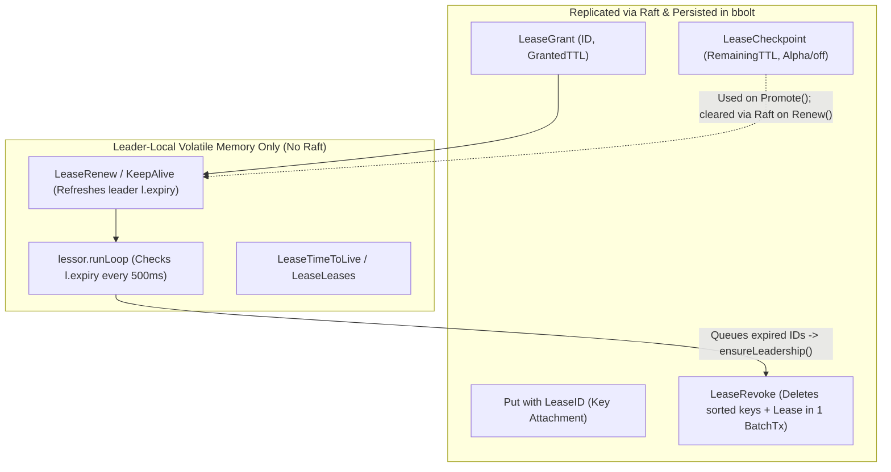

# etcd Leases, Raft Bypass, and Leader Failover Correctness

- **History:** revised 2026-11-01 after cross-validating peer analyses `leases-claude.md` and `leases-codex.md` against `v3.7.3` and `jetcd-0.8.7` source code
- **Versions analyzed:**
  - etcd `v3.7.3` (`0a173d0410a9`); upstream `origin/main` (`1573d59416ef`) and `origin/release-3.7` (`34d8004033dd`) checked for post-release diffs
  - `go.etcd.io/raft/v3` `v3.7.0` (pinned in `server/go.mod:30 @ v3.7.3`)
  - jetcd `jetcd-0.8.7` (`23b61f1499a5`)
  - Kubernetes `v1.37.2` (`c50e5395f1ae`) / `master` (`3c690c189e5d`) for `lease_manager.go`, `reconcilers/lease.go`, `coordination.k8s.io/v1`, and `kubeadm`
- **Upstream references:**
  - **Open `etcd-io/etcd` lease, session, and leasing issues/PRs:**
    [#22649](https://github.com/etcd-io/etcd/issues/22649) (PR [#22650](https://github.com/etcd-io/etcd/pull/22650)),
    [#22094](https://github.com/etcd-io/etcd/issues/22094) (PRs [#22253](https://github.com/etcd-io/etcd/pull/22253), [#22291](https://github.com/etcd-io/etcd/pull/22291)),
    [#22081](https://github.com/etcd-io/etcd/issues/22081) (PR [#22087](https://github.com/etcd-io/etcd/pull/22087)),
    [#21638](https://github.com/etcd-io/etcd/issues/21638) (`main` commit `a81b6d623eb7`),
    [#22082](https://github.com/etcd-io/etcd/issues/22082),
    [#19597](https://github.com/etcd-io/etcd/issues/19597),
    [#22382](https://github.com/etcd-io/etcd/issues/22382),
    [#22084](https://github.com/etcd-io/etcd/issues/22084),
    [#22083](https://github.com/etcd-io/etcd/issues/22083),
    [#22417](https://github.com/etcd-io/etcd/issues/22417),
    [#22209](https://github.com/etcd-io/etcd/issues/22209) (PR [#22550](https://github.com/etcd-io/etcd/pull/22550)),
    [#22450](https://github.com/etcd-io/etcd/issues/22450)
  - **Closed `etcd-io/etcd` issues/PRs on Raft bypass, leader failover, and lease expiration:**
    [#13915](https://github.com/etcd-io/etcd/issues/13915),
    [#13776](https://github.com/etcd-io/etcd/issues/13776),
    [#15247](https://github.com/etcd-io/etcd/issues/15247),
    [#12528](https://github.com/etcd-io/etcd/issues/12528) (unmerged PR [#12531](https://github.com/etcd-io/etcd/pull/12531)),
    PR [#16822](https://github.com/etcd-io/etcd/pull/16822) (`67f17166bf`),
    [#18069](https://github.com/etcd-io/etcd/issues/18069),
    PR [#18428](https://github.com/etcd-io/etcd/pull/18428) (`b8b0cf83d1`),
    [#18100](https://github.com/etcd-io/etcd/issues/18100),
    PR [#20589](https://github.com/etcd-io/etcd/pull/20589) (`ec3bc3c74e`),
    [#14758](https://github.com/etcd-io/etcd/issues/14758),
    PR [#20590](https://github.com/etcd-io/etcd/pull/20590) (`943f4d296a`),
    unmerged PR [#21389](https://github.com/etcd-io/etcd/pull/21389),
    [#9888](https://github.com/etcd-io/etcd/issues/9888),
    [#9395](https://github.com/etcd-io/etcd/issues/9395),
    PR [#9924](https://github.com/etcd-io/etcd/pull/9924),
    PR [#13508](https://github.com/etcd-io/etcd/pull/13508),
    [#17132](https://github.com/etcd-io/etcd/issues/17132),
    [#13294](https://github.com/etcd-io/etcd/issues/13294),
    [#20273](https://github.com/etcd-io/etcd/issues/20273),
    [#9360](https://github.com/etcd-io/etcd/issues/9360),
    PR [#20492](https://github.com/etcd-io/etcd/pull/20492) (`59ce0ce31f`),
    [#21735](https://github.com/etcd-io/etcd/issues/21735),
    [#13675](https://github.com/etcd-io/etcd/issues/13675) (PR [#13690](https://github.com/etcd-io/etcd/pull/13690)),
    PR [#21122](https://github.com/etcd-io/etcd/pull/21122) (`b54c88406`),
    [#20621](https://github.com/etcd-io/etcd/issues/20621),
    [#12594](https://github.com/etcd-io/etcd/issues/12594),
    [#22506](https://github.com/etcd-io/etcd/issues/22506),
    [#7320](https://github.com/etcd-io/etcd/issues/7320),
    [#12651](https://github.com/etcd-io/etcd/issues/12651),
    [#14019](https://github.com/etcd-io/etcd/issues/14019),
    [#19091](https://github.com/etcd-io/etcd/issues/19091),
    [#12260](https://github.com/etcd-io/etcd/issues/12260),
    [#13019](https://github.com/etcd-io/etcd/issues/13019)
  - **Kubernetes issues/PRs:**
    [kubernetes#65497](https://github.com/kubernetes/kubernetes/issues/65497),
    [kubernetes#47532](https://github.com/kubernetes/kubernetes/issues/47532),
    [kubernetes#64539](https://github.com/kubernetes/kubernetes/pull/64539),
    [kubernetes#96836](https://github.com/kubernetes/kubernetes/issues/96836),
    [kubernetes#110210](https://github.com/kubernetes/kubernetes/issues/110210) (open)

---

## Scope

This document evaluates the correctness, failover safety, and production readiness of etcd's lease subsystem (`server/lease`, `client/v3`, `grpcproxy`) at `v3.7.3` and its Java client (`jetcd`) at `jetcd-0.8.7`. It tests the architectural hypothesis that etcd leases suffer from a design flaw relative to Google's Chubby lock service (`doc/chubby-osdi06.md`), audits open and stale-closed upstream bugs, and examines how Kubernetes works around these limitations.

**Terminology:** Throughout this analysis, **lease** refers to a native etcd v3 TTL lease (`LeaseGrant` / `LeaseKeepAlive` / `LeaseRevoke`), **not** Raft's internal leader lease (`CheckQuorum`) and **not** Kubernetes `coordination.k8s.io/v1` `Lease` API objects (which are plain MVCC keys). The **primary lessor** is the lease manager on the etcd member that believes it is the Raft leader.

---

## Summary

1. **Replicated KV state stays consistent (P1), but the lease contract breaks across failover (P2, P3, P4) (**High confidence**):**
   Lease creation (`LeaseGrant`), revocation (`LeaseRevoke`), and optional remaining-TTL checkpoints (`LeaseCheckpoint`) are committed through Raft, and key deletions are applied deterministically in a single backend transaction. Consequently, lease activity never causes replicas' key-value stores to diverge. However, lease renewals (`LeaseKeepAlive`), status reads (`LeaseTimeToLive`, `LeaseLeases`), and expiration timers (`lessor.runLoop`) bypass Raft and live only in the leader's volatile memory. Across leader changes or stalls, etcd violates both the **renewal safety lower bound (P3)** (a renewed lease must not be revoked before its promised TTL elapses while quorum holds) and the **expiration upper bound (P2)** (an unrenewed lease should expire near its TTL).
2. **Comparison with Chubby refutes "bypassing Raft on renewals is the mistake" and isolates three narrower design flaws (**High confidence** on mechanisms; **Moderate confidence** on design judgement):**
   Chubby also keeps KeepAlives out of its Paxos log, runs session timers only in master memory, stops timers during master failover, and conservatively extends leases on the new master. Where etcd's design actually failed is:
   - **Epoch-less revocation proposals + Raft follower proposal forwarding:** etcd's lessor comment assumes a deposed leader's revocation proposal will fail due to a stale Raft term and that followers do not forward lease proposals. Both assumptions are false: `go.etcd.io/raft/v3` forwards proposals from followers to the new leader, and `LeaseRevokeRequest` carries no term or epoch, turning a deposed leader's stale timer decision into a committed deletion in the new term ([#12528](https://github.com/etcd-io/etcd/issues/12528), [#15247](https://github.com/etcd-io/etcd/issues/15247)).
   - **Decoupled clocks for leadership authority vs. lease expiry:** Chubby bounds mastership with a real-time master lease; etcd measures leadership step-down (`CheckQuorum`) in Raft ticks processed by the same loop that stalls on WAL `fdatasync`, while lease expiration runs on real time (`time.Now()`) in a separate goroutine.
   - **One primitive overloaded for two conflicting workloads:** Chubby uses sessions only for active client sessions; etcd uses a single Lease API for both short-lived, actively renewed coordination sessions (which need failover extensions) and passive 1-hour object TTL garbage collection (which breaks under failover TTL resets).
3. **The `v3.7.3` leadership check (`ensureLeadership` + `isActive`) is a heuristic, not a fence, leaving four residual vulnerabilities (**High confidence** on code paths; **Moderate confidence** on race schedules):**
   - **R1 (`isActive` local-tick shortcut):** PR [#18428](https://github.com/etcd-io/etcd/pull/18428) skips `ReadIndex` whenever the local Raft ticker fired within `3 * TickMs`. That detects local disk stalls, not network isolation, and can flip `true` immediately after a disk stall if Go's `select` picks a buffered tick before `Ready()` demotes the lessor.
   - **R2 (Single pre-batch check + 16-slot semaphore delay):** `revokeExpiredLeases` checks `ensureLeadership()` once for a batch of up to 500 leases before dispatching workers through a 16-slot semaphore (`maxPendingRevokes = 16`, up to 7s timeout per slot). Workers delayed across a failover resume as followers and forward stale `LeaseRevoke` proposals to the new leader.
   - **R3 (Unchecked follower HTTP forwarding):** The leader's peer-HTTP renewal handler (`leasehttp`) calls `lessor.Renew` directly without calling `ensureLeadership()`.
   - **R4 (`Revoke` / `Renew` lock-drop TOCTOU race):** `lessor.Revoke` unlocks `le.mu` while deleting attached keys, allowing a concurrent `lessor.Renew` to see the lease still in `leaseMap` and return full-TTL success while its keys are being deleted ([#14758](https://github.com/etcd-io/etcd/issues/14758), unmerged PR [#21389](https://github.com/etcd-io/etcd/pull/21389)).
4. **TTL preservation (`LeaseCheckpoint`) remains Alpha, disabled by default, coarse-grained (5 min), and broken on checkpoint-clear error ([#22649](https://github.com/etcd-io/etcd/issues/22649)) (**High confidence**):**
   By default, every leader election resets all lease TTLs to `ElectionTimeout + GrantedTTL`. Even when the Alpha `LeaseCheckpoint` gate is enabled, leases with `TTL <= 300s` are never checkpointed, leader elections faster than 5 minutes still postpone expiry indefinitely, and open bug [#22649](https://github.com/etcd-io/etcd/issues/22649) causes `SetCheckpointer` to silently discard `raftRequest` errors when `Renew()` clears a checkpointed `remainingTTL`—reporting full-TTL success to the client while arming the stale, shorter `remainingTTL` on the server.
5. **Both Go (`client/v3`) and Java (`jetcd-0.8.7`) clients use optimistic deadlines (`receipt_time + TTL`), lack Chubby's jeopardy protocol, and contain severe leader-loss bugs (**High confidence**):**
   In `client/v3`, open bug [#22094](https://github.com/etcd-io/etcd/issues/22094) causes `closeRequireLeader()` to close a `WithRequireLeader` subscriber's channel upon leader loss while leaving an orphaned entry in `l.keepAlives` whose deadline is refreshed on reconnect—**silently renewing the "lost" lease every 500ms for the life of the process** and wedging any held locks. Open bug [#22081](https://github.com/etcd-io/etcd/issues/22081) corrupts the subscriber context-to-channel mapping, and `grpcproxy` reads outgoing instead of incoming metadata, ignoring `WithRequireLeader`. In `jetcd-0.8.7`, `KeepAlive.handleException` delivers a terminal `onError` to all `StreamObserver`s on any stream error without removing the lease, then reconnects 500ms later and **renews the lease in the background forever** unless `CloseableClient.close()` is called.
6. **Kubernetes uses API-object coordination (`coordination.k8s.io/v1` `Lease`) rather than native etcd leases, while `Event` TTL leases suffer from failover retention and multi-key revocation watch bugs (**High confidence**):**
   Because Kubernetes components interact only through `kube-apiserver`, leader election and node heartbeats use `coordination.k8s.io/v1` `Lease` API objects (plain MVCC keys with client-evaluated `spec.renewTime` and CAS `resourceVersion`, with no etcd `TTLFunc`), and `kube-apiserver` never calls `KeepAlive`. For `Event` TTLs, `kube-apiserver` had to pool Events into shared 60s leases capped at 1,000 objects ([#47532](https://github.com/kubernetes/kubernetes/issues/47532), [#96836](https://github.com/kubernetes/kubernetes/issues/96836)), remains exposed to indefinite Event growth under frequent elections on default `kubeadm` clusters ([#65497](https://github.com/kubernetes/kubernetes/issues/65497)), and has an open watch bug ([#110210](https://github.com/kubernetes/kubernetes/issues/110210)) because `lessor.Revoke` deletes all keys on a shared lease at a single MVCC main revision.

---

## 1. Architecture and Correctness Model

### 1.1 The Raft vs. Leader-Memory Split

To avoid a quorum consensus round-trip and WAL `fdatasync` on every heartbeat, etcd splits lease management across two consistency domains. Lease **existence** and **key attachment** live in the replicated Raft state machine and bbolt database, whereas lease **expiration timers** and **renewals** live only in the volatile memory of the primary `lessor` on the Raft leader. Because followers set every lease's expiration to `forever` (`time.Time{}`) and never see `LeaseKeepAlive` RPCs, every leadership change creates a state discontinuity between the old leader's timers, the Raft log, the new leader's timers, and connected clients.



| Operation | Raft Consensus? | bbolt Persistence? | Follower State | Leader State | Code Evidence (`@ v3.7.3`) |
|---|---|---|---|---|---|
| `LeaseGrant` | **Yes** (`InternalRaftRequest.LeaseGrant`) | **Yes** (`lease` bucket: `ID`, `TTL`, `RemainingTTL`) | `l.expiry = forever` (`time.Time{}`) | `l.expiry = time.Now() + TTL`; inserted into `leaseExpiredNotifier` heap | `server/etcdserver/v3_server.go:435-457`, `server/etcdserver/apply/backend.go:83-92`, `server/lease/lessor.go:281-324`, `server/lease/lease.go:84-89` |
| `LeaseRevoke` (explicit or expired) | **Yes** (`InternalRaftRequest.LeaseRevoke`) | **Yes** (deletes attached MVCC keys + `lease` entry in one `BatchTx`) | Deletes sorted keys & lease from `leaseMap` and `bbolt` | Deletes sorted keys & lease from `leaseMap` and `bbolt`; closes `l.revokec` | `server/etcdserver/v3_server.go:471-487`, `server/etcdserver/apply/backend.go:94-97`, `server/lease/lessor.go:326-365` |
| `LeaseCheckpoint` (Alpha, **off by default**) | **Yes** (`InternalRaftRequest.LeaseCheckpoint`) | **Yes** (if cluster version $\ge 3.6$ or `LeaseCheckpointPersist` on) | Updates `l.remainingTTL` (and persists to `bbolt`) | Updates `l.remainingTTL`, persists, schedules next checkpoint in 5 min | `server/lease/lessor.go:367-388,667-687`, `server/etcdserver/server.go:394-403` |
| `LeaseRenew` (`LeaseKeepAlive`) | **No** (unless clearing `remainingTTL > 0` when checkpointing is on) | **No** | Untouched (`l.expiry` stays `forever`); follower forwards over peer HTTP `POST /leases` | Updates in-memory `l.expiry = time.Now() + l.getRemainingTTL()` | `server/etcdserver/v3_server.go:489-561`, `server/lease/lessor.go:396-456`, `server/lease/leasehttp/http.go:78-108,172-221` |
| `LeaseTimeToLive` | **No** | **No** | Untouched; follower forwards over peer HTTP `POST /leases/internal` | Reads in-memory `l.expiry` and `l.itemSet` | `server/etcdserver/v3_server.go:637-697`, `server/lease/leasehttp/http.go:109-160,224-278` |
| `LeaseLeases` | **No** | **No** | Reads local `leaseMap` directly (**no forwarding, no `ReadIndex`, no `waitAppliedIndex`**) | Reads local `leaseMap` | `server/etcdserver/v3_server.go:737-749` |
| `lessor.Promote` / `lessor.Demote` | Local Raft state transition | **No** | `Demote()` resets all `l.expiry = forever` and clears heaps | `Promote()` sets all `l.expiry = time.Now() + ElectionTimeout + l.getRemainingTTL()` | `server/etcdserver/server.go:770-773,1959-1967`, `server/lease/lessor.go:480-550` |

### 1.2 Five Distinct Correctness Properties (P1–P5)

"Lease correctness" conflates five distinct properties that behave very differently under failure:

| ID | Property | Status in `v3.7.3` | Mechanism & Evidence (`@ v3.7.3`) | Confidence |
|---|---|---|---|---|
| **P1** | **KV State-Machine Consistency:** All replicas agree on which keys exist at every MVCC revision; KV reads and writes remain linearizable. | **Holds.** | Keys disappear only when a Raft-committed `LeaseRevoke` entry is applied. `lessor.Revoke` sorts keys deterministically (`lessor.go:345-351`) and deletes keys and lease metadata in one backend transaction (`lessor.go:353-361`). A new leader only calls `Promote()` after applying the empty no-op entry of its new term (`server.go:1959-1967`), ensuring all prior-term revocations are applied first. | **High** |
| **P2** | **Expiration Upper Bound (Liveness / GC):** An unrenewed lease is revoked roughly `TTL` seconds after grant or last renewal. | **Violated by design on failover and restart.** | Every leader election or restart resets uncheckpointed leases to `now + ElectionTimeout + GrantedTTL` (`lessor.go:480-492`) and spreads expiries when $\ge 1000$ leases exist (`lessor.go:494-531`). Even with `LeaseCheckpoint` enabled, leases with `TTL <= 300s` are never checkpointed, and leader elections faster than 5 minutes postpone expiration indefinitely (§3.3). | **High** |
| **P3** | **Expiration Lower Bound (Renewal Safety Promise):** Once the server acknowledges a `Grant` or `KeepAlive` with `TTL`, it does not automatically revoke the lease before `TTL` elapses while a quorum survives. | **Broken historically ([#12528](https://github.com/etcd-io/etcd/issues/12528), [#15247](https://github.com/etcd-io/etcd/issues/15247)); broken when `LeaseCheckpoint` is on ([#22649](https://github.com/etcd-io/etcd/issues/22649)); residual races remain (§3.2).** | Raft replicates any `LeaseRevoke` proposal without validating whether the proposer's timer decision is stale. Pre-proposal `ensureLeadership()` checks mitigate [#15247](https://github.com/etcd-io/etcd/issues/15247) but leave post-check batching and checkpoint-clear holes (§3.2, §3.3). | **High** (#15247, #22649); **Moderate** (residual races) |
| **P4** | **Lease API Linearizability:** `LeaseTimeToLive`, `LeaseLeases`, and `LeaseKeepAliveResponse.Header.Revision` reflect linearizable state. | **Not provided** ([#13915](https://github.com/etcd-io/etcd/issues/13915), closed *not planned*). | `LeaseLeases` is a local unlinearized read (`v3_server.go:737-749`); follower-forwarded `KeepAlive` and `TimeToLive` stamp responses with the follower's local `Revision` (`v3rpc/lease.go:74,134`); `FastLeaseKeepAlive` skips `waitAppliedIndex()` (`v3_server.go:512-523`; §3.4). | **High** |
| **P5** | **Mutual Exclusion for Locks / Elections:** Only one client acts as lock holder or leader at a time. | **Requires transactional revision fencing in any lease design.** | Client deadlines are local (and optimistic in etcd/jetcd, §4.1), so safe etcd writes must compare `CreateRevision(myKey) == myRev` inside a Raft `Txn` (`Mutex.IsOwner()` in `client/v3/concurrency/mutex.go:152-153`; `Election.Proclaim()` in `election.go:115`). Fencing protects etcd writes even when P3 fails, but external side effects (and unfenced deletes like `Mutex.Unlock` in [#22082](https://github.com/etcd-io/etcd/issues/22082)) suffer server-induced dual leadership if P3 fails. | **High** |

---

## 2. Design Evaluation: etcd Leases vs. Google Chubby Sessions

Per `AGENTS.md` §8.1, we test the hypothesis that etcd's lease bugs stem from a fundamental design mistake in how etcd leases were conceived compared with Chubby's sessions and KeepAlives (`doc/chubby-osdi06.md`).

### 2.1 Case Against the Hypothesis: Why Bypassing Consensus on KeepAlives Is Not the Flaw

Keeping renewal heartbeats out of the consensus log is **not** where etcd diverged from Chubby (**High confidence** — verified in `doc/chubby-osdi06.md` §§2.8–2.9, 4.4 and `server/etcdserver/v3_server.go:541 @ v3.7.3`):
- **Master-local timers outside Paxos:** In Chubby (§2.8–2.9, pp. 7–9), KeepAlive RPCs do not write to the replicated Paxos database. The authoritative session timer runs solely in the Chubby master's volatile memory.
- **Timer suspension and extension on failover:** When a Chubby master loses mastership, the session timer stops (*"until a new master is elected the session lease timer is stopped; this is legal because it is equivalent to extending the client's lease"*, §2.9, p. 8), and a newly elected master extends all session leases *"to the maximum that the previous master may have been using"* (§2.9 step 3, p. 9). etcd's `lessor.Promote(ElectionTimeout)` implements this exact principle.
- **Avoiding database writes for sessions:** In Chubby's revised failover design (§4.4, pp. 12–13), Chubby stopped recording sessions in the replicated database altogether to avoid write amplification during mass job startups, and instead waits a full worst-case lease timeout on failover while reconstructing sessions from client KeepAlives.

> **Evidence:** `doc/chubby-osdi06.md:257-315` (§2.8–2.9, pp. 7–9); `doc/chubby-osdi06.md:476-493` (§4.4, pp. 12–13); `server/etcdserver/v3_server.go:541 @ v3.7.3` (`// renewals don't go through raft; forward to leader manually`).

### 2.2 Case For the Hypothesis: Three Structural Flaws Where etcd Departed from Chubby

While etcd copied Chubby's leader-local timers and failover extensions, it omitted Chubby's supporting safety mechanisms and overloaded the lease abstraction:

1. **Unfenced, Epoch-Less Revocations + Raft Follower Proposal Forwarding (**High confidence** — verified in code and [#12528](https://github.com/etcd-io/etcd/issues/12528), [#15247](https://github.com/etcd-io/etcd/issues/15247)):**
   Every new Chubby master increments a **master epoch number** (§2.9 step 1, p. 9) that fences out stale packets and stale master actions. In etcd, expiry-driven `LeaseRevokeRequest`s carry only the `int64 ID`—with no Raft term or lease generation—and `go.etcd.io/raft/v3` automatically forwards any proposal from a follower to the current leader. When a stalled ex-leader recovers as a follower, its stale expiration decisions are forwarded into the new leader's term and committed across the cluster (§3.1).
2. **Decoupled Clocks for Leadership Authority vs. Lease Expiration (**High confidence** — verified in `raft.go:183-185` and `lessor.go:620-662 @ v3.7.3`):**
   Chubby bounds master authority using a **real-time master lease** (§2.2, p. 3). etcd bounds leadership via Raft's `CheckQuorum`, which counts **Raft ticks** processed by the single-threaded `raftNode.start()` loop. When a WAL `fdatasync` stalls that loop, the leader's step-down clock freezes while `lessor.runLoop()` continues expiring leases on real time (`time.Now()`) in a separate goroutine.
3. **Overloading One Primitive for Active Sessions and Passive Object TTLs (**High confidence** on mechanism in `lessor.go:480-492 @ v3.7.3` and [kubernetes#65497](https://github.com/kubernetes/kubernetes/issues/65497); **Moderate confidence** on design judgment):**
   Chubby sessions only represent active client sessions maintained by KeepAlives; extending them on failover is always safe. etcd uses a single Lease API for both **active coordination sessions** (locks, leader election) and **passive, unrenewed TTL garbage collection** (Kubernetes 1-hour `Event`s). Extending all leases on `Promote()` protects active sessions (P3) at the direct expense of resetting passive TTLs (P2).

### 2.3 Architectural Comparison Matrix: Chubby vs. etcd & jetcd

| Architectural Axis | Google Chubby (`doc/chubby-osdi06.md`) | etcd (`v3.7.3`) & `jetcd` (`0.8.7`) | Consequence in etcd | Confidence |
|---|---|---|---|---|
| **Leader Authority Bound** | **Real-time master lease** (§2.2, p. 3, `:90`): replicas promise not to elect another master until the time interval expires. | **Tick-driven Raft `CheckQuorum`** (`bootstrap.go:548`): step-down counts ticks in `raftNode.start()` (`raft.go:183-185`), which stalls on WAL `fdatasync`. | Stalled leader's authority clock freezes while `lessor.runLoop()` expires leases on real time ([#12528](https://github.com/etcd-io/etcd/issues/12528), [#15247](https://github.com/etcd-io/etcd/issues/15247)). | **High** |
| **Fencing of Stale Decisions & RPCs** | **Master epoch numbers** (§2.9 step 1, p. 9, `:305`): RPCs with older epochs are rejected; consensus writes are ballot-fenced. | **Epoch-less `LeaseRevokeRequest` & `LeaseKeepAliveRequest`** (`rpc.proto:889-894,920-924`) + **Raft follower proposal forwarding** (`raft.go:1718-1729 @ v3.7.0`). | Deposed leader's stale `LeaseRevoke` is forwarded into the new term and deletes active leases (§3.1–3.2). | **High** (#15247); **Moderate** (residual R2 race) |
| **Client Deadline Calculation** | **Conservative lower bound** (§2.8, p. 7, `:263`): deducts reply transit time and bounds master-vs-client clock drift rate. | **Optimistic receipt-time addition:** `receipt_time + TTL` (`client/v3/lease.go:543`; wall-clock `System.currentTimeMillis() + ttl*1000` in `LeaseImpl.java:265`), swept every 1s. | Client's local belief (`Session.Done()`) outlasts server expiry by reply transit delay + up to 1s sweep interval + clock drift (§4.1). | **High** |
| **Client Uncertainty & Failover Grace Period** | **Jeopardy + 45s Grace Period** (§2.8–2.9, pp. 7–9, `:265-292`): emits `jeopardy`, disables cache, blocks API calls up to 45s, and resumes with `safe` if new master responds. | **No jeopardy state.** Binary alive/dead (`Session.Done()`). `WithRequireLeader` aborts without a grace period and triggers bugs [#22081](https://github.com/etcd-io/etcd/issues/22081) and [#22094](https://github.com/etcd-io/etcd/issues/22094); `jetcd` fires terminal `onError` on any stream error while continuing background renewals (§4.2–4.4). | Applications cannot quiesce and recover sessions cleanly across transient failovers; `WithRequireLeader` corrupts client state or leaks infinite renewals. | **High** |
| **KeepAlive Pacing & Load Shedding** | **Server-blocked long poll** (§2.8, p. 7, `:259-261`; §3, p. 10, `:352`): master blocks KeepAlive until near expiry and scales TTL from 12s to 60s under load. | **Immediate reply + client polling every `TTL / 3`** (`client/v3/lease.go:542`, `LeaseImpl.java:263`). Dynamic TTL scaling under load is an unimplemented 10-year-old `TODO` (`lessor.go:290-291`). | High steady-state renewal RPC rate under short TTLs ([#18069](https://github.com/etcd-io/etcd/issues/18069)). | **High** |
| **Lock Release Delay on Holder Failure** | **lock-delay** (up to 1 min) before a failed holder's lock can be acquired (§2.4, p. 5, `:159`). | **None.** Waiters wake immediately on the revocation delete event. | Zero time buffer for unfenced external resources when a lock holder pauses or its lease is prematurely revoked. | **High** |

---

## 3. Server-Side Failure Modes Across Leader Failover

### 3.1 Split-Brain Lessor Authority and Deposed-Leader Revocations ([#12528](https://github.com/etcd-io/etcd/issues/12528), [#15247](https://github.com/etcd-io/etcd/issues/15247))

#### Why the Safety Assumption in `lessor.go:253-262` Failed
In etcd, `raftNode.start()` and `lessor.runLoop()` execute in separate goroutines. The lessor learns that it has lost primary status only when `raftNode.start()` processes a `Ready()` batch carrying an updated `SoftState` and calls `rh.updateLeadership()` → `s.lessor.Demote()`.

Since etcd v3.0, `lessor.isPrimary()` has carried the following safety argument:
```go
// in etcd, raft leader is the primary. Thus there might be two primary
// leaders at the same time (raft allows concurrent leader but with different term)
// for at most a leader election timeout.
// The old primary leader cannot affect the correctness since its proposal has a
// smaller term and will not be committed.
//
// TODO: raft follower do not forward lease management proposals. There might be a
// very small window (within second normally which depends on go scheduling) that
// a raft follow is the primary between the raft leader demotion and lessor demotion.
// Usually this should not be a problem. Lease should not be that sensitive to timing.
```

**All three premises of this comment are false in production (**High confidence**):**
1. **Stalls last much longer than an election timeout:** When leader $L_1$ stalls on a slow WAL disk write (`r.storage.Save`) or CPU contention, `raftNode.start()` blocks, so $L_1$ neither processes Raft ticks nor calls `s.lessor.Demote()` for the duration of the stall (e.g., 30–60s). Meanwhile, peers $\{F_2, F_3\}$ elect $F_2$ as the new leader and primary lessor.
2. **Raft followers forward proposals into the new term:** Once $L_1$'s Raft state machine receives a message from the higher term and steps down to `StateFollower`, `go.etcd.io/raft/v3`'s `stepFollower` function **forwards any `MsgProp` to the new leader $F_2$**, because etcd never enables `DisableProposalForwarding`.
3. **Revocation proposals are unfenced:** Because neither `LeaseRevokeRequest` nor `InternalRaftRequest` carries the proposer's `RaftTerm`, $F_2$ appends $L_1$'s forwarded revocation in the **new term**, commits it across the quorum, and `applierV3backend.LeaseRevoke` unconditionally deletes the lease and its keys.

This produced the two production failure modes reported in [#12528](https://github.com/etcd-io/etcd/issues/12528) (2020, closed by stale bot) and [#15247](https://github.com/etcd-io/etcd/issues/15247) (2023):
- **Failure Mode 1 (Spurious Revocations by Deposed Leader):** Clients connected to $F_2$ or $F_3$ renewed their leases on schedule at the new leader $F_2$. On the stalled old leader $L_1$, `lessor.runLoop()` saw those leases expire in $L_1$'s local memory and queued them on `expiredC`. When $L_1$'s stall ended, its `LeaseRevoke` proposals were forwarded to $F_2$ and committed, deleting active locks and election keys across the cluster.
- **Failure Mode 2 (Swallowed KeepAlives on Deposed Leader):** Clients whose `LeaseKeepAlive` streams were connected to $L_1$ continued sending renewals to $L_1$, which refreshed `l.expiry` in $L_1$'s local memory and returned `TTL = l.ttl` while $F_2$ never saw those renewals and revoked the leases after its promoted TTL elapsed.

#### The Rejected Structural Fixes vs. What Shipped (PR [#16822](https://github.com/etcd-io/etcd/pull/16822) and PR [#18428](https://github.com/etcd-io/etcd/pull/18428))
During the [#15247](https://github.com/etcd-io/etcd/issues/15247) investigation, two structural fixes were proposed:
- **Term fencing on `LeaseRevokeRequest`** (`@mitake`, [comment 1510362310](https://github.com/etcd-io/etcd/issues/15247#issuecomment-1510362310)): include the proposer's Raft term in expiry-driven `LeaseRevokeRequest`s and ignore at apply time if stale.
- **Conditional apply (`SkipIfLeaderNotMatch`)** (`@serathius`, [comment 1735268056](https://github.com/etcd-io/etcd/issues/15247#issuecomment-1735268056)): reject internal proposals at apply time if leadership changed.

Maintainers rejected both structural fixes over mixed-version WAL/protobuf compatibility concerns and instead merged PR [#16822](https://github.com/etcd-io/etcd/pull/16822) (`67f17166bf`, Dec 2023), adding a pre-operation leadership check `s.ensureLeadership()` (`LinearizableReadNotify` / `ReadIndex`) to `revokeExpiredLeases`, `LeaseRenew`, and `SetCheckpointer`. As `@serathius` noted in [#15247](https://github.com/etcd-io/etcd/issues/15247#issuecomment-1735268056), a pre-proposal check *"reduces the chance of this happening, but doesn't fully resolve a possibility of a race."*

Worse, running `ReadIndex` on every `LeaseRenew` caused a 20% leader CPU regression and 10x peer network traffic at 1,500 renewals/sec ([#18069](https://github.com/etcd-io/etcd/issues/18069)). PR [#18428](https://github.com/etcd-io/etcd/pull/18428) (`b8b0cf83d1`, Aug 2024) therefore short-circuited `ensureLeadership()` whenever `s.isActive()` is true:
```go
func (s *EtcdServer) isActive() bool {
	latestTickTs := s.r.getLatestTickTs()
	threshold := 3 * time.Duration(s.Cfg.TickMs) * time.Millisecond
	return latestTickTs.Add(threshold).After(time.Now())
}
```

> **Evidence:** `server/lease/lessor.go:253-265,620-662 @ v3.7.3`; `server/etcdserver/raft.go:174-207,256 @ v3.7.3`; `server/etcdserver/server.go:395,770-773,858-942 @ v3.7.3`; `server/etcdserver/v3_server.go:504 @ v3.7.3`; `server/etcdserver/bootstrap.go:540-551 @ v3.7.3`; `server/etcdserver/apply/backend.go:94-96 @ v3.7.3`; `api/etcdserverpb/rpc.proto:889-894 @ v3.7.3`; `api/etcdserverpb/raft_internal.proto:10-18 @ v3.7.3`; `go.etcd.io/raft/v3` `raft.go:1718-1729 @ v3.7.0`.

---

### 3.2 Four Residual Server-Side Vulnerabilities in `v3.7.3` (R1–R4)

1. **R1 — `isActive()` Measures the Local Ticker, Not Peer Heartbeat Responses (Network Partition & Post-Stall `select` Race) (**High confidence** on local-ticker code path and [#22649](https://github.com/etcd-io/etcd/issues/22649) interaction; **Moderate confidence** on post-stall `select` race schedule):**
   - **What `isActive()` actually checks (**High confidence**):** Despite its comment (*"returns false if no heartbeat has been received within 3 * tickMs"*), `s.r.getLatestTickTs()` only records when the **local** `<-r.ticker.C` channel fired in `raftNode.start()`. It does not check whether any peer responded to heartbeats. Maintainer `@serathius` objected to PR [#18428](https://github.com/etcd-io/etcd/pull/18428) post-merge on safety grounds ([review r1719518498](https://github.com/etcd-io/etcd/pull/18428#discussion_r1719518498), [comment 2291124275](https://github.com/etcd-io/etcd/pull/18428#issuecomment-2291124275)).
   - **Pure network partition (`CheckQuorum` $[1.0E, 2.0E]$ overlap window) (**High confidence**):** When leader $L_1$ is network-isolated from $\{F_2, F_3\}$ while its disk is healthy, `<-r.ticker.C` fires every `TickMs` (100ms), so `s.isActive()` remains `true` and `ensureLeadership()` skips `ReadIndex`. Because `CheckQuorum` checks `checkQuorumActive()` once per `ElectionTimeout` ($E = 1\text{s}$) and passes at $t = 1.0E$ if peers acknowledged a heartbeat just after $t = 0$, $L_1$ remains `isLeader() == true` and `isActive() == true` until $t = 2.0E$, while followers can elect $F_2$ starting at $t \approx 1.0E - 1\text{ tick}$.
     - *When `Promote(E)` masks this window:* Minimum lease TTL is clamped to $\lceil 1.5 \times E \rceil$, and when `LeaseCheckpoint` is **off** (default), $F_2$'s `Promote(E)` extends all leases to $t_{\text{promote}} + E + \text{TTL} \ge 2.0E - 1\text{ tick} + \text{TTL}$, which covers any renewal $L_1$ accepted before stepping down at $2.0E$ to within at most one Raft tick (`100ms`).
     - *When this window violates P3:* When `LeaseCheckpoint` is **on** and a lease has a checkpointed `remainingTTL < TTL`. A renewal on isolated $L_1$ during $[1.0E, 2.0E]$ fails to clear `remainingTTL` across the partition, hits bug [#22649](https://github.com/etcd-io/etcd/issues/22649) (error discarded), and returns the full `l.ttl` to the client while $F_2$ promotes the lease with only $t_{\text{promote}} + E + \text{remainingTTL} \ll t_{\text{renew}} + \text{TTL}$.
   - **Post-stall `select` race (**Moderate confidence** — race schedule inferred from code):** When a disk stall on $L_1$ finishes, both `<-r.ticker.C` and `rd := <-r.Ready()` (carrying the step-down `SoftState`) are ready in `raftNode.start()`. Because Go's `select` chooses pseudo-randomly, picking `<-r.ticker.C` first updates `latestTickTs = time.Now()` *before* `rh.updateLeadership()` calls `s.lessor.Demote()`, briefly making `s.isActive() == true` while `lessor` is still primary.

2. **R2 — Single Pre-Batch `ensureLeadership()` Check + 16-Slot Semaphore Delay + Follower Forwarding (**Moderate confidence**):**
   In `EtcdServer.revokeExpiredLeases`, `s.ensureLeadership()` is called **once** at the start of a batch of up to `leaseRevokeRate / 2 = 500` expired leases. The loop then acquires a 16-slot semaphore (`maxPendingRevokes = 16`) and spawns goroutines via `s.GoAttach` using `s.ctx` (which cancels only on server shutdown, not demotion) to call `s.LeaseRevoke`. Neither the worker goroutines nor `LeaseRevoke` nor `processInternalRaftRequestOnce` re-checks `ensureLeadership()`, checks `s.lessor.isPrimary()`, or fences the proposal by Raft term:
   - **Single-lease scheduling delay (unstalled vs. stalled leader):** If a worker is delayed after `ensureLeadership()` passes on leader $A$ while leadership transfers to $B$ and $B$ renews lease $L$ for a client, the resuming worker on $A$ (now a follower of $B$) calls `s.r.Propose`, which Raft forwards to $B$ to commit and delete the freshly renewed lease $L$. *(Note: if $A$ was not stalled when $L$ expired, the Go client's local `deadlineLoop` reaps the keepalive entry within ~1s of expiry unless renewals through a follower were blocked by an apply backlog on $A$ or the application invokes `KeepAlive` / `KeepAliveOnce` again after $B$'s `Promote` extends $L$.)*
   - **Multi-lease batch amplification (up to $\lceil 500/16 \rceil \times 7\text{s}$):** If a batch has $> 16$ leases and $A$'s first 16 proposals stall at its old term, they hold all 16 semaphore slots until `ReqTimeout()` (`5s + 2 * ElectionTimeout = 7s`). If $A$ steps down to a follower of $B$ before those 7 seconds elapse, when the first 16 proposals time out and release the semaphore, leases $17 \dots 500$ are dispatched **7+ seconds after `ensureLeadership()` ran** and forwarded directly to leader $B$.

3. **R3 — Missing `ensureLeadership()` on the Follower Peer-HTTP Renewal Path (**High confidence**):**
   When a client sends `LeaseKeepAlive` to a follower, the follower forwards `POST /leases` over peer HTTP to `s.Leader()`. The receiving handler `leasehttp.ServeHTTP` is wired to the bare `s.lessor`; it waits on `<-h.waitch()` (`s.ApplyWaitCommit()`) and calls `h.l.Renew(id)` **without calling `s.ensureLeadership()`**. If a stalled leader has `appliedIndex == committedIndex`, `<-h.waitch()` returns immediately and `h.l.Renew` succeeds based solely on the stale `le.isPrimary()` flag.

4. **R4 — `lessor.Revoke` / `lessor.Renew` Lock-Drop TOCTOU Race ([#14758](https://github.com/etcd-io/etcd/issues/14758), PR [#20590](https://github.com/etcd-io/etcd/pull/20590), unmerged PR [#21389](https://github.com/etcd-io/etcd/pull/21389)) (**High confidence**):**
   When `lessor.Revoke(id)` deletes attached MVCC keys via `txn.DeleteRange`, `mvcc.storeTxnWrite.delete` calls `lessor.Detach`, which acquires `le.mu.Lock()`. Consequently, `lessor.Revoke` **releases `le.mu.Unlock()` before deleting keys** and only removes `l.ID` from `le.leaseMap` after all keys are deleted (and closes `l.revokec` on return). Although PR [#20590](https://github.com/etcd-io/etcd/pull/20590) added a `le.leaseMap[id]` check at the end of `lessor.Renew`, a concurrent `Renew(id)` acquiring `le.mu.Lock()` while `Revoke(id)` is in its key-deletion loop still sees `le.leaseMap[id] != nil`, refreshes `l`, re-inserts `l.ID` into `leaseExpiredNotifier`, and returns full-TTL success for a lease whose keys are actively being deleted.

```go
// server/lease/lessor.go:335-356 @ v3.7.3 — Revoke drops le.mu while deleting keys
	defer close(l.revokec)
	// unlock before doing external work
	le.mu.Unlock()
	...
	for _, key := range keys {
		txn.DeleteRange([]byte(key), nil) // calls mvcc.delete -> lessor.Detach (locks le.mu)
	}

	le.mu.Lock()
	defer le.mu.Unlock()
	delete(le.leaseMap, l.ID) // l remains in leaseMap throughout the key deletion loop!
```

> **Evidence:**
> - **R1:** `server/etcdserver/server.go:340,908-942 @ v3.7.3`; `server/etcdserver/raft.go:159-207 @ v3.7.3`; `server/lease/lessor.go:301-303,480-492 @ v3.7.3`.
> - **R2:** `server/etcdserver/server.go:103,858-903,2413-2428 @ v3.7.3`; `server/lease/lessor.go:644 @ v3.7.3`; `server/etcdserver/v3_server.go:471-487,1059-1134 @ v3.7.3`; `server/config/config.go:320-324 @ v3.7.3`.
> - **R3:** `server/etcdserver/server.go:646 @ v3.7.3`; `server/lease/leasehttp/http.go:78-100 @ v3.7.3`; `server/lease/lessor.go:396-402 @ v3.7.3`.
> - **R4:** `server/lease/lessor.go:326-365,442-455 @ v3.7.3`; `server/storage/mvcc/kvstore_txn.go:334-345 @ v3.7.3`.

---

### 3.3 Unreplicated Remaining TTL: Failover Resets and Broken Checkpointing

#### Default `Promote()` Behavior: Resetting All Lease TTLs (**High confidence**)
When a new leader applies its initial no-op entry, `s.lessor.Promote(s.Cfg.ElectionTimeout())` refreshes every lease to `now + ElectionTimeout + l.getRemainingTTL()`. When `len(le.leaseMap) >= le.leaseRevokeRate` (`1000`), `Promote()` also sorts all leases by expiry and staggers overlapping expirations so at most $\frac{3}{4} \times \text{leaseRevokeRate} = 750$ leases expire per second.

With `LeaseCheckpoint` disabled by default, `l.remainingTTL` is `0`, so `l.getRemainingTTL()` returns the full `l.ttl`. Every leader election or cluster restart resets **every lease in the cluster** to `now + ElectionTimeout + GrantedTTL`:
- For **short-lived coordination leases** ([#13294](https://github.com/etcd-io/etcd/issues/13294), [#20273](https://github.com/etcd-io/etcd/issues/20273)), a dead client's 60s lock lease that was 1s from expiring is held for another full `ElectionTimeout + 60s` (**High confidence**).
- For **long-lived passive TTL leases** ([kubernetes#65497](https://github.com/kubernetes/kubernetes/issues/65497), [etcd#9888](https://github.com/etcd-io/etcd/issues/9888)), 1-hour Kubernetes `Event` leases are renewed indefinitely if leader elections occur more than once per hour, causing unbounded Event growth in etcd (**High confidence**; **Moderate confidence** on exhausting `QuotaBackendBytes` / `NOSPACE`, which depends on sustained election churn and configured quota size).

#### Four Flaws in `LeaseCheckpoint` in `v3.7.3`

1. **Alpha and Disabled by Default (**High confidence**):**
   Despite stale code comments claiming checkpoint persistence is enabled by default in v3.6, `DefaultEtcdServerFeatureGates` in `v3.7.3` defines both `LeaseCheckpoint` and `LeaseCheckpointPersist` as `{Default: false, PreRelease: featuregate.Alpha}`, and `NewServer` only wires up `srv.lessor.SetCheckpointer` when `LeaseCheckpoint` is enabled. *(Configuration nuance: if an operator enables `LeaseCheckpoint=true` on a cluster with cluster version $\ge 3.6$, `lessor.shouldPersistCheckpoints()` automatically persists those checkpoints to bbolt even if `LeaseCheckpointPersist` is `false`; however, with `LeaseCheckpoint=false` by default, no checkpoints are generated.)* Tracking issue [#13776](https://github.com/etcd-io/etcd/issues/13776) was closed *not planned* by `github-actions[bot]`.
2. **5-Minute Minimum Threshold Ignores Coordination Leases (**High confidence**):**
   `defaultLeaseCheckpointInterval` is `5 * time.Minute` (configurable only via `ServerConfig.LeaseCheckpointInterval` in Go code/tests at `server/config/config.go:164 @ v3.7.3`, with no CLI flag), and `scheduleCheckpointIfNeeded` only schedules a checkpoint when `lease.getRemainingTTL() > int64(le.checkpointInterval.Seconds())` (`> 300s`). Any lease with `TTL <= 300s` (including `concurrency.NewSession`'s 60s default and Kubernetes's 60s `lease_manager.go` reuse window) is never checkpointed.
3. **Relative `remainingTTL` Does Not Bound Retention Under Frequent Elections (**High confidence**):**
   Checkpoints store a relative `remainingTTL` duration rather than an absolute expiration timestamp. On leader failover, `Promote()` restarts the lease timer from the last saved `remainingTTL + ElectionTimeout` without subtracting the time elapsed since the last checkpoint or the leaderless interval, and schedules the next checkpoint 5 minutes out. If leader elections occur more often than every 5 minutes, even checkpointed leases never expire.
4. **Open Bug [#22649](https://github.com/etcd-io/etcd/issues/22649) (Open PR [#22650](https://github.com/etcd-io/etcd/pull/22650)) — Discarded `raftRequest` Error on Checkpoint Clear Violates P3 (**High confidence**):**
   When `LeaseCheckpoint` is enabled and a lease has been checkpointed with `l.remainingTTL > 0`, `lessor.Renew(id)` must clear `l.remainingTTL` to `0` through Raft before granting a full new TTL. However, `SetCheckpointer` discards both return values of `srv.raftRequest`:
   ```go
   // server/etcdserver/server.go:394-403 @ v3.7.3
   srv.lessor.SetCheckpointer(func(ctx context.Context, cp *pb.LeaseCheckpointRequest) error {
   	if !srv.ensureLeadership() {
   		...
   		return lease.ErrNotPrimary
   	}
   	srv.raftRequest(ctx, &pb.InternalRaftRequest{LeaseCheckpoint: cp})
   	return nil // BUG (#22649): raftRequest error is silently discarded!
   })
   ```
   If `srv.raftRequest` fails or times out (e.g., due to apply backlog, `ErrTooManyRequests`, or leader change—**even while quorum holds**):
   - `l.remainingTTL` remains at the **stale, shorter checkpointed value** on both the leader and followers.
   - `lessor.Renew()` calls `l.refresh(0)`, which sets `l.expiry = time.Now() + l.getRemainingTTL()` using the **stale, shorter `l.remainingTTL`**, while returning `l.ttl` (the **full nominal TTL**) to the client. *(Under steady renewals every `TTL / 3`, a single checkpointed `remainingTTL` is at least $\sim\frac{2}{3}\text{TTL}$, shrinking the safety margin below the promised `TTL`; if renewals were delayed by a partition/backlog or spanned multiple checkpoints before the failed clear, `remainingTTL` can be arbitrarily small.)*
   - Even if the timed-out `LeaseCheckpoint{Remaining_TTL: 0}` proposal later commits and applies via `lessor.Checkpoint(id, 0)`, `Checkpoint()` only updates `l.remainingTTL = 0` and **does not update `l.expiry` or `le.leaseExpiredNotifier`**, leaving the shorter expiry armed in the leader's expiration heap.

> **Evidence:** `server/lease/lessor.go:52,188,367-388,412-455,480-532,753-768,808-835 @ v3.7.3`; `server/lease/lease.go:76-89 @ v3.7.3`; `server/features/etcd_features.go:58-70,94-95 @ v3.7.3`; `server/etcdserver/server.go:392-403,1959-1967 @ v3.7.3`; `client/v3/concurrency/session.go:26 @ v3.7.3`.

---

### 3.4 Non-Linearizable Lease Reads, Revision Anomalies, and Auth TOCTOU (P4)

Bypassing Raft on lease reads and renewals introduces five linearizability, availability, and authorization anomalies (tracked under [#13915](https://github.com/etcd-io/etcd/issues/13915), closed *not planned*):

1. **`FastLeaseKeepAlive` (Beta, Default `true` in `v3.7.3`) Real-Time-Order Trade-Off and Follower `leasehttp` Asymmetry (**High confidence** on code paths; **Moderate confidence** on operational impact of follower apply-backlog asymmetry):**
   To fix [#13675](https://github.com/etcd-io/etcd/issues/13675) (where `KeepAlive` on a leader that had not yet applied a committed `LeaseGrant` returned `ErrLeaseNotFound` and killed `concurrency.NewSession`), PR [#13690](https://github.com/etcd-io/etcd/pull/13690) added `s.waitAppliedIndex()` before `lessor.Renew()`. When `waitAppliedIndex()` stalled keepalives under apply backlogs ([#18100](https://github.com/etcd-io/etcd/issues/18100), [#22450](https://github.com/etcd-io/etcd/issues/22450)), PR [#20589](https://github.com/etcd-io/etcd/pull/20589) enabled `FastLeaseKeepAlive` by default, skipping `waitAppliedIndex()` whenever `s.lessor.Lookup(id) != nil`.
   - **Real-time ordering vs. explicit `LeaseRevoke`:** PR [#20589](https://github.com/etcd-io/etcd/pull/20589) accepts a narrow P4 trade-off: if an explicit client `LeaseRevoke` (or a stale-leader revoke from R2) for `id` is already **committed** in Raft (`committedIndex`, e.g., already applied and acknowledged on a follower) and sits in the leader's apply backlog behind `appliedIndex`, `Lookup(id)` on the leader still returns non-nil and `LeaseRenew` returns `TTL = l.ttl` for a lease whose revocation is already committed. *(For a local expiry-driven revocation on the leader itself, `l.expired()` is already `true` at `lessor.go:415-430`, so `Renew` blocks on `<-l.revokec` and does not return success.)*
   - **Asymmetry on follower-forwarded renewals (`leasehttp/http.go:37,84-89 @ v3.7.3`):** The peer HTTP handler `leaseHandler.ServeHTTP` was **not** updated for `FastLeaseKeepAlive`; it unconditionally waits on `<-h.waitch()` (`s.ApplyWaitCommit()`) with a hardcoded `applyTimeout = 1s` (`http.go:37`) and returns HTTP 408 on timeout, while the follower retries every 50ms for `ReqTimeout() = 7s` before failing the stream (`v3_server.go:541-572`). Thus, whenever the leader's apply backlog exceeds 1 second, renewals sent directly to the leader succeed immediately while renewals routed through followers ($\frac{N-1}{N}$ of cluster members) fail and register extra `applyWait` waiters on the leader.
2. **Pre-Filled Follower `ResponseHeader.Revision` on `LeaseKeepAliveResponse` (`TTL > 0` Lower Bound vs. `TTL == 0` Anomaly) (**High confidence**):**
   In `LeaseServer.leaseKeepAlive`, `ls.hdr.fill(resp.Header)` stamps `Revision` and `RaftTerm` from the **contacted member's local state before calling `LeaseRenew`**, and neither `EtcdServer.LeaseRenew` nor `leasehttp.RenewHTTP` returns a header from the leader (`// TODO: fill out ResponseHeader` at `leasehttp/http.go:101`).
   - For **successful renewals (`TTL > 0`)**, pre-filling the header is a deliberate **lower bound** (`v3rpc/lease.go:127-134`): it guarantees that a renewal occurring before a revocation at revision $R$ cannot be stamped with a revision $> R$.
   - For **expired/revoked responses (`ErrLeaseNotFound` $\rightarrow$ `TTL == 0`, `v3rpc/lease.go:137-140`)**, however, stamping a lagging follower's pre-request revision is backwards: if the follower lags at Revision 10 while the leader revoked the lease at Revision 15, the follower returns `{TTL: 0, Header: {Revision: 10}}`, reporting lease absence at a revision where the lease and its keys still existed.
3. **`LeaseTimeToLive` Overwrites the Leader's Header with the Follower's Local Revision (**High confidence**):**
   Both `EtcdServer.leaseTimeToLive` and `leasehttp` leave `resp.Header` empty (`// TODO: fill out ResponseHeader` at `leasehttp/http.go:132`), and `v3rpc/lease.go:74` populates it from the serving node's local MVCC state, pairing the leader's current in-memory `TTL` and `Keys` with a lagging follower's unlinearized `Revision`.
4. **`LeaseLeases` Is Local-Only and Unlinearized (**High confidence**):**
   `EtcdServer.LeaseLeases` reads `s.lessor.Leases()` directly on the contacted node without `ensureLeadership()`, `LinearizableReadNotify()`, `waitAppliedIndex()`, or leader forwarding.
5. **Bounded RBAC Lag on Follower-Forwarded `LeaseRenew` (**High confidence** on code path; **Moderate confidence** on practical impact since it only permits TTL extension during follower apply lag):**
   When a follower forwards `LeaseRenew`, it checks RBAC permissions locally via `s.checkLeaseRenew(ctx, id)`—iterating `l.Keys()` in the **follower's** local `lessor` without waiting for `appliedIndex`—and then posts to the leader's unauthenticated peer HTTP `/leases` endpoint. During the follower's apply lag after a `LeaseGrant` or key attachment on the leader, `s.lessor.Lookup(leaseID)` on the follower misses the lease or newly attached restricted key and skips the `IsPutPermitted` check (bounded in impact because `LeaseRenew` only extends the lease's TTL).

> **Evidence:** `server/etcdserver/v3_server.go:508-523,548-550,575-606,650-651,737-749 @ v3.7.3`; `server/features/etcd_features.go:97 @ v3.7.3`; `server/etcdserver/api/v3rpc/lease.go:62-76,127-147 @ v3.7.3`; `server/lease/leasehttp/http.go:78-102,132 @ v3.7.3`.

---

### 3.5 Expiration Storms: Asymmetric Raft Cost on Expiry

Keeping `LeaseRenew` off Raft makes maintaining thousands of leases cheap until they expire together:
1. **One Raft Proposal Per Expired Lease (**High confidence**):** Unlike `LeaseCheckpoint` (which batches up to `maxLeaseCheckpointBatchSize = 1000` leases per Raft entry), `revokeExpiredLeases` submits a separate `LeaseRevokeRequest` Raft proposal per expired lease across `maxPendingRevokes = 16` goroutines, capped at `defaultLeaseRevokeRate / 2 = 500` leases per 500ms tick.
2. **Single-Transaction Multi-Key Deletion (**High confidence** on mechanism and [kubernetes#96836](https://github.com/kubernetes/kubernetes/issues/96836); **Moderate confidence** on target-hardware stall thresholds):** `lessor.Revoke` deletes all keys attached to a lease in a single backend `BatchTx`, holding the MVCC/backend write lock across the entire loop ([#96836](https://github.com/kubernetes/kubernetes/issues/96836)).
3. **Overload Feedback Loop (`ErrTooManyRequests`) (**High confidence**):** When `committedIndex - appliedIndex > maxGapBetweenApplyAndCommitIndex` (`5000`), `processInternalRaftRequestOnce` rejects `LeaseRevoke` proposals with `ErrTooManyRequests`, leaving expired keys in MVCC ([#9360](https://github.com/etcd-io/etcd/issues/9360)). PR [#20492](https://github.com/etcd-io/etcd/pull/20492) added the `PriorityRequest` feature gate (`maxPriorityGap = 10000`), but it remains **Alpha and disabled by default** in `v3.7.3`.
4. **Per-Revoke Root JWT Signing ([#21735](https://github.com/etcd-io/etcd/issues/21735)) (**High confidence**):** `revokeExpiredLeases` calls `s.authStore.WithRoot(s.ctx)` inside the per-lease loop; when `--auth-token=jwt` is used, etcd generates and cryptographically signs a new JWT token for every single expired lease.

> **Evidence:** `server/lease/lessor.go:46,55,343-361,623,644,674 @ v3.7.3`; `server/etcdserver/server.go:874-899 @ v3.7.3`; `server/etcdserver/v3_server.go:51,1063-1065 @ v3.7.3`; `server/etcdserver/util.go:60-74 @ v3.7.3`; `server/features/etcd_features.go:82-86,98 @ v3.7.3`.

---

## 4. Client and Proxy Failure Modes (Go `client/v3`, Java `jetcd`, and `grpcproxy`)

### 4.1 Optimistic Client Deadlines vs. Chubby's Conservative Bounds (**High confidence**)

Both the Go client (`client/v3`) and Java client (`jetcd-0.8.7`) compute their local lease expiration deadline by adding the full integer `TTL` (`int64` seconds) to the **client's response receipt timestamp**, and sweep expired deadlines only once per second:
```go
// client/v3/lease.go:542-543 @ v3.7.3
nextKeepAlive := time.Now().Add((time.Duration(karesp.TTL) * time.Second) / 3.0)
ka.deadline = time.Now().Add(time.Duration(karesp.TTL) * time.Second)
```
```java
// jetcd-core/.../impl/LeaseImpl.java:263-265 @ jetcd-0.8.7
long nextKeepAlive = System.currentTimeMillis() + ttl * 1000 / 3;
ka.setNextKeepAlive(nextKeepAlive);
ka.setDeadLine(System.currentTimeMillis() + ttl * 1000);
```

Because the server sets `l.expiry = time.Now() + TTL` *before* the reply is marshaled, returned over peer HTTP (if proxied by a follower), and transmitted over gRPC to the client, **the server's lease timer expires $\Delta t_{\text{reply}} + \text{up to } 1\text{s}$ (plus clock drift) before `Session.Done()` closes on the client** (**High confidence**). Moreover, `jetcd` uses wall-clock `System.currentTimeMillis()` rather than monotonic `System.nanoTime()`, exposing its deadlines to NTP clock steps (**High confidence**).

> **Evidence:** `client/v3/lease.go:542-543,560-583 @ v3.7.3`; `jetcd-core/src/main/java/io/etcd/jetcd/impl/LeaseImpl.java:263-265,301-314 @ jetcd-0.8.7`; `server/lease/lease.go:85 @ v3.7.3`; §2.8, `doc/chubby-osdi06.md:263`.

---

### 4.2 Go Client (`client/v3`) Leader-Loss Bugs (`WithRequireLeader`, [#22081](https://github.com/etcd-io/etcd/issues/22081), [#22094](https://github.com/etcd-io/etcd/issues/22094), [#21638](https://github.com/etcd-io/etcd/issues/21638))

1. **How `WithRequireLeader` Operates on KeepAlive Streams (**High confidence**):**
   The Go lease client always opens its shared background keepalive stream using `l.stopCtx = WithRequireLeader(context.Background())` (`hasleader=true`). On the server, `monitorLeader` checks `s.Leader() == raft.None` once per `ElectionTimeout` and cancels `hasleader=true` streams with `ErrGRPCNoLeader` after `maxNoLeaderCnt = 3` consecutive leaderless checks (~3–4 election timeouts). *(Without the flag, a follower's `LeaseRenew` waits up to `ReqTimeout() = 7s` for a leader before returning `ErrNoLeader` and ending the stream. Also note that before PR [#21122](https://github.com/etcd-io/etcd/pull/21122) in `v3.7.0`, `v3rpc/lease.go` reported **any** server-side stream cancellation as `ErrGRPCNoLeader`.)*
   When `recvKeepAliveLoop` receives `ErrNoLeader`, it calls `l.closeRequireLeader()` and reconnects 500ms later. `closeRequireLeader()` only closes subscriber channels whose *per-subscriber* `KeepAlive(ctx, id)` context carried `WithRequireLeader` (`concurrency.NewSession` does not set it by default).

2. **Open Bug [#22081](https://github.com/etcd-io/etcd/issues/22081) — Corrupted Subscriber Context Mapping in `closeRequireLeader()` (**High confidence**):**
   When compacting surviving subscribers after leader loss, line 406 of `client/v3/lease.go` copies `ka.ctxs[newIdx]` instead of `ka.ctxs[i]`:
   ```go
   // client/v3/lease.go:402-408 @ v3.7.3
   for i := range ka.chs {
   	if ka.chs[i] == nil {
   		continue
   	}
   	newChs[newIdx], newCtxs[newIdx] = ka.chs[i], ka.ctxs[newIdx] // BUG: should be ka.ctxs[i]
   	newIdx++
   }
   ```
   If subscriber A (`WithRequireLeader`, index 0, `cA`) precedes unflagged subscriber B (index 1, `cB`), leader loss removes A and leaves `ka.chs = [B]` paired with `ka.ctxs = [cA]`:
   - If A then cancels `cA`, `keepAliveCtxCloser` matches `cA` at index 0, **closes B's live channel**, and deletes the lease from `l.keepAlives`, terminating B's renewals.
   - If A does not cancel `cA` and B cancels `cB`, `keepAliveCtxCloser` finds no match for `cB`, leaving B's channel open and renewing the lease forever after its last subscriber cancelled.

3. **Open Bug [#22094](https://github.com/etcd-io/etcd/issues/22094) — Orphaned Entry Renews a "Lost" Lease Every 500ms Forever (**High confidence** on the 500ms infinite renewal loop; **Moderate confidence** on downstream lock wedging if callers do not explicitly revoke or close the client):**
   When all subscribers on a lease used `WithRequireLeader`, `closeRequireLeader()` closes their channels (`ka.chs = []`), telling the application the lease is lost, but **never deletes the lease ID from `l.keepAlives`**. When the client reconnects its stream to a healthy member within `TTL`, `recvKeepAlive` updates `ka.deadline` *outside* the empty `ka.chs` loop, but only advances `ka.nextKeepAlive` *inside* that loop:
   ```go
   // client/v3/lease.go:542-557 @ v3.7.3
   nextKeepAlive := time.Now().Add((time.Duration(karesp.TTL) * time.Second) / 3.0)
   ka.deadline = time.Now().Add(time.Duration(karesp.TTL) * time.Second)
   for _, ch := range ka.chs { // empty after closeRequireLeader()!
   	...
   	ka.nextKeepAlive = nextKeepAlive // never reached!
   }
   ```
   Because `ka.nextKeepAlive` remains in the past while `ka.deadline` keeps moving forward on every reply, `deadlineLoop` never reaps the entry and `sendKeepAliveLoop` sends a `LeaseKeepAliveRequest` on **every 500ms tick for the lifetime of the process**, permanently wedging any lock or ephemeral key attached to the lease.

4. **Open Issue [#21638](https://github.com/etcd-io/etcd/issues/21638) — Buffered Pre-Revoke Responses Delivered After `Revoke()` Returns (**High confidence**):**
   `KeepAlive` buffers up to `LeaseResponseChSize = 16` responses per channel, and `client.Revoke(ctx, id)` is a separate unary RPC that does not touch `l.keepAlives[id]`. After `Revoke()` completes at revision $R_2$, a caller can read a buffered `LeaseKeepAliveResponse` with `TTL > 0` and revision $R_1 < R_2$, and the channel itself does not close until the next keepalive cycle (`TTL / 3` later) receives `TTL == 0`. On `origin/main` (`a81b6d623eb7`), maintainers documented this as expected channel-buffering behavior.

> **Evidence:** `client/v3/lease.go:210-211,230-237,274,342-411,478-490,541-619 @ v3.7.3`; `client/v3/ctx.go:26-38 @ v3.7.3`; `client/v3/concurrency/session.go:43,57-58 @ v3.7.3`; `server/etcdserver/api/v3rpc/interceptor.go:38,239-258,315-354 @ v3.7.3`; `server/etcdserver/api/v3rpc/lease.go:97-108,136-143 @ v3.7.3`; `server/etcdserver/v3_server.go:538-548,785-803 @ v3.7.3`.

---

### 4.3 Unreported `grpcproxy` Bug: `WithRequireLeader` Ignored on KeepAlive Streams (**High confidence**)

In `LeaseProxy.LeaseKeepAlive`, the gRPC proxy checks for `hasleader=true` using `metadata.FromOutgoingContext` instead of `metadata.FromIncomingContext` on a **server** stream, and subscribes to its backend `clientv3.Lease` using an unflagged context:
```go
// server/proxy/grpcproxy/lease.go:160-164, 276-279 @ v3.7.3
var lostLeaderC <-chan struct{}
if md, ok := metadata.FromOutgoingContext(stream.Context()); ok { // BUG: server stream metadata is in IncomingContext!
	v := md[rpctypes.MetadataRequireLeaderKey]
...
func (lps *leaseProxyStream) keepAliveLoop(leaseID int64, neededResps *atomicCounter) error {
	cctx, ccancel := context.WithCancel(lps.ctx) // unflagged context
	defer ccancel()
	respc, err := lps.lessor.KeepAlive(cctx, clientv3.LeaseID(leaseID))
```
As a result, `lostLeaderC` is always `nil`, and `closeRequireLeader()` on the proxy's backend client ignores `cctx`. A client connected through `grpcproxy` whose backend member is partitioned receives no `ErrNoLeader` signal and only discovers lease loss when its local `TTL` deadline expires (**High confidence**).

> **Evidence:** `server/proxy/grpcproxy/lease.go:160-174,276-280 @ v3.7.3`.

---

### 4.4 Java Client (`jetcd-0.8.7`) Defects (`LeaseImpl.java` and `jetcd-launcher`)

1. **Terminal `onError` Followed by Infinite Background Renewal and Post-Error `onNext` Events (**High confidence**):**
   `LeaseImpl` unconditionally applies `Util.applyRequireLeader(true, ...)` to `leaseStub`. When the keepalive stream encounters any error (including `ErrGRPCNoLeader` on leader loss or a transient disconnect), `KeepAlive.handleException` delivers `onError` to all registered `StreamObserver`s without removing the lease, and restarts the stream 500ms later:
   ```java
   // jetcd-core/.../impl/LeaseImpl.java:273-287 @ jetcd-0.8.7
   private synchronized void handleException(Throwable throwable) {
       if (!this.isRunning()) {
           return;
       }
       keepAlives.values().forEach(ka -> ka.onError(throwable)); // terminal StreamObserver.onError!
       restart = connectionManager().vertx().setTimer(500, l -> {
           if (isRunning()) {
               restart(); // reconnects and keeps renewing all entries in keepAlives!
           }
       });
   }
   ```
   - **Non-terminal `onError` violates `StreamObserver` conventions (and its unit test class is `@Disabled`) (**High confidence**):** Because `handleException` and `KeepAliveObserver.onError` neither clear `ka.observers` nor remove the lease from `keepAlives`, reconnecting 500ms later delivers subsequent `onNext` / `onError` / `onCompleted` calls to `StreamObserver` instances that already received `onError`. *(This behavior was added in `jetcd` #1322 / commit `10b07f5` and encoded in `LeaseUnitTest.testKeepAliveResetOnStreamErrors` at `LeaseUnitTest.java:234-250 @ jetcd-0.8.7`, but the entire `LeaseUnitTest` class is annotated `@Disabled("TODO: does not seems to add much value")` at `LeaseUnitTest.java:57`.)*
   - **Infinite background renewal leak (equivalent to Go's [#22094](https://github.com/etcd-io/etcd/issues/22094)) (**High confidence**):** If an application follows standard gRPC `StreamObserver` conventions by treating `observer.onError(...)` as terminal session loss and does not explicitly call `CloseableClient.close()`, `jetcd` continues renewing the lease in the background every `TTL / 3` (refreshing `ka.setDeadLine(...)` on every reply) for the lifetime of the `LeaseImpl` client, preventing attached locks or keys from ever expiring.

2. **`keepAliveOnce` Duplicate Request Write (and Suppressed NPE on Pre-Open Failure) (**High confidence**):**
   In `LeaseImpl.keepAliveOnce(long leaseId)`:
   ```java
   // jetcd-core/.../impl/LeaseImpl.java:154-171 @ jetcd-0.8.7
   leaseStub.leaseKeepAliveWithHandler(
       s -> { ref.set(s); s.write(req); },
       r -> { ... }, null, future::completeExceptionally);
   return future.whenComplete((r, t) -> ref.get().end(req));
   ```
   On normal completion, `ref.get().end(req)` invokes Vert.x `WriteStream.end(T)`, which writes a second, redundant `LeaseKeepAliveRequest` before half-closing the stream. *(If stream creation fails before `s -> ref.set(s)` runs, `ref.get()` is `null` and `ref.get().end(req)` throws a `NullPointerException`, which `CompletableFuture.whenComplete` catches and attaches as a suppressed exception to the already-failed future.)*

3. **Outdated Test Container Target in `jetcd-launcher` (**High confidence**):**
   `jetcd-launcher` defaults to `quay.io/coreos/etcd:v3.5.14`, two minor versions behind `v3.7.3` (predating PR #18439's `isActive()` shortcut in v3.5.16, PR #20590's renew re-check in v3.5.23, and `FastLeaseKeepAlive`).

> **Evidence:** `jetcd-core/src/main/java/io/etcd/jetcd/impl/LeaseImpl.java:74,149-172,234-246,263-287,301-314,391-396 @ jetcd-0.8.7`; `jetcd-core/src/test/java/io/etcd/jetcd/impl/LeaseUnitTest.java:57,234-250 @ jetcd-0.8.7`; `jetcd-common/src/main/java/io/etcd/jetcd/common/Service.java:40-43 @ jetcd-0.8.7`; `jetcd-launcher/src/main/java/io/etcd/jetcd/launcher/Etcd.java:31 @ jetcd-0.8.7`.

---

## 5. Production Case Study: Kubernetes

### 5.1 Why `kube-apiserver` Never Calls `KeepAlive` and How Event Leases Failed

In Kubernetes (`v1.37.2` / `master`), `kube-apiserver` never calls `LeaseKeepAlive` (**High confidence** in inspected `v1.37.2` storage, reconciler, and coordination packages; **Moderate confidence** across the entire Kubernetes repository):
- For **API-server endpoint registration ("master leases")**, `pkg/controlplane/reconcilers/lease.go` attaches a TTL lease to the endpoint key and refreshes it by **granting a new lease and rewriting the key** (`// we can't refresh the TTL without actually changing the object`, **High confidence**).
- For **`Event` objects** (`--event-ttl=1h`), `kube-apiserver` attaches a native etcd lease at creation time and lets it expire without renewal (**High confidence**). This triggered three major production issues:
  1. **Lease grant/revoke storms and massive single-txn revocations ([kubernetes#47532](https://github.com/kubernetes/kubernetes/issues/47532), [PR #64539](https://github.com/kubernetes/kubernetes/pull/64539), [kubernetes#96836](https://github.com/kubernetes/kubernetes/issues/96836)) (**High confidence**):** Creating one etcd lease per Event overloaded Raft with `LeaseGrant`/`LeaseRevoke` proposals ([#47532](https://github.com/kubernetes/kubernetes/issues/47532)). PR [#64539](https://github.com/kubernetes/kubernetes/pull/64539) added `lease_manager.go` to pool Events created within $\min(5\% \times \text{TTL}, 60\text{s})$ onto one shared lease. However, pooling tens of thousands of Events onto a single lease caused [#96836](https://github.com/kubernetes/kubernetes/issues/96836): when that lease expired, etcd's `lessor.Revoke` deleted all attached keys in one huge backend transaction, stalling etcd past health-check timeouts. Kubernetes had to cap `defaultMaxLeasedObjects = 1000` per lease.
  2. **Infinite Event retention under leader churn ([kubernetes#65497](https://github.com/kubernetes/kubernetes/issues/65497), [etcd#9888](https://github.com/etcd-io/etcd/issues/9888)) (**High confidence**):** Because `Promote()` resets uncheckpointed 1-hour Event leases on every etcd leader election, [#65497](https://github.com/kubernetes/kubernetes/issues/65497) reported that when leader elections occur more often than `--event-ttl`, *"event leases will be renewed indefinitely and the number of events stored in etcd will grow"* (which can eventually exhaust `QuotaBackendBytes` / `NOSPACE`, **Moderate confidence** depending on churn duration and quota). Default `kubeadm` clusters still do **not** enable `LeaseCheckpoint` (`--feature-gates=InitialCorruptCheck=true` only) and remain exposed on `v3.7.3` (**High confidence**).
  3. **Open Event-watch bug on multi-key lease revocation ([kubernetes#110210](https://github.com/kubernetes/kubernetes/issues/110210)) (**High confidence**):** When a shared lease with up to 1,000 Events is revoked, `lessor.Revoke` deletes all keys in one `BatchTx`, assigning all 1,000 deletions the **same MVCC main revision** (`Revision.Main`) with distinct `Revision.Sub` values. When `kube-apiserver` translates that single etcd watch batch into 1,000 individual Kubernetes `Event` watch items, all 1,000 share the same `metadata.resourceVersion`. If a watch connection drops mid-batch and resumes from `resourceVersion`, the remaining Event deletions at that revision are permanently missed.

### 5.2 Why Kubernetes Uses `coordination.k8s.io/v1` `Lease` API Objects Instead of Native etcd Leases for Coordination

Because Kubernetes components (`kubelet`, `kube-controller-manager`, `kube-scheduler`) communicate only with `kube-apiserver` over REST rather than talking directly to etcd, Kubernetes coordination primitives (`Endpoints`/`ConfigMap` locks and later `coordination.k8s.io/v1` `Lease` for KEP-0009 Node Heartbeats and `client-go/tools/leaderelection`) are modeled as Kubernetes API objects (**High confidence**). Crucially, `pkg/registry/coordination/lease/storage/storage.go:36-50` defines **no etcd `TTLFunc`** on `coordination.k8s.io/v1` `Lease`: it is stored as an ordinary MVCC key (`/registry/leases/<ns>/<name>`) with an explicit client-evaluated `spec.renewTime` field updated via Raft-committed compare-and-swap transactions (`GuaranteedUpdate` conditioned on `ModRevision` / `resourceVersion`, **High confidence**). While this design follows from Kubernetes's API-server architecture, it also insulates Kubernetes leader election and node heartbeats from etcd's `Promote()` TTL resets and `LeaseKeepAlive` failover bugs, at the cost of one Raft log entry per heartbeat/renewal (**Moderate confidence** on the architectural insulation assessment).

> **Evidence:** Kubernetes `v1.37.2` / `master`: `staging/src/k8s.io/apiserver/pkg/storage/etcd3/store.go:322,532`; `staging/src/k8s.io/apiserver/pkg/storage/etcd3/lease_manager.go:28-30,90-131`; `pkg/registry/core/event/storage/storage.go:37-44`; `pkg/controlplane/reconcilers/lease.go:96-120`; `pkg/registry/coordination/lease/storage/storage.go:36-50`; `staging/src/k8s.io/client-go/tools/leaderelection/resourcelock/leaselock.go:42-89`; `cmd/kubeadm/app/phases/etcd/local.go:265`. etcd `v3.7.3`: `server/lease/lessor.go:343-361`; `server/storage/mvcc/kvstore_txn.go:209,308-310`.

---

## 6. Reference Catalogs: Open Issues, Test Coverage Gaps, and Verification Matrix

### 6.1 Inventory of Open Lease Issues in `etcd-io/etcd` (Verified 2026-10-31)

Of 27 open issues matching `repo:etcd-io/etcd is:issue is:open lease`, 11 are direct bugs, regressions, or feature gaps in etcd's lease, session, or leasing subsystems (**High confidence**):

| Issue | Opened | Subsystem | Verified Mechanism & Upstream Status (`v3.7.3` & `origin/main`) |
|---|---|---|---|
| [#22649](https://github.com/etcd-io/etcd/issues/22649) | 2026-10-23 | `server/etcdserver`, `server/lease` | **Confirmed (`server.go:394-403`, `lessor.go:371-379,436-455`, High confidence).** `SetCheckpointer` discards `raftRequest`'s error and returns `nil`. When `Renew()`'s checkpoint-clear fails or times out, `Renew()` returns full `l.ttl` to the client while `l.refresh(0)` arms the stale, shorter `l.remainingTTL`; later apply via `Checkpoint()` does not update `l.expiry`. Open PR [#22650](https://github.com/etcd-io/etcd/pull/22650). |
| [#22081](https://github.com/etcd-io/etcd/issues/22081) | 2026-07-12 | `client/v3` (`lease.go`) | **Confirmed (`client/v3/lease.go:406`, High confidence).** `closeRequireLeader()` writes `newCtxs[newIdx] = ka.ctxs[newIdx]` instead of `ka.ctxs[i]`, misaligning surviving subscriber channels and contexts after leader loss (§4.2). Open PR [#22087](https://github.com/etcd-io/etcd/pull/22087). |
| [#22094](https://github.com/etcd-io/etcd/issues/22094) | 2026-07-13 | `client/v3` (`lease.go`) | **Confirmed (`client/v3/lease.go:376-411,541-619`, High confidence).** `closeRequireLeader()` leaves an empty entry in `l.keepAlives` when all subscribers are closed; on reconnect, `ka.deadline` is refreshed while `ka.nextKeepAlive` stays in the past, renewing the "lost" lease every 500ms forever (§4.2). Open PRs [#22253](https://github.com/etcd-io/etcd/pull/22253), [#22291](https://github.com/etcd-io/etcd/pull/22291). |
| [#21638](https://github.com/etcd-io/etcd/issues/21638) | 2026-04-19 | `client/v3` (`lease.go`) | **Confirmed (`client/v3/lease.go:230-237,274,545-557`, High confidence).** `KeepAlive` channel (buffer 16) can yield pre-revoke `TTL > 0` responses after unary `Revoke()` returns, and does not close until the next `TTL / 3` cycle. Documented as intended on `main` (`a81b6d623eb7`). |
| [#22082](https://github.com/etcd-io/etcd/issues/22082) | 2026-07-12 | `client/v3/concurrency` | **Confirmed (`mutex.go:115,134-150`, High confidence).** `Mutex` derives its lock key from the session's `LeaseID` and `Unlock()` calls unfenced `client.Delete(ctx, m.myKey)` without checking `m.IsOwner()`, so a retried `Unlock()` can delete a newer lock acquired under the same session. |
| [#19597](https://github.com/etcd-io/etcd/issues/19597) | 2025-03-13 | `client/v3/concurrency` | **Confirmed (`mutex.go:88-105`, High confidence).** `waitDeletes` only watches keys with `CreateRevision <= m.myRev-1`; if the waiter's own session lease expires while waiting, it stays blocked until prior holders unlock before checking `m.myKey`. |
| [#22382](https://github.com/etcd-io/etcd/issues/22382) | 2026-09-04 | `client/v3/concurrency` | Feature request for `concurrency.ResumeMutex` (analogous to `ResumeElection`) to recover mutex ownership when reattaching to an existing lease. |
| [#22084](https://github.com/etcd-io/etcd/issues/22084), [#22083](https://github.com/etcd-io/etcd/issues/22083), [#22417](https://github.com/etcd-io/etcd/issues/22417) | 2026-07 / 2026-09 | `client/v3/leasing` | **Confirmed (`client/v3/leasing/`, High confidence).** Data race in `LockWriteOps` range branch (`#22084`), `Delete` with `WithFromKey` deleting internal leasing keys (`#22083`), and stale `RangeResponse.Count` after cached key deletion (`#22417`). |
| [#22209](https://github.com/etcd-io/etcd/issues/22209) | 2026-07-28 | `server/storage/mvcc` | **Confirmed (`server/storage/mvcc`, High confidence).** v3.7 regression where `RangeRequest` with `keys_only=true` omits the `lease` field on returned `KeyValue` protobufs (open PR [#22550](https://github.com/etcd-io/etcd/pull/22550)). |
| [#22450](https://github.com/etcd-io/etcd/issues/22450) | 2026-09 | `server/etcdserver` | **Confirmed (High confidence).** Apply backlog / keepalive stalls after disk stalls on v3.5.21 / v3.6.6 (mitigated on the leader in v3.7 by `FastLeaseKeepAlive`, though `leasehttp` follower forwarding still blocks on `ApplyWaitCommit()`, §3.4). |

*(Note: Foundational issues [#12528](https://github.com/etcd-io/etcd/issues/12528), [#13915](https://github.com/etcd-io/etcd/issues/13915), [#13776](https://github.com/etcd-io/etcd/issues/13776), [#20273](https://github.com/etcd-io/etcd/issues/20273), and PR [#21389](https://github.com/etcd-io/etcd/pull/21389) were closed by `stale[bot]` / `github-actions[bot]` due to inactivity rather than architectural resolution.)*

### 6.2 Upstream Test Coverage Gaps (`v3.7.3`)

1. **Robustness (Porcupine Linearizability) and Antithesis Suites Never Test `KeepAlive` or Lease Expiry (**High confidence**):**
   `tests/robustness/traffic/traffic.go:50 @ v3.7.3` (reused by `tests/antithesis/test-template/robustness/traffic/main.go:60 @ v3.7.3`) grants leases with `DefaultLeaseTTL = 7200` seconds (2 hours) so they never expire during a test, never invokes `KeepAlive`, and `tests/robustness/model/deterministic.go:146-150,238-269 @ v3.7.3` models only explicit `LeaseGrant` and `LeaseRevoke` with no concept of time or expiration. Issue [#20621](https://github.com/etcd-io/etcd/issues/20621) (to add leases to the Kubernetes robustness traffic profile) was closed *not planned*.
2. **Stalled-Leader E2E Regression Tests Only Exercise 1 Lease Across a Continuous 30s Sleep (**High confidence**):**
   `TestLeaseRevoke_IgnoreOldLeader` and `TestLeaseRevoke_ClientSwitchToOtherMember` (`tests/e2e/v3_lease_no_proxy_test.go:33-160 @ v3.7.3`) grant a single 20s lease (`:98`) and inject a continuous 30s `raftBeforeSave` sleep (`:127`). Because only 1 lease is created and `isActive()` is `false` throughout the 30s sleep, these tests never exercise the $> 16$-lease `maxPendingRevokes` semaphore delay across demotion (§3.2 R2), the post-stall `select` ordering race (§3.2 R1), the `leasehttp` follower-forwarding path (§3.2 R3), or checkpoint-clear failures ([#22649](https://github.com/etcd-io/etcd/issues/22649)).

### 6.3 Verification vs. Inference and Failure-Condition Matrix

| Finding | Verified vs. Inferred & Confidence | Condition Under Which Conclusion Fails |
|---|---|---|
| KV state-machine consistency (P1) holds across lease operations (`LeaseGrant`, `LeaseRevoke`, `LeaseCheckpoint` go through Raft; `lessor.Revoke` sorts keys and deletes keys + lease in one backend `BatchTx`). | **Verified (`v3_server.go:435-487`, `lessor.go:326-365 @ v3.7.3`; High confidence).** | Fails only if there is a bug in `bbolt` transaction atomicity or deterministic key sorting during apply. |
| Deposed leader's stale `LeaseRevoke` commits in the new term because Raft followers forward `MsgProp` to the leader and `LeaseRevokeRequest` carries no term/epoch (`lessor.go:253-262` comment is false). | **Verified (`lessor.go:253-262`, `bootstrap.go:540-551`, `rpc.proto:889-894 @ v3.7.3`; `raft.go:1718-1729 @ v3.7.0`; High confidence).** | Settled fact for historical bugs [#12528](https://github.com/etcd-io/etcd/issues/12528) and [#15247](https://github.com/etcd-io/etcd/issues/15247). |
| `ensureLeadership()` skips `ReadIndex` when `s.isActive()` is true (`latestTickTs` within `3 * TickMs`), which only checks the local `r.ticker.C`. Under a pure network partition, isolated $L_1$ stays `isActive() == true` during $[1.0E, 2.0E]$, though for uncheckpointed leases $F_2$'s `Promote(E)` extension covers renewals in that window. | **Verified (`server.go:908-942`, `raft.go:159-185`, `lessor.go:480-492 @ v3.7.3`; High confidence on code path and partition window, Moderate confidence on post-stall `select` race).** | Causes P3 violation during a pure partition when `LeaseCheckpoint` is enabled and `remainingTTL < TTL` (hitting [#22649](https://github.com/etcd-io/etcd/issues/22649)), or if `CheckQuorum` step-down on $L_1$ is delayed beyond $t_{\text{promote}} + E$. |
| `revokeExpiredLeases` calls `ensureLeadership()` once per batch of up to 500 leases before a 16-slot semaphore (`maxPendingRevokes = 16`, 7s timeout per slot), allowing workers delayed across a failover to forward stale `LeaseRevoke` proposals to the new leader. | **Code path verified (`server.go:103,858-903`, `v3_server.go:471-487,1059-1134 @ v3.7.3`; High confidence); race schedule inferred (Moderate confidence).** | Fails to cause premature revocation if the old leader crashes permanently instead of recovering as a follower, or if all workers finish/fail before the old leader learns the new leader's ID. |
| `lessor.Revoke` unlocks `le.mu` while deleting attached keys (`lessor.go:337-353`), allowing a concurrent `lessor.Renew` to see `le.leaseMap[id] != nil` and return full-TTL success while keys are being deleted ([#14758](https://github.com/etcd-io/etcd/issues/14758), unmerged PR [#21389](https://github.com/etcd-io/etcd/pull/21389)). | **Verified (`lessor.go:326-365,442-455`, `kvstore_txn.go:334-345 @ v3.7.3`; High confidence).** | Only triggers when `Renew` interleaves with `Revoke`'s key-deletion loop. |
| `SetCheckpointer` discards `srv.raftRequest`'s error ([#22649](https://github.com/etcd-io/etcd/issues/22649)), causing `Renew()` to return `l.ttl` while arming the stale, shorter `l.remainingTTL`; later apply via `Checkpoint()` does not update `l.expiry`. | **Verified (`server.go:394-403`, `lessor.go:371-379,412-455`, `lease.go:76-89 @ v3.7.3`; High confidence).** | Only triggers when `LeaseCheckpoint=true` (`Default: false`), `l.remainingTTL > 0`, and `srv.raftRequest` fails or times out during `Renew()`. |
| In `client/v3`, `closeRequireLeader()` bugs [#22081](https://github.com/etcd-io/etcd/issues/22081) and [#22094](https://github.com/etcd-io/etcd/issues/22094) corrupt subscriber contexts or leak an orphaned `keepAlive` entry that renews a "lost" lease every 500ms forever; `grpcproxy` (`lease.go:161`) ignores `WithRequireLeader`. | **Verified (`client/v3/lease.go:360-411,541-619`, `grpcproxy/lease.go:160-174,276-280 @ v3.7.3`; High confidence).** | [#22081](https://github.com/etcd-io/etcd/issues/22081)/[#22094](https://github.com/etcd-io/etcd/issues/22094) only trigger when callers pass `WithRequireLeader(ctx)` to `KeepAlive(ctx, id)` (`concurrency.NewSession` does not by default). |
| In `jetcd-0.8.7`, `LeaseImpl.KeepAlive.handleException` delivers `onError` to all `StreamObserver`s on any stream error without removing the lease, then reconnects 500ms later and renews the lease in the background forever unless `CloseableClient.close()` is called. | **Verified (`LeaseImpl.java:74,263-287,391-396`, `Service.java:40-43 @ jetcd-0.8.7`; High confidence).** | Does not leak background renewals if the application explicitly calls `closeableClient.close()` or `leaseClient.close()` inside its `onError` handler. |

---

## Conclusions

1. **Production-Readiness Verdict on etcd Leases (`v3.7.3`) and `jetcd` (`0.8.7`) (**High confidence**):**
   - **What is safe:** Replicated key-value consistency (P1) is solid, and applications that guard etcd writes with transactional revision compares (`CreateRevision(key) == myRev` via `Mutex.IsOwner()` or `Election.Proclaim()`, P5) cannot corrupt etcd state even when a lease fails prematurely or expires late (**High confidence**).
   - **What is not production-ready:**
     - **Do not enable `--feature-gates=LeaseCheckpoint=true` on `v3.7.3`** without patching [#22649](https://github.com/etcd-io/etcd/issues/22649) (`server/etcdserver/server.go:401-402`): a transient Raft timeout during checkpoint-clear causes `LeaseKeepAlive` to lie to the client about its renewed TTL while keeping a shorter server timer (**High confidence**).
     - **Do not pass `WithRequireLeader(ctx)` to `clientv3.Lease.KeepAlive(ctx, id)` on `v3.7.3`** without patching [#22081](https://github.com/etcd-io/etcd/issues/22081) and [#22094](https://github.com/etcd-io/etcd/issues/22094) (`client/v3/lease.go:376-411`): a single leader loss will close the subscriber channel while leaking a background loop that renews the lease every 500ms forever (**High confidence**).
     - **In `jetcd-0.8.7`, callers of `Lease.keepAlive(leaseId, observer)` must always invoke `CloseableClient.close()` inside `observer.onError()`**, or `jetcd` will silently reconnect 500ms later and renew the lease forever in the background while emitting illegal post-`onError` events (**High confidence**).
     - **Do not rely on native etcd leases for bounded-time TTL garbage collection under leader churn** (P2), or on `Session.Done()` alone to guard unfenced external resources (P3/P5). Kubernetes's decision to use plain MVCC keys with compare-and-swap (`coordination.k8s.io/v1` `Lease`) for leader election and node heartbeats is the sound architectural choice when deterministic failover behavior is required (**High confidence** on P2/P3/P5 failure modes; **Moderate confidence** on the comparative architectural recommendation).

2. **Verdict on the Design Hypothesis (**High confidence** on mechanisms; **Moderate confidence** on design judgment):**
   Keeping `LeaseKeepAlive` off the Raft log is the right performance trade-off and matches Chubby. The actual design flaw in etcd is that **time-driven expiration decisions (`LeaseRevoke`) are generated from one member's volatile timer state while leadership authority is ticked on a stall-prone Raft loop, and those decisions are proposed as epoch-less commands that Raft followers blindly forward into newer terms.**

3. **Recommended Structural Fixes and Next Verification Steps:**
   - **Fence expiry-driven `LeaseRevoke` proposals by Raft term (**High confidence** on mechanism for follower-forwarded proposals; **Moderate confidence** as an untested code change):** Attach the proposing leader's `RaftTerm` to internal expiry-driven `LeaseRevokeRequest` proposals and reject them at apply time (`lessor.Revoke` / `applierV3backend.LeaseRevoke`) if `proposal.LeaderTerm < entry.Term`. This single structural invariant eliminates both historical bug [#15247](https://github.com/etcd-io/etcd/issues/15247) (Case 1) and the residual batch/semaphore delay races (§3.2 R1 & R2) when forwarded into a new term without requiring `ReadIndex` on `revokeExpiredLeases`.
   - **Propagate `raftRequest` errors in `SetCheckpointer` ([#22649](https://github.com/etcd-io/etcd/issues/22649)) and call `ensureLeadership()` in `leasehttp.ServeHTTP` (§3.2 R3) (**High confidence**).**
   - **Reproduce §3.2 R2 with failpoints in a worktree (`AGENTS.md` §9.1):** Extend `tests/e2e/v3_lease_no_proxy_test.go` to expire $> 16$ leases across a leader stall/demotion and verify whether queued workers forward stale `LeaseRevoke` proposals into the new leader's term.
