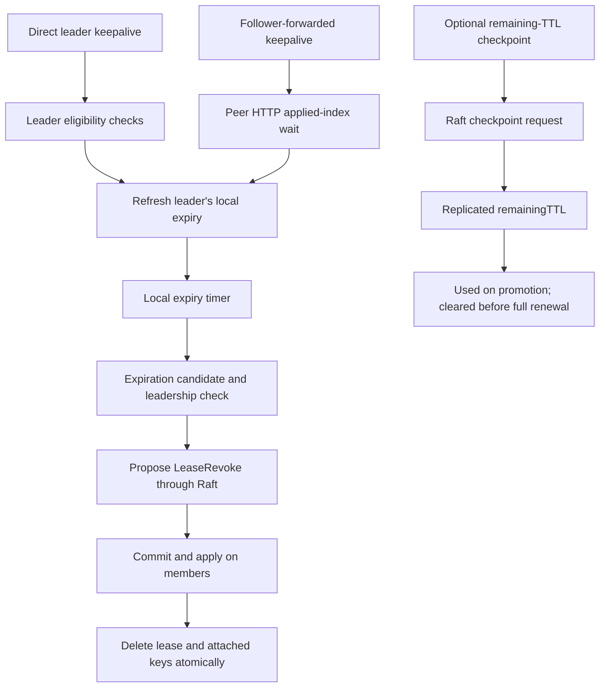

# etcd leases: server authority, client recovery, and Kubernetes consequences

**Investigation dates:** 2026-10-31 and 2026-11-01. This editorial revision preserves the findings and evidence from those investigations; issue-state snapshots are explained in Appendix A.

**Versions analyzed:** etcd server and Go client `v3.7.3` (`0a173d0410a9`); jetcd `jetcd-0.8.7` (`23b61f1499a5`); Raft library `v3.7.0`; selected Kubernetes `v1.37.2` code (`c50e5395f1ae`). Full pins and inspection limits are in Appendix A.

**Upstream references:** principal findings concern [#15247](https://github.com/etcd-io/etcd/issues/15247), [#13915](https://github.com/etcd-io/etcd/issues/13915), and [#22649](https://github.com/etcd-io/etcd/issues/22649). The [reference catalog](#a2-upstream-reference-catalog) retains the complete issue/PR list.

## Scope

Assess the correctness, failure recovery, and performance risks of etcd leases and selected Go/jetcd client behavior, including Kubernetes consequences and comparison with Chubby sessions.

## Summary

**etcd replicates lease creation and deletion, but usually renews leases in leader-local memory.** The central production question is whether that local timing state remains consistent with the lifetime promised to clients. Agreement on a deletion does not prove that the deletion was timely or justified.

- **Renewal promises can fail in the target release.** With checkpointing enabled, #22649 can acknowledge a full TTL after a failed checkpoint clear leaves renewal using a shorter saved duration. This mechanism is verified in `v3.7.3` and does not require loss of quorum; no new fault-injection reproduction was run. **High confidence.** (§4.3)
- **The default configuration has unresolved failure candidates.** The historical stalled-leader bug has a shipped fix. Source traces nevertheless identify delayed revocation across failover, a weaker follower-forwarded renewal path, and a renewal/expiration race. Their end-to-end executions remain untested; a short partition alone is not a demonstrated failure. **High confidence in the code facts; Moderate in the candidate failures.** (§3)
- **TTL is not a retention deadline.** By default, leadership changes restart surviving leases from their granted TTL plus an election allowance. Repeated elections can postpone expiration indefinitely. Experimental checkpointing reduces some lost progress, but provides neither an absolute deadline nor default coverage for short session leases. **High confidence.** (§4)
- **Client status is not proof of current ownership or stopped renewal.** The Go client, gRPC proxy, and jetcd have distinct notification and recovery behaviors. Both clients calculate local deadlines from response receipt; errors or closed subscriptions can also coexist with continued renewal. Applications protecting data still need atomic ownership checks or externally enforced fencing. **High confidence in implementation behavior; Moderate in untested recovery consequences.** (§5)
- **Operational exposure depends on the consumer and workload.** Kubernetes Events use native leases; Kubernetes coordination Lease objects do not. Expiration entails replicated requests, key deletion work, and sometimes JWT signing. The inspected robustness model does not test lease timing promises. These are code and coverage findings, not benchmark results. **High confidence.** (§§6–7, 9)
- **The design concern is narrower than “renewals must use Raft.”** Chubby also extends sessions across failover and avoids persisting every renewal, while providing a richer authority and recovery protocol. The evidence points to weaknesses where local authority, replicated deletion, and client knowledge meet; it does not establish that logging every renewal is a sufficient redesign. **Moderate confidence.** (§8)

The main analysis runs from [correctness criteria](#1-terms-and-correctness-criteria) through [verification priorities](#9-test-coverage-and-verification-priorities). Appendices retain the research record, related issues, and decisions about peer-analysis leads. The closing [Conclusions](#conclusions) state the production implications.

## 1. Terms and correctness criteria

The report evaluates native etcd v3 leases. A full audit of locks, watches, jetcd API coverage, and the client-side leasing cache remains outside its scope.

| Term | Meaning in this report |
|---|---|
| Lease | A server-managed lifetime to which keys may be attached. Revoking it deletes the attached keys. |
| TTL | The duration granted or returned by a renewal. Distinguish this promised lifetime from an upper bound on retention. |
| Lessor | The server-side lease manager. Its primary instance tracks expiration. |
| Checkpoint | A replicated record of remaining lease duration, not an absolute expiration timestamp. |
| Committed / applied | Raft has agreed on a command / the member has executed it against its local state. These need not happen at the same instant. |

**Evidence limits:** This is a source and issue/patch investigation. Code paths and test definitions were read, and historical fixes were checked for ancestry. No cluster, fault-injection test, or benchmark was run. TTL examples illustrate possible executions or configuration constants. **High** confidence identifies verified mechanisms or well-supported implications; **Moderate** marks conditional executions and design judgments that still need testing. Detailed provenance is in Appendix A.

### 1.1 Renewal safety, retention, and application ownership

Three separate outcomes matter:

| Question | Criterion | Why it matters |
|---|---|---|
| Renewal safety | After accepting a renewal, the service must not automatically terminate the lease before the promised lifetime elapses, including across leader changes. | Early termination can let a replacement acquire ownership while the previous holder still relies on a successful renewal. |
| Expiration progress | An unrenewed lease must eventually be revoked for cleanup or takeover to complete. | Retaining a lease too long delays a new lock holder or elected coordinator. TTL is not necessarily an upper bound on this delay. |
| Application write safety | Protected writes must check that the actor still owns the resource. | A client's local belief can be stale even when the replicated state is correct. Atomic checks or fencing protect the operation itself (§5.1). |

The renewal-safety criterion excludes separately authorized explicit revocation. It also does not restart the server's promised interval when a delayed reply reaches the client. A successful response that overstates the installed lifetime violates the criterion even if every replica agrees on the later deletion.

Replicated grants record which leases and granted durations must survive failover. Replicated revocations record their definitive end and prevent an already deleted lease from reappearing. Neither records the last ordinary renewal. A new leader therefore extends surviving leases conservatively (§4), because identical grant records do not reveal which leases were recently renewed. That explains the design; it does not prove every implementation interleaving safe.

**Assessment:** #22649 establishes a source-verified renewal defect with checkpointing enabled (**High confidence**, §4.3). Delayed expiration work supplies a failure candidate in the default configuration (**Moderate confidence**, §3.3). Keeping three of five members available can allow consensus to continue once leadership is established, but does not validate the timer decisions proposed to it. Neither case was reproduced in a five-member cluster here. Ownership checks can preserve application writes despite a lease failure; they do not repair the failed renewal promise.

## 2. Replicated state and local lease timing

Lease creation and deletion use consensus. Most renewal and status paths use local state. The distinction explains both the efficiency of renewal and the failure cases examined later.

### 2.1 Which operations use Raft?

**High confidence — verified in `v3.7.3`:** Lease existence and lease timing are maintained differently.

| Operation | Actual path | Evidence at `v3.7.3` |
|---|---|---|
| Grant a lease | `LeaseGrant` submits an `InternalRaftRequest`; application creates the lease | [server/etcdserver/v3_server.go:452](https://github.com/etcd-io/etcd/blob/v3.7.3/server/etcdserver/v3_server.go#L452), [server/etcdserver/apply/backend.go:83](https://github.com/etcd-io/etcd/blob/v3.7.3/server/etcdserver/apply/backend.go#L83) |
| Ordinary keepalive | Direct leader path checks eligibility, then calls local `lessor.Renew`; follower-forwarded peer HTTP calls `Renew` without that same check (§3.4) | [server/etcdserver/v3_server.go:496](https://github.com/etcd-io/etcd/blob/v3.7.3/server/etcdserver/v3_server.go#L496), especially :529 and :541; [server/lease/leasehttp/http.go:84–91](https://github.com/etcd-io/etcd/blob/v3.7.3/server/lease/leasehttp/http.go#L84) |
| Renew after a positive checkpoint | First attempts a Raft checkpoint clearing the saved remaining TTL; then refreshes locally | [server/lease/lessor.go:411](https://github.com/etcd-io/etcd/blob/v3.7.3/server/lease/lessor.go#L411), :433–455 |
| Detect expiration | Leader's lessor examines local timers and queues candidates | [server/lease/lessor.go:620](https://github.com/etcd-io/etcd/blob/v3.7.3/server/lease/lessor.go#L620), :640–663 |
| Revoke, explicitly or following expiration | `LeaseRevoke` submits a Raft request; apply deletes the lease and attached keys | [server/etcdserver/server.go:858](https://github.com/etcd-io/etcd/blob/v3.7.3/server/etcdserver/server.go#L858), [server/etcdserver/v3_server.go:482](https://github.com/etcd-io/etcd/blob/v3.7.3/server/etcdserver/v3_server.go#L482), [server/lease/lessor.go:326](https://github.com/etcd-io/etcd/blob/v3.7.3/server/lease/lessor.go#L326) |
| Read remaining TTL | Uses the apparent leader's local state after an applied-index wait; followers forward manually; detects demotion during lookup | [server/etcdserver/v3_server.go:637](https://github.com/etcd-io/etcd/blob/v3.7.3/server/etcdserver/v3_server.go#L637) |
| List leases | Reads the contacted member's lessor; no linearizable-read barrier on this path | [server/etcdserver/v3_server.go:737](https://github.com/etcd-io/etcd/blob/v3.7.3/server/etcdserver/v3_server.go#L737) |

The forwarding-path comment summarizes ordinary renewal: “renewals don't go through raft; forward to leader manually” (`v3_server.go:541 @ v3.7.3`). Clearing a positive checkpoint is the important exception: that renewal does require a Raft request.

The important distinction is between **agreeing to execute a deletion** and **correctly deciding that the lease should be deleted**. Raft can consistently replicate a mistaken `LeaseRevoke` proposal. It does not automatically validate the local timer or leadership assumption that caused the proposal. Conversely, keeping a key longer than intended need not violate ordering of KV operations.

`ensureLeadership()` primarily guards against a stalled Raft loop. It accepts a member that processed a local Raft tick within the last three configured tick intervals. Otherwise, it performs a linearizable read and checks the Raft leader ID. Thus a normal renewal need not make a fresh quorum round trip.

**Evidence:** [server/etcdserver/server.go:905–941 @ v3.7.3](https://github.com/etcd-io/etcd/blob/v3.7.3/server/etcdserver/server.go#L905).

### 2.2 Response headers do not identify an atomic lease snapshot

**High confidence — verified construction:** The gRPC member stamps the keepalive response header **before** renewing or forwarding. `header.fill` reads that member's MVCC revision and Raft term; the peer HTTP renewal response returns the lease ID and TTL without a populated header. Similarly, a forwarded `LeaseTimeToLive` result receives its header at the serving gRPC member. Thus leader-derived TTL information can be paired with a follower's older revision.

**Evidence:** [server/etcdserver/api/v3rpc/lease.go:62–75, :127–146 @ v3.7.3](https://github.com/etcd-io/etcd/blob/v3.7.3/server/etcdserver/api/v3rpc/lease.go#L127), [server/etcdserver/api/v3rpc/header.go:30–56 @ v3.7.3](https://github.com/etcd-io/etcd/blob/v3.7.3/server/etcdserver/api/v3rpc/header.go#L30), [server/lease/leasehttp/http.go:101–102, :129–135 @ v3.7.3](https://github.com/etcd-io/etcd/blob/v3.7.3/server/lease/leasehttp/http.go#L101).

The practical conclusion is limited: the header does not identify a revision at which the returned lease lifetime or key set was atomically observed. It does not prove that the lease was renewed, created, or deleted *at* that revision. In particular, a lease grant alone does not advance the MVCC key revision ([server/etcdserver/apply/backend.go:83–91 @ v3.7.3](https://github.com/etcd-io/etcd/blob/v3.7.3/server/etcdserver/apply/backend.go#L83)); conflating lease creation with a KV write produces misleading examples. This metadata construction does not itself establish a KV linearizability violation or make `RaftTerm` a fencing token for an external resource.

### 2.3 Lease-status APIs and the unfinished linearizability proposal

[#13915, “Make leases linearizable (excluding TTL)”](https://github.com/etcd-io/etcd/issues/13915), opened in April 2022, explicitly identifies request forwarding outside Raft and disagreement between locally expired timers and replicated lease existence. It was closed **not planned on 2025-12-19**, following inactivity notices; the closure did not complete a redesign.

**High confidence — current source:** Listing leases remains a local operation. A lagging follower can omit a grant already acknowledged elsewhere, or retain a lease already revoked elsewhere; the implementation does not wait for a current quorum-backed read before returning its lease map. `LeaseTimeToLive` waits for local application, but does not use the same fresh linearizable-read path as a normal linearizable KV read. Therefore one should not transfer the KV API's freshness guarantee to every lease-status RPC.

**Evidence:** [server/etcdserver/v3_server.go:459, :637, :737 @ v3.7.3](https://github.com/etcd-io/etcd/blob/v3.7.3/server/etcdserver/v3_server.go#L459).

Some old concerns have been addressed more narrowly. Current `Renew` waits for a locally expired lease's committed revocation or for demotion before returning a terminal result; it does not immediately report absence solely because the timer ran out.

**Evidence:** [server/lease/lessor.go:415–428 @ v3.7.3](https://github.com/etcd-io/etcd/blob/v3.7.3/server/lease/lessor.go#L415). Thus the 2022 issue body is evidence of the design discussion, not an exact description of every current code path.

## 3. Server correctness: shipped fixes and remaining candidates

The first two cases have shipped fixes. The later cases trace remaining gaps in the target source. Checkpoint-specific behavior is grouped separately in §4.3.

### 3.1 False absence immediately after grant: #13675

[#13675](https://github.com/etcd-io/etcd/issues/13675) reported immediate `concurrency.Session` closure on **v3.5.2**. The maintainer traced it to a follower acknowledging a committed grant before the leader finished applying it. A following keepalive reached the leader, whose local lease map did not yet contain that grant. The client interpreted the response as lease loss. This did not require a leader election. [Maintainer diagnosis](https://github.com/etcd-io/etcd/issues/13675#issuecomment-1034264152).

**High confidence — fix present:** [PR #13690](https://github.com/etcd-io/etcd/pull/13690), merge `dd08e15d7c4750b1a94a8b4760a4de7fd14b0e78`, added an applied-index wait; the issue was closed and the maintainer identified v3.5.3 as the release carrying it. The merge is an ancestor of `v3.7.3`.

`v3.7.3` refines this with `FastLeaseKeepAlive`, a Beta feature enabled by default: an existing local lease can be renewed without waiting for the apply backlog, while an absent lease still triggers the wait. See [server/etcdserver/v3_server.go:508–523 @ v3.7.3](https://github.com/etcd-io/etcd/blob/v3.7.3/server/etcdserver/v3_server.go#L508), [server/features/etcd_features.go:97 @ v3.7.3](https://github.com/etcd-io/etcd/blob/v3.7.3/server/features/etcd_features.go#L97), and merged [PR #20589](https://github.com/etcd-io/etcd/pull/20589). The preservation of this guard is verified; I did not reproduce the historical workload.

### 3.2 Stalled old leader: #15247

[#15247](https://github.com/etcd-io/etcd/issues/15247) was initially reported with **v3.4.3**, deployed on Kubernetes with Portworx storage. A stalled `fdatasync` prevented the old leader's server loop from keeping its lessor synchronized with Raft leadership. Two failures followed:

1. Clients renewing through the new leader could nevertheless lose their leases when the recovered old leader submitted stale expiration decisions.
2. Clients still attached to the old leader could receive renewal acknowledgments that the new leader never saw; the new leader could then expire those leases.

Both failures broke the lease promise. In the first case, consensus could accept an inappropriate revoke command even though deletion itself remained replicated. [Maintainer's two-case analysis](https://github.com/etcd-io/etcd/issues/15247#issuecomment-1777862093).

**High confidence — historical fix present:** [PR #16822](https://github.com/etcd-io/etcd/pull/16822) merged on 2023-12-15; merge commit `4e986363a371ad88479cb8f9b248d16ea83abc87` is an ancestor of `v3.7.3`. The issue closed on 2024-02-23 after backports. The direct renewal path, expiration revocation, and checkpoint submission call the leadership safeguard described in §2.1. The forwarded-renewal exception is examined in §3.4.

**Source:** [server/etcdserver/v3_server.go:504 @ v3.7.3](https://github.com/etcd-io/etcd/blob/v3.7.3/server/etcdserver/v3_server.go#L504), [server/etcdserver/server.go:394, :858 @ v3.7.3](https://github.com/etcd-io/etcd/blob/v3.7.3/server/etcdserver/server.go#L394).

There are dedicated stalled-write tests for both cases and both three- and five-member clusters: [tests/e2e/v3_lease_no_proxy_test.go:33, :45, :126 @ v3.7.3](https://github.com/etcd-io/etcd/blob/v3.7.3/tests/e2e/v3_lease_no_proxy_test.go#L33). Their presence is verified; their execution was not repeated here.

**Limit:** This establishes that the reported scenario has a targeted fix, not a proof of correctness under arbitrary pauses between checks and effects. The following subsection records a specific remaining candidate interleaving. Clients also need a reachable alternative endpoint to recover from a stalled one; missing that is a connectivity limitation, not evidence that the historical patch failed.

### 3.3 Delayed revocation after a leadership check

**Moderate confidence — source-derived failure candidate, not reproduced.** Re-reading `v3.7.3` under the renewal-promise criterion in §1.1 identifies the following schedule, with checkpointing disabled:

1. While A is leader, its lessor identifies lease L as expired. The lease and its keys still exist because revocation has not committed.
2. A's expiration batch passes `ensureLeadership()`. An expiration worker is delayed after that check and before calling `LeaseRevoke`.
3. Leadership transfers to B while a quorum remains available. B applies the preceding log, promotes its lessor, and extends L because L has not been revoked.
4. B successfully renews L for its client. That acceptance establishes a new promised lifetime; this example does not depend on the client continuing to trust an acknowledgment from the obsolete leader.
5. A remains a running member. Its delayed worker resumes and submits the stale expiration decision as an ordinary `LeaseRevoke(L)` request.
6. If that proposal commits, application deletes L and its attached keys without checking whether the expiration decision predates B's leadership or renewal. If this happens within the newly promised interval, it is premature automatic termination despite a functioning quorum.

**High confidence — verified code facts supporting the candidate:**

- The leadership check occurs once before the batch starts submitting revocations in separate goroutines: [server/etcdserver/server.go:858–885 @ v3.7.3](https://github.com/etcd-io/etcd/blob/v3.7.3/server/etcdserver/server.go#L858).
- The workers use the server context, and `GoAttach` checks server shutdown rather than binding the worker to a leadership term: [server/etcdserver/server.go:884, :2413–2428 @ v3.7.3](https://github.com/etcd-io/etcd/blob/v3.7.3/server/etcdserver/server.go#L2413). Demotion is not equivalent to server shutdown.
- `LeaseRevoke` submits a normal Raft request without a new leadership or expiration check: [server/etcdserver/v3_server.go:471–486, :1114 @ v3.7.3](https://github.com/etcd-io/etcd/blob/v3.7.3/server/etcdserver/v3_server.go#L471).
- The revoke payload contains the lease ID, with no expected leadership term or renewal generation: [api/etcdserverpb/rpc.proto:889–894 @ v3.7.3](https://github.com/etcd-io/etcd/blob/v3.7.3/api/etcdserverpb/rpc.proto#L889).
- Application invokes `Lessor.Revoke(ID)`, which deletes the lease and attached keys without checking their current expiration: [server/etcdserver/apply/backend.go:94–96 @ v3.7.3](https://github.com/etcd-io/etcd/blob/v3.7.3/server/etcdserver/apply/backend.go#L94), [server/lease/lessor.go:326–361 @ v3.7.3](https://github.com/etcd-io/etcd/blob/v3.7.3/server/lease/lessor.go#L326).

The end-to-end conclusion remains **Moderate confidence** because the controlled scheduling/commit test has not been run. The bad outcome requires the worker to survive the leadership change, its proposal to be accepted, and application to occur before the new promised interval ends. Stopping A permanently before submission or rejecting the stale proposal prevents this particular execution. Thus this is not a claim that any two permanent crashes in a five-member cluster cause premature expiry. It is a quorum-preserving failover schedule to test with a delayed, surviving former leader.

This trace points to a missing condition at the point of deletion: the expiration decision must still be valid under the current leadership and lease state. Another separate preflight check would leave a gap between checking and acting. Raft agreement alone does not establish that validity, and logging every renewal would not by itself specify the needed check.

**Why forwarding matters — verified code:** etcd's Raft configuration does not disable proposal forwarding ([server/etcdserver/bootstrap.go:540–551 @ v3.7.3](https://github.com/etcd-io/etcd/blob/v3.7.3/server/etcdserver/bootstrap.go#L540)). In the pinned Raft library, a follower with a known leader forwards `MsgProp`; the receiving leader assigns its **current term** when appending the entries ([raft.go:1718–1729, :812–819 @ raft v3.7.0](https://github.com/etcd-io/raft/blob/v3.7.0/raft.go#L1718)). The entry's term therefore does not encode the term in which the expiration decision was made. The explanatory comment at [server/lease/lessor.go:253–262 @ v3.7.3](https://github.com/etcd-io/etcd/blob/v3.7.3/server/lease/lessor.go#L253) cannot exclude this schedule by saying an old primary's lower-term proposal will not commit. This confirms the forwarding mechanism, while the scheduled end-to-end failure remains untested.

**Batching can delay action after the check.** The lessor selects up to 500 expiration candidates per pass with default settings. Each `revokeExpiredLeases` batch creates its own 16-slot semaphore, checks authority once, and then submits individual revokes. Later requests can wait behind earlier ones and be submitted after a leadership change. The limit of sixteen applies **per batch**; overlapping batches need not share that cap. Even an initially valid leadership check can become obsolete while work waits.

**Evidence:** [server/lease/lessor.go:640–648 @ v3.7.3](https://github.com/etcd-io/etcd/blob/v3.7.3/server/lease/lessor.go#L640), [server/etcdserver/server.go:103, :858–902 @ v3.7.3](https://github.com/etcd-io/etcd/blob/v3.7.3/server/etcdserver/server.go#L858). There is insufficient evidence to call the window normally milliseconds, assign a probability, or multiply default request timeouts into a hard maximum.

### 3.4 Forwarded renewals and the limits of the authority check

**High confidence — verified path difference:** A follower forwards a renewal to its known leader through `leasehttp.RenewHTTP`. The receiver waits for its locally known committed index to apply, then calls the lessor's `Renew` directly. This bypasses the `EtcdServer.LeaseRenew` entry point and its `ensureLeadership` check and `FastLeaseKeepAlive` optimization.

At entry, `Renew` checks primary status through the lessor's `demotec` flag. A positive-checkpoint clear can invoke a separate authority guard (§4.3), but ordinary renewal with checkpointing disabled has no such step. Waiting for locally known committed work to apply does not establish current quorum authority.

**Evidence:** [server/etcdserver/v3_server.go:538–556 @ v3.7.3](https://github.com/etcd-io/etcd/blob/v3.7.3/server/etcdserver/v3_server.go#L538), [server/lease/leasehttp/http.go:48–55, :84–102 @ v3.7.3](https://github.com/etcd-io/etcd/blob/v3.7.3/server/lease/leasehttp/http.go#L84), [server/lease/lessor.go:263–264, :396–412 @ v3.7.3](https://github.com/etcd-io/etcd/blob/v3.7.3/server/lease/lessor.go#L396).

**Moderate confidence — failure candidate, checkpointing disabled:** A delayed forwarding request can reach an old leader after another member has been promoted. The old lessor can still consider itself primary if its Ready loop remains stalled. If its applied-index wait completes and its local lease is still live, it can acknowledge a renewal that the new leader never receives.

This route is possible even if the forwarding member has since learned the new leader: the request may already be in flight. A five-member partition can also leave a follower with the obsolete leader while the other three elect a replacement.

**Required timing:** To violate the promise, the renewal's promised end must fall after the new leader's extended expiry, with no later valid renewal repairing the interval. The bypass alone does not establish that timing. Demotion, apply-wait timeout, local expiration, or routing to the current leader prevents this execution.

**What a plain partition establishes.** `isActive` records local calls to `raftNode.tick`, not peer heartbeat replies; ticks and Ready processing share a loop. [PR #18428](https://github.com/etcd-io/etcd/pull/18428), merge `a8b30b19bdbd`, introduced this shortcut in response to [#18069](https://github.com/etcd-io/etcd/issues/18069). The primary review contains a [partition-safety objection](https://github.com/etcd-io/etcd/pull/18428#discussion_r1719518498) and an [explanation that the guard targets self-stalls](https://github.com/etcd-io/etcd/pull/18428#discussion_r1718613608). Those are design discussion, not a reproduced `v3.7.3` violation. Code: [server/etcdserver/raft.go:159–205 @ v3.7.3](https://github.com/etcd-io/etcd/blob/v3.7.3/server/etcdserver/raft.go#L159).

The new leader's `Promote(ElectionTimeout)` extension matters when evaluating a stale acknowledgment. With equal-rate clocks, consider a surviving, uncheckpointed lease:

| Quantity | Value |
|---|---|
| Time at which B is promoted | `p` |
| Election-time extension and granted TTL | `E` and `T` |
| B's new expiry, before any further extension | At least `p + E + T` |
| Promise from an obsolete leader's renewal accepted at `a` | Through `a + T` |

If `a <= p + E`, B's extension already covers that promise. The missing replication of that renewal therefore does not alone establish early expiry.

CheckQuorum runs on election ticks and clears peers' activity between checks ([raft.go:861–885, :1281–1292 @ raft v3.7.0](https://github.com/etcd-io/raft/blob/v3.7.0/raft.go#L861)); it is not a wall-time guarantee during process/Ready-loop stalls. This argument rejects the peer report's specific short-overlap example as sufficient proof, without proving safety for arbitrary delays, asymmetric partitions, checkpoints, or clock rates.

The server also rounds up a minimum granted TTL derived from approximately 1.5 election timeouts; the actual expression truncates `(3 * ElectionTicks) / 2` before multiplying by the tick duration and rounding to seconds ([server/etcdserver/server.go:340–345 @ v3.7.3](https://github.com/etcd-io/etcd/blob/v3.7.3/server/etcdserver/server.go#L340), [server/lease/lessor.go:301–303 @ v3.7.3](https://github.com/etcd-io/etcd/blob/v3.7.3/server/lease/lessor.go#L301)). Short-TTL examples must use the granted value, not just the requested one.

### 3.5 Renewal racing automatic expiration

**High confidence for the missing synchronization; Moderate for the unexecuted failure schedule.** [PR #20590](https://github.com/etcd-io/etcd/pull/20590), merge `f896a1728ac1`, added the final lease-map lookup in `Renew`; it is present in `v3.7.3`. This rejects a lease already removed from the map. It does not reject a revocation in progress or repeat the initial expiry check under the final lock.

A precise schedule is:

1. `Renew` finds the lease and passes `l.expired()` while time remains.
2. It pauses before acquiring its final write lock. Time passes; expiration is detected and its revoke commits.
3. `Revoke` releases the lessor lock while deleting attached keys through its transaction. The lease remains in `leaseMap` until deletion work is finished.
4. The delayed `Renew` takes the lock during that interval, finds the map entry, refreshes it, and returns the full TTL.
5. `Revoke` then removes the entry and ends the transaction without rechecking that refreshed timer.

The necessary earlier expiry check matters: a renewal that first arrives **after** local expiration ordinarily waits for revocation or demotion (§2.3). Also, internal key deletions staged before `txn.End()` are not proof that another client could already observe those deletions. The important consequence is that automatic revocation can complete inside the newly acknowledged lifetime.

**Evidence:** [server/lease/lessor.go:326–361, :415–455 @ v3.7.3](https://github.com/etcd-io/etcd/blob/v3.7.3/server/lease/lessor.go#L326). [PR #21389](https://github.com/etcd-io/etcd/pull/21389) contains a proposed regression using pauses after the initial renewal check and during revocation; it was **closed unmerged on 2026-06-19**. Its patch and test were read, not run, and do not establish the frequency or the cause of the older #14758 production report. If revocation removes the map entry before the final lookup, the existing guard works. This race requires delay across the expiry boundary; it is distinct from the already-covered cross-leader schedule and from buffered replies (§5.3).

`FastLeaseKeepAlive` also permits renewal while a committed revoke is waiting to apply. That observation alone is **not** a linearizability counterexample: an overlapping explicit revoke can legitimately be ordered after a renewal, and §1.1 excludes explicit revocation from the no-early-automatic-expiry property. A claimed violation needs the ordering of completed client calls or the automatic-expiry schedule above. Disabling the fast path does not make the later `Renew`/`Revoke` lock sequence atomic.

### 3.6 Authorization based on a follower’s attachment state

**High confidence for the checks; Moderate for the security consequence, not reproduced.** `checkLeaseRenew` authenticates the caller and, for a non-admin, checks write permission on each key attached to the lease in the **contacted member's local** map. An absent local lease produces no per-key checks. The follower forwarding path does not first wait for local application, and the peer HTTP receiver performs `Renew` without repeating the caller's key authorization.

**Sources:** [server/etcdserver/v3_server.go:548–554, :575–605 @ v3.7.3](https://github.com/etcd-io/etcd/blob/v3.7.3/server/etcdserver/v3_server.go#L575), [server/lease/leasehttp/http.go:78–102 @ v3.7.3](https://github.com/etcd-io/etcd/blob/v3.7.3/server/lease/leasehttp/http.go#L78).

A focused test would use this sequence:

1. Enable auth and establish a valid restricted user who knows the lease ID.
2. Attach a key outside that user's permissions and delay application on the serving follower.
3. Renew through that follower while its old attachment set still passes the permission check.

If the leader accepts the forwarded renewal, it can extend the lease without checking the permissions required by the current attachment set. The auth-revision recheck does not alone detect ordinary key-attachment changes.

**Limits:** This requires follower lag, valid credentials, a known lease ID, and different attachment/permission sets. Current attachment state or denial on an already-visible key defeats the schedule. It does not establish unauthenticated access to peer endpoints or arbitrary key reads/writes. The full RBAC and peer-trust audit remains open; this is a bounded concern, not a confirmed vulnerability advisory.

## 4. Lifetime across failover and checkpointing

### 4.1 Default behavior: failover restarts the granted TTL

**High confidence — code-derived:** When the new leader applies its term's initial no-op entry, it promotes its lessor with an election-time extension. Promotion refreshes all outstanding leases. `refresh` uses a saved positive `remainingTTL` when available, otherwise the original granted TTL. With checkpointing off, the latter is the normal case.

**Evidence:** [server/etcdserver/server.go:1957–1965 @ v3.7.3](https://github.com/etcd-io/etcd/blob/v3.7.3/server/etcdserver/server.go#L1957), [server/lease/lessor.go:480–491 @ v3.7.3](https://github.com/etcd-io/etcd/blob/v3.7.3/server/lease/lessor.go#L480), [server/lease/lease.go:75–88 @ v3.7.3](https://github.com/etcd-io/etcd/blob/v3.7.3/server/lease/lease.go#L75).

Illustratively, a lease granted for an hour can be almost an hour old without any client renewal. If leadership then changes, its new timer starts with approximately another full hour plus the election allowance. Repeating this before expiration prevents collection indefinitely. This is an execution permitted by the code, not a claim about how frequently production clusters elect leaders.

The behavior is documented in the [v3.7 failure guide](https://etcd.io/docs/v3.7/op-guide/failures/#leader-failure) and explicitly expected by [tests/integration/v3_lease_test.go:517–523 @ v3.7.3](https://github.com/etcd-io/etcd/blob/v3.7.3/tests/integration/v3_lease_test.go#L517). Promotion may additionally spread expirations to control revocation bursts (`lessor.go:494–530 @ v3.7.3`). Therefore TTL is not an upper bound on key retention across failures.

This favors preservation of sessions over timely cleanup. For a dead lock holder it delays takeover; for expiring records it retains unwanted data. Those are progress/retention consequences. They do not by themselves show that an acknowledged lease was terminated too early. **High confidence — condition on the inference:** indefinite postponement requires continuing elections or another continuing source of renewal/delay. A finite pair of failures followed by stable leadership and eventual revocation processing does not, by itself, imply indefinite retention.

### 4.2 Checkpointing preserves some progress, not a deadline

[#9888](https://github.com/etcd-io/etcd/issues/9888) led to [PR #9924](https://github.com/etcd-io/etcd/pull/9924), merged in 2018. Its motivation was to retain some expiration progress without replicating every keepalive. The implementation checkpoints remaining durations periodically through Raft. The default interval is five minutes; checkpoints are scheduled only when the remembered remaining duration exceeds that interval.

**Source:** [server/lease/lessor.go:52, :667, :753 @ v3.7.3](https://github.com/etcd-io/etcd/blob/v3.7.3/server/lease/lessor.go#L52).

**High confidence — configuration nuance:** `LeaseCheckpoint` and `LeaseCheckpointPersist` are both listed as Alpha/default false, but persistence is also enabled by the **cluster version being at least 3.6**. Thus, on a fully upgraded 3.7 cluster, enabling checkpoint generation also causes those checkpoints to be persisted even when the separate persistence gate remains false. With checkpoint generation disabled, that version rule does not create checkpoints.

**Evidence:** [server/features/etcd_features.go:94–95 @ v3.7.3](https://github.com/etcd-io/etcd/blob/v3.7.3/server/features/etcd_features.go#L94), [server/lease/lessor.go:367–387 @ v3.7.3](https://github.com/etcd-io/etcd/blob/v3.7.3/server/lease/lessor.go#L367), and [server/etcdserver/server.go:392 @ v3.7.3](https://github.com/etcd-io/etcd/blob/v3.7.3/server/etcdserver/server.go#L392).

This distinction explains [#17132](https://github.com/etcd-io/etcd/issues/17132), reported on **v3.5.9**: checkpointing alone did not preserve remaining TTL through enough member restarts. The reporter confirmed that enabling checkpoint persistence as well addressed the reproduction. That historical configuration trap is not directly transferable to a fully upgraded 3.7 cluster.

**High confidence — inferred limit from the algorithm:** Checkpointing still does not provide an absolute expiration time. A new leader restarts a saved duration; time since the checkpoint and time without a leader are not subtracted from a shared absolute deadline. Elections faster than checkpoint progress can repeatedly restart the same duration. Leases at or below the checkpoint interval do not get scheduled for further periodic checkpoints. Accordingly, even successful checkpointing does not prove bounded retention under unbounded leadership churn. This limit follows from `lease.go:75–88`, `lessor.go:480–491`, and `lessor.go:753–768 @ v3.7.3`.

The inference fails as a prediction of indefinite retention when the cluster eventually stays healthy long enough to expire and commit revocation, or another actor explicitly deletes/revokes the data. It does not assert that ordinary stable deployments will retain leases indefinitely.

With the default five-minute interval, a newly granted lease of at most 300 seconds does not enter periodic checkpointing. Enabling the gate therefore does not address ordinary short session leases' failover resets. The interval is an internal `LessorConfig`/`ServerConfig` field ([server/lease/lessor.go:201–217 @ v3.7.3](https://github.com/etcd-io/etcd/blob/v3.7.3/server/lease/lessor.go#L201), [server/config/config.go:163–164 @ v3.7.3](https://github.com/etcd-io/etcd/blob/v3.7.3/server/config/config.go#L163)); the suggested `--experimental-lease-checkpoint-interval` CLI flag in one peer report was **not found** in the stable config/flag definitions and is not an operator recommendation here. The stabilization tracker [#13776](https://github.com/etcd-io/etcd/issues/13776) closed **not planned on 2025-09-30**; the current gate definitions, not that closure alone, establish its experimental status.

### 4.3 Checkpoint-clear errors can overstate the renewed lifetime: #22649

**High confidence — verified implementation defect, conditional on checkpointing.** [#22649](https://github.com/etcd-io/etcd/issues/22649), opened 2026-10-23, matches the stable code exactly:

1. A periodic checkpoint records `remainingTTL > 0`.
2. `Renew` attempts to clear it through Raft before granting a full new duration. It checks the checkpointer's returned error.
3. The production checkpointer calls `raftRequest` but discards its error and returns `nil` after its preflight leadership check.
4. If the clear failed or has not applied when the request times out, renewal proceeds. `refresh(0)` uses the still-positive, shorter `remainingTTL`, while `Renew` returns the original `l.ttl` to the client.

**Evidence:** [server/etcdserver/server.go:394–402 @ v3.7.3](https://github.com/etcd-io/etcd/blob/v3.7.3/server/etcdserver/server.go#L394); [server/lease/lessor.go:433–455 @ v3.7.3](https://github.com/etcd-io/etcd/blob/v3.7.3/server/lease/lessor.go#L433); [server/lease/lease.go:75–88 @ v3.7.3](https://github.com/etcd-io/etcd/blob/v3.7.3/server/lease/lease.go#L75).

For example, if the granted TTL is 600 seconds and the saved remaining TTL is 300 seconds, that failure path can acknowledge 600 while refreshing for 300. These are illustrative values. The later application of a timed-out clear is not by itself sufficient to correct the timer already installed: `Checkpoint` updates `remainingTTL`, not the current expiry (`lessor.go:371–379 @ v3.7.3`). A later successful renewal can correct it before expiration.

**Exposure — High confidence in the mechanism, production incidence unmeasured:** The failure requires a positive checkpoint and a failed or delayed clear that remains unapplied when the timer is refreshed. Not every Raft timeout has that outcome. Default configurations avoid this path because checkpoint generation is off.

**Quorum can remain available.** An apply delay can exceed the request timeout without a leader election or loss of quorum. Reporting that failed or incomplete clear as success is the defect: Raft can subsequently agree on a deletion that occurs before the acknowledged lifetime ends. This breaks the lease promise itself. The proposed regression below tests error propagation; no new end-to-end premature-expiry measurement was performed here.

[PR #22650](https://github.com/etcd-io/etcd/pull/22650) proposes propagating the Raft error and adds an integration test with a delayed apply. As inspected, it is **open, unmerged**, at head `a6b36f39996fd1150928e7eecc3844df79912d1b`. I read the patch; I did not execute its test. Both stable and inspected `main` still discard the error. Its significance is specifically failure to honor the consensus result at the boundary with a local renewal, rather than proof that every renewal needs to be logged.

## 5. Client knowledge, recovery, and ownership

A server lease, a client’s local status, and the client’s authority to modify protected data are separate concerns. This section examines those boundaries for the Go client, gRPC proxy, and jetcd.

### 5.1 Local deadlines and atomic ownership checks

**High confidence — verified arithmetic:** The Go client sets its keepalive deadline to **response receipt time + returned TTL**, and its `Session.Done()` follows closure of the keepalive channel. That is not a conservative lower bound on the leader's remaining lease lifetime: a delayed reply can arrive after part or all of the server's interval has already elapsed.

**Source:** [client/v3/lease.go:542–543 @ v3.7.3](https://github.com/etcd-io/etcd/blob/v3.7.3/client/v3/lease.go#L542), [client/v3/concurrency/session.go:57–76, :95–97 @ v3.7.3](https://github.com/etcd-io/etcd/blob/v3.7.3/client/v3/concurrency/session.go#L57).

The local deadline therefore cannot authorize a protected operation by itself. This does not imply that ordinary etcd transactions are unsafe, or that the client API promised Chubby's cache-consistency contract. For an etcd change, test lock ownership in the **same transaction** as the change; the existing helper compares the lock key's creation revision ([client/v3/concurrency/mutex.go:152 @ v3.7.3](https://github.com/etcd-io/etcd/blob/v3.7.3/client/v3/concurrency/mutex.go#L152)).

For an external resource, fencing must be enforced by that resource: it must reject operations from superseded owners. A lease ID alone should not be assumed to be an ordered fencing token.

For example, an elected coordinator can compare its ownership key's expected identity or creation revision in each protected write transaction. Once that key is deleted or replaced, the former coordinator's conditional write fails even if its session still appears active. A separate ownership read followed by an unconditional write leaves a race.

**High confidence — consequence of the atomic check:** This can preserve write safety despite premature lease loss. It does not repair the server's lease promise or guarantee prompt takeover. The distinction is also acknowledged in the project's [lock-safety explanation](https://etcd.io/blog/2020/jepsen-343-results/#documentation-issues).

### 5.2 Go leader-loss handling and subscriber-cleanup defects

**Exposure is determined at two different levels.** The Go lease client's shared transport stream always uses `WithRequireLeader`, but `closeRequireLeader` checks the contexts supplied by individual `KeepAlive` subscribers. On `ErrNoLeader`, flagged subscribers are closed; unflagged subscribers can survive transport reconnection and are otherwise subject to the local deadline. `concurrency.NewSession` uses the client context unless overridden and does not itself add the flag.

**Sources:** [client/v3/lease.go:210–211, :376–410, :478–489 @ v3.7.3](https://github.com/etcd-io/etcd/blob/v3.7.3/client/v3/lease.go#L210), [client/v3/concurrency/session.go:40–58 @ v3.7.3](https://github.com/etcd-io/etcd/blob/v3.7.3/client/v3/concurrency/session.go#L40).

`WithRequireLeader` is a local leader-loss detector, not a fresh quorum test on each message. The server rejects new flagged streams when its leader ID is absent and cancels existing ones after three consecutive leaderless samples separated by the configured election timeout. That is not a hard three-second end-to-end bound, and a stale nonzero leader ID can delay detection.

**Sources:** [server/etcdserver/api/v3rpc/interceptor.go:38, :239–258, :315–353 @ v3.7.3](https://github.com/etcd-io/etcd/blob/v3.7.3/server/etcdserver/api/v3rpc/interceptor.go#L315). Watch timing measurements from another analysis were not imported as lease measurements.

Two subscriber-cleanup defects affect this path in the Go client shipped with `v3.7.3`:

| Open issue | Verified mechanism and consequence | Conditions |
|---|---|---|
| [#22081](https://github.com/etcd-io/etcd/issues/22081) | **High confidence:** `closeRequireLeader` copies surviving channel `chs[i]` with context `ctxs[newIdx]`, rather than `ctxs[i]`. Cancellation can subsequently close the wrong subscriber's channel. | Multiple subscribers to one lease, a removed require-leader subscriber before a surviving subscriber, and later context handling. |
| [#22094](https://github.com/etcd-io/etcd/issues/22094) | **High confidence:** after removing all require-leader subscribers, the function leaves an empty entry in `keepAlives`. Replies update its deadline, but its next-send time is advanced only inside the now-empty channel loop. Renewal can continue with no local subscribers. | Leader-loss cleanup removes every subscriber; the client remains running and receives successful replies; no later cancellation or cleanup removes the entry. |

**Source:** [client/v3/lease.go:376–410, especially :406 @ v3.7.3](https://github.com/etcd-io/etcd/blob/v3.7.3/client/v3/lease.go#L376); [client/v3/lease.go:541–556 @ v3.7.3](https://github.com/etcd-io/etcd/blob/v3.7.3/client/v3/lease.go#L541); [client/v3/lease.go:590–610 @ v3.7.3](https://github.com/etcd-io/etcd/blob/v3.7.3/client/v3/lease.go#L590). Ordinary context cleanup does remove an entry with no subscribers (`lease.go:368–370`), which is the missing counterpart in the leader-loss path.

For #22081, the concrete compaction `[channel A, channel B] / [flagged context A, ordinary context B]` becomes `[channel B] / [context A]`. Cancelling A can close B; cancelling B can fail to remove its subscription. The latter can leave renewal running after B intended to stop it.

For #22094, an empty subscriber set leaves `nextKeepAlive` in the past; the send loop can then issue renewals on each 500 ms retry pass instead of the usual TTL/3 schedule. Continued successful responses refresh its deadline.

**Moderate confidence — traced consequences:** unwanted retention can continue for as long as the entry survives, but it is not unconditional or literally permanent: deadline cleanup, explicit revocation, relevant context cleanup, client shutdown, or terminal lease loss can end it. Recovery must beat cleanup for the orphan to persist. The 500 ms interval is a code constant, not a measured request rate.

Both mechanisms remain in the inspected `main` and release branch. Open proposed fixes include [#22087](https://github.com/etcd-io/etcd/pull/22087) for the context mapping and [#22253](https://github.com/etcd-io/etcd/pull/22253)/[#22291](https://github.com/etcd-io/etcd/pull/22291) for orphaned entries. These explain misleading local session state or unwanted retention; they are not failures of Raft replication. They are also not automatically jetcd defects.

### 5.3 Buffered success after revoke: #21638

[#21638](https://github.com/etcd-io/etcd/issues/21638) reports that a `KeepAlive` channel can deliver a previously buffered positive-TTL response after `Revoke` completes. The reporter reproduced it on **v3.6.10**. A maintainer explicitly treats it as permitted buffering semantics and accepts documentation clarification ([comment](https://github.com/etcd-io/etcd/issues/21638#issuecomment-4767757231)).

**High confidence:** This is not evidence of a revoked lease being recreated or a new successful renewal ordered after revocation. The Go client buffers replies, and `Revoke` is a separate RPC; reading an old channel item does not establish current lease ownership. Current source: [client/v3/lease.go:230 @ v3.7.3](https://github.com/etcd-io/etcd/blob/v3.7.3/client/v3/lease.go#L230), [client/v3/lease.go:541 @ v3.7.3](https://github.com/etcd-io/etcd/blob/v3.7.3/client/v3/lease.go#L541).

The issue is still open, but upstream already added a clarifying interface comment in commit [`a81b6d623eb7e078a625532404cdfbf5a3447cb7`](https://github.com/etcd-io/etcd/commit/a81b6d623eb7e078a625532404cdfbf5a3447cb7). It is present at [client/v3/lease.go:135 @ main commit `1573d59416ef`](https://github.com/etcd-io/etcd/blob/1573d59416efa220421c451f5266b24a5d8374ef/client/v3/lease.go#L135), but absent from the inspected stable file. This is a documentation change, not an implementation change that drains or suppresses buffered responses.

### 5.4 gRPC proxy: missed require-leader metadata

**High confidence — source defect; Moderate for the untested lease-stream consequence.** The etcd gRPC proxy checks `metadata.FromOutgoingContext(stream.Context())` when deciding whether to subscribe the caller to leader-loss notifications. An ordinary gRPC server receives client metadata in the **incoming** context, as used by the direct server's [interceptor.go:228 @ v3.7.3](https://github.com/etcd-io/etcd/blob/v3.7.3/server/etcdserver/api/v3rpc/interceptor.go#L228). The proxy's backend `KeepAlive` subscription also inherits that server context without translating the require-leader flag into outgoing subscriber metadata.

**Sources:** [server/proxy/grpcproxy/lease.go:148–173, :276–279 @ v3.7.3](https://github.com/etcd-io/etcd/blob/v3.7.3/server/proxy/grpcproxy/lease.go#L148), the standard proxy server setup at [server/etcdmain/grpc_proxy.go:507–541 @ v3.7.3](https://github.com/etcd-io/etcd/blob/v3.7.3/server/etcdmain/grpc_proxy.go#L507), and the Go subscriber logic in §5.2.

Consequently, under the normal incoming-context path, `lostLeaderC` remains nil and does not trigger the proxy's intended stream cancellation. Its own Go client may reconnect in the background without notifying that unflagged backend subscription of `ErrNoLeader`. A downstream caller can therefore miss prompt leader-loss notification and wait for a deadline or another error.

**Other ways the stream can end:** backend channel closure can trigger `TimeToLive`, and context/proxy shutdown can close the stream ([server/proxy/grpcproxy/lease.go:190–228, :299–324 @ v3.7.3](https://github.com/etcd-io/etcd/blob/v3.7.3/server/proxy/grpcproxy/lease.go#L190)). Successful backend failover can also make the interruption brief. The outcome need not be silence until TTL. Direct clients avoid this proxy-specific defect, and a custom wrapper that copies incoming metadata to outgoing context would change the premise. No lease-proxy fault test was run here.

### 5.5 jetcd deadlines and error/retry behavior

**High confidence — stable source:** jetcd has its own implementation; it is not subject to the Go client's channel-compaction bug merely because both use the same server. All Java paths below are **@ `jetcd-0.8.7`**:

- `LeaseImpl` enables require-leader metadata on its keepalive stub ([jetcd-core/src/main/java/io/etcd/jetcd/impl/LeaseImpl.java:70–77](https://github.com/etcd-io/jetcd/blob/jetcd-0.8.7/jetcd-core/src/main/java/io/etcd/jetcd/impl/LeaseImpl.java#L70)).
- On a positive response, it schedules the next renewal at `System.currentTimeMillis() + TTL/3` and the local deadline at `System.currentTimeMillis() + TTL`; it checks deadlines on a one-second periodic task ([LeaseImpl.java:249–269, :299–314](https://github.com/etcd-io/jetcd/blob/jetcd-0.8.7/jetcd-core/src/main/java/io/etcd/jetcd/impl/LeaseImpl.java#L249)). It therefore shares the reply-transit overestimate in §5.1 and additionally relies on wall time for these calculations. A forward wall-clock step can make a deadline pass sooner; a backward step can defer renewal/deadline checks. These are arithmetic consequences, not clock-step measurements.
- While running, the stream-error handler notifies every registered observer through `onError`, leaves the lease registrations in the map, and schedules a restart after 500 ms. `Service.restart()` stops and starts the stream service. Observer `onError` does not clear the observer list; a later successful response can call `onNext` on the retained observers ([LeaseImpl.java:273–287, :384–401](https://github.com/etcd-io/jetcd/blob/jetcd-0.8.7/jetcd-core/src/main/java/io/etcd/jetcd/impl/LeaseImpl.java#L273), [jetcd-common/src/main/java/io/etcd/jetcd/common/Service.java:28–42](https://github.com/etcd-io/jetcd/blob/jetcd-0.8.7/jetcd-common/src/main/java/io/etcd/jetcd/common/Service.java#L28)).

**Moderate confidence — application consequence, not a tested reconnect:** A caller can receive an error while background renewal recovery remains active. The callback therefore does not prove that renewal has stopped or that no later callback can occur. Continued renewal requires a successful reconnect before the entry is removed, a still-live lease, and observer code that leaves the registration and callback path intact.

**Termination paths:** Closing the returned `CloseableClient` removes that observer and, when it is the last one, the lease registration ([LeaseImpl.java:128–145, :368–373](https://github.com/etcd-io/jetcd/blob/jetcd-0.8.7/jetcd-core/src/main/java/io/etcd/jetcd/impl/LeaseImpl.java#L128)). Deadline expiry removes the entry and calls `onCompleted`; a nonpositive server TTL removes it and reports `NOT_FOUND`. Applications need to distinguish those terminal paths from a recoverable stream error.

Neither client's one-second deadline sweep yields a hard “reply delay plus at most one second” ownership-error window: process scheduling, pauses, server revocation delay, and clock behavior can enlarge or mask it. Timers and callbacks report client knowledge; they do not replace the atomic ownership checks in §5.1. No Java performance comparison or failure test was run.

## 6. Performance costs and overload behavior

**High confidence — performance structure, not a benchmark:** Avoiding one replicated write per keepalive removes that work from the normal renewal path. Expiration still performs replicated deletion and deletes every attached key in one transaction. The lessor checks on a 500 ms ticker and selects at most half its nominal 1,000-leases-per-second revoke rate per pass; this is an internal scheduling limit, **not** guaranteed achieved throughput or a bound on deletion latency. Large key sets, pending work, unavailable quorum, and promotion spreading can add delay.

**Evidence:** [server/lease/lessor.go:46, :343–361, :620–660 @ v3.7.3](https://github.com/etcd-io/etcd/blob/v3.7.3/server/lease/lessor.go#L343).

**High confidence — verified cost structure:** Grants are replicated (§2), and expiration introduces the following costs and limits:

| Cost or limit | Verified implementation at `v3.7.3` | Consequence and limit of the inference |
|---|---|---|
| One revoke proposal per lease | [server/etcdserver/server.go:874–900](https://github.com/etcd-io/etcd/blob/v3.7.3/server/etcdserver/server.go#L874) | An expiration wave creates many requests. The per-batch semaphore is described in §3.3. Separate proposals do not imply a separate fsync for each proposal. |
| All attached keys deleted in one transaction | [server/lease/lessor.go:343–361](https://github.com/etcd-io/etcd/blob/v3.7.3/server/lease/lessor.go#L343) | Pooling reduces lease/proposal count but makes each revoke larger; a lease-count rate limit does not bound keys deleted or transaction duration. |
| Overload can reject expiration requests | [server/etcdserver/v3_server.go:51–53, :1059–1065](https://github.com/etcd-io/etcd/blob/v3.7.3/server/etcdserver/v3_server.go#L1059), [server/etcdserver/util.go:60–74](https://github.com/etcd-io/etcd/blob/v3.7.3/server/etcdserver/util.go#L60) | Normally an apply/commit gap above 5,000 rejects the request. `PriorityRequest` permits `LeaseRevoke` up to a gap of 10,000, then rejects it too. These are index-gap thresholds, not throughput figures. |
| JWT signing on internal revocation | [server/etcdserver/server.go:884–885](https://github.com/etcd-io/etcd/blob/v3.7.3/server/etcdserver/server.go#L884), [server/auth/store.go:1159–1187](https://github.com/etcd-io/etcd/blob/v3.7.3/server/auth/store.go#L1159), [server/auth/jwt.go:93–107](https://github.com/etcd-io/etcd/blob/v3.7.3/server/auth/jwt.go#L93) | Each attempted expiry revoke calls `WithRoot`. With authentication enabled and a signing-capable JWT provider, this generates/signs a root token. The JWT cost is absent when auth is disabled or a different provider is used. |

[PR #20492](https://github.com/etcd-io/etcd/pull/20492), merge `8dfd8288b27e`, introduced the overload allowance. `PriorityRequest` remains **Alpha/default off** ([server/features/etcd_features.go:82–98 @ v3.7.3](https://github.com/etcd-io/etcd/blob/v3.7.3/server/features/etcd_features.go#L82)). It relaxes admission for a request type; it does not reorder Raft application, guarantee timely expiry, or remove the deletion work. Expired timers can therefore coexist with retained keys while revocation is delayed or rejected.

[#21735](https://github.com/etcd-io/etcd/issues/21735), closed **not planned on 2026-05-13**, reports JWT signing as a hotspot in an internal rollout. The tagged source confirms that work remains on the path; the report's CPU improvements are not adopted as a prediction for `v3.7.3` or another deployment. Similarly, #18069 supports investigating renewal authority-check cost, not a portable percentage regression. No host performance results or unqualified external benchmark numbers are used here.

## 7. Kubernetes consequences

Two different abstractions are called “leases” in this context. Establishing which one a workload uses is the first step in assessing its exposure.

### 7.1 Coordination Lease objects use ordinary API updates

**High confidence — verified distinction:** A Kubernetes `coordination.k8s.io` Lease is a normal API object containing election/heartbeat information. The resource's storage constructor has no TTL function, and the client-go election lock reads, creates, and updates that object through the Kubernetes API. It does not renew it by issuing native etcd `LeaseKeepAlive` RPCs.

Evidence, **@ Kubernetes `v1.37.2`**: [pkg/registry/coordination/lease/storage/storage.go:36–50](https://github.com/kubernetes/kubernetes/blob/v1.37.2/pkg/registry/coordination/lease/storage/storage.go#L36); [staging/src/k8s.io/client-go/tools/leaderelection/resourcelock/leaselock.go:42, :57, :73–89](https://github.com/kubernetes/kubernetes/blob/v1.37.2/staging/src/k8s.io/client-go/tools/leaderelection/resourcelock/leaselock.go#L42).

Consequently, a report of kube-controller-manager losing a Kubernetes leader-election Lease is not, by itself, evidence of native etcd TTL state being lost. Etcd stalls can prevent API object updates and therefore disrupt election/heartbeat activity through an ordinary availability failure. Establishing the native-lease bug as the cause requires a more specific trace. The Kubernetes-hosted etcd/Portworx report in #15247 is relevant operational evidence, but its deployment location does not establish that Kubernetes control-plane election uses native etcd leases.

This architecture does not establish that Kubernetes **abandoned** native leases because of these bugs; that is a historical/causal claim requiring design evidence not supplied by the inspected code. Nor does persisting a Lease object make external actions fenced: client-go's election package explicitly disclaims that guarantee and uses locally observed timing rather than trusting remote timestamp values as accurate clocks ([staging/src/k8s.io/client-go/tools/leaderelection/leaderelection.go:17–28 @ Kubernetes v1.37.2](https://github.com/kubernetes/kubernetes/blob/v1.37.2/staging/src/k8s.io/client-go/tools/leaderelection/leaderelection.go#L17)). Resource-version checks protect API-object updates, not arbitrary side effects by an elected process.

### 7.2 Event retention, lease reuse, and kubeadm defaults

[Kubernetes #65497](https://github.com/kubernetes/kubernetes/issues/65497), opened in 2018, describes exactly the retention consequence: with elections more frequent than the Event TTL, leases can continually restart, so Event records and outstanding leases accumulate. It directly links to etcd #9888. The issue closed on 2019-05-06.

The discussion distinguishes limiting the number of objects attached to a lease from repairing remaining-TTL handling. [Kubernetes PR #64539](https://github.com/kubernetes/kubernetes/pull/64539) was described as mitigating expensive revocations and possible election churn; [etcd PR #9924](https://github.com/etcd-io/etcd/pull/9924) was identified as the underlying checkpointing change. [Clarifying comment](https://github.com/kubernetes/kubernetes/issues/65497#issuecomment-411133915).

**High confidence — present implementation prerequisites:** Kubernetes `v1.37.2` still gives Event storage a `TTLFunc`, and its etcd lease manager still grants and reuses native leases for objects with similar expiration times. The default reuse window is capped at 60 seconds and the default object-count limit is 1,000. These are source constants, not a measured workload. The manager's reuse is sharing an existing lease among writes, not sending keepalives to preserve it forever.

Evidence, all **@ Kubernetes `v1.37.2`**:

- [pkg/registry/core/event/storage/storage.go:37–44](https://github.com/kubernetes/kubernetes/blob/v1.37.2/pkg/registry/core/event/storage/storage.go#L37): Event TTL function.
- [staging/src/k8s.io/apiserver/pkg/storage/etcd3/lease_manager.go:28–30](https://github.com/kubernetes/kubernetes/blob/v1.37.2/staging/src/k8s.io/apiserver/pkg/storage/etcd3/lease_manager.go#L28): reuse and attachment limits.
- [staging/src/k8s.io/apiserver/pkg/storage/etcd3/lease_manager.go:90–119](https://github.com/kubernetes/kubernetes/blob/v1.37.2/staging/src/k8s.io/apiserver/pkg/storage/etcd3/lease_manager.go#L90): reuse or grant, including an extra reuse allowance in the granted TTL.

**High confidence — conditional current conclusion:** Such Event records remain exposed to the default etcd retention behavior in §4 when backed by `v3.7.3` without checkpointing. Closing the historical Kubernetes issue does not override that code. This does not establish that a particular Kubernetes distribution disables checkpointing, experiences frequent elections, or currently accumulates Events; deployed etcd flags and observed elections must be checked separately.

**Reuse-window calculation:** The default manager computes 5% of the requested TTL, truncated to whole seconds and capped at 60 seconds, then grants TTL plus that allowance ([staging/src/k8s.io/apiserver/pkg/storage/etcd3/lease_manager.go:69–73, :90–130 @ Kubernetes v1.37.2](https://github.com/kubernetes/kubernetes/blob/v1.37.2/staging/src/k8s.io/apiserver/pkg/storage/etcd3/lease_manager.go#L69)). Pooling and the object cap address opposite sides of the cost tradeoff in §6; they do not repair failover timing.

**High confidence — checked default, not deployment census:** kubeadm `v1.37.2` generates local-etcd arguments with `feature-gates=InitialCorruptCheck=true`, without enabling `LeaseCheckpoint`. It then merges user `ExtraArgs`, and manifests may be patched. Therefore this specific default does not opt into checkpointing, but actual deployments can differ. This does not assert kubeadm's default image is etcd `v3.7.3`; the server conclusions apply when that version is used.

**Evidence:** [cmd/kubeadm/app/phases/etcd/local.go:248–266, :282–283, :311–315 @ Kubernetes v1.37.2](https://github.com/kubernetes/kubernetes/blob/v1.37.2/cmd/kubeadm/app/phases/etcd/local.go#L248).

### 7.3 Shared-lease deletion and Event-watch resumption: #110210

[Kubernetes #110210](https://github.com/kubernetes/kubernetes/issues/110210) remains **open**. It describes a different failure:

1. Several Events share one native etcd lease.
2. Lease revocation deletes them in one etcd transaction, so their deletion events share one main revision.
3. A Kubernetes watch connection breaks after delivering only some of those per-object notifications.
4. Resuming after the last delivered resource version can skip the other deletions at that same version.

**High confidence — source-verified storage prerequisite:** etcd's lessor deletes all attached keys inside one write transaction, and MVCC (the revisioned key-value storage layer) gives those deletions the same main revision with distinct internal subrevisions.

**Evidence:** [server/lease/lessor.go:343–361 @ v3.7.3](https://github.com/etcd-io/etcd/blob/v3.7.3/server/lease/lessor.go#L343), [server/storage/mvcc/kvstore_txn.go:209, :308–310 @ v3.7.3](https://github.com/etcd-io/etcd/blob/v3.7.3/server/storage/mvcc/kvstore_txn.go#L308). The Kubernetes lease-sharing prerequisite also remains (§7.2).

**Moderate confidence about exposure through any particular current Kubernetes watch path:** The issue remains open, but I did not re-audit or reproduce the entire v1.37.2 watch/cache/resumption pipeline. The maintainer discussion locates the problem at the loss of transaction-boundary information when exposing per-object Kubernetes events ([comment](https://github.com/kubernetes/kubernetes/issues/110210#issuecomment-1370779174)). This is not an example of expiration bypassing Raft; it arises because multiple deletions are atomically grouped. The issue identifies Events as the affected TTL-backed resource in the implementation it analyzed, not arbitrary Pod/controller state.

### 7.4 TTL-backed API-server endpoint records

**High confidence — selected stable code:** The control-plane endpoint reconciler maintains TTL-backed records for API-server IPs. Its `UpdateLease` changes an object's generation and calls storage `GuaranteedUpdate` with a TTL; it does not issue native `LeaseKeepAlive` in this path.

**Evidence:** [pkg/controlplane/reconcilers/lease.go:96–121 @ Kubernetes v1.37.2](https://github.com/kubernetes/kubernetes/blob/v1.37.2/pkg/controlplane/reconcilers/lease.go#L96). These records should not be confused with coordination API Lease objects or described as Events.

**Moderate confidence — scope of exposure:** The inspected TTL-storage paths use grant/reuse and key writes rather than a long-lived renewal subscription, so their direct exposure differs from a client continuously renewing a lock lease. Failover extension can still delay stale-record collection, and expiration costs still apply. It would be too broad to conclude that all kube-apiserver code, distributions, or components never call `KeepAlive`, or that the whole Kubernetes deployment is immune to native-lease defects. No full-repository or third-party-component census was performed.

## 8. Design comparison with Chubby

### 8.1 Shared choices: local timers and conservative extension

**High confidence — verified in the supplied paper:** Chubby §2.8, pp. 7–8, defines a session lease as a promise that the master will not terminate the session before a timeout, and allows the master to extend it. Section 2.9, pp. 8–9, stops the effective timer during the masterless interval and has a new master reconstruct a conservative lease duration. Therefore “failover extends leases” cannot by itself distinguish etcd from Chubby. See [doc/chubby-osdi06.md:257](../doc/chubby-osdi06.md#28-sessions-and-keepalives), specifically lines 257–291 and 303–311.

Section 4.4, pp. 12–13, describes unsafe optimizations in session persistence, then a revised design that reconstructs sessions without recording them in the database. Recovery waits a worst-case lease interval. The paper therefore does not support the claim that Chubby safely persists every keepalive. See [Chubby §4.4](../doc/chubby-osdi06.md#44-problems-with-fail-over), lines 475–492. The relevant question is how the complete protocol preserves its promises, including recovery waits and client behavior.

### 8.2 Client uncertainty and session recovery

Chubby's client timer is deliberately conservative about reply transit time and relative clock rates. When uncertain, the client disables its cache, enters a jeopardy period, and blocks operations until the session is known to have survived or is abandoned. Recovery uses a new master epoch and client acknowledgments before normal operations resume.

**Evidence:** Chubby §2.8–2.9, pp. 7–9; `doc/chubby-osdi06.md:263–289, :305–311`.

The Go and Java clients’ receipt-based deadlines and notification behavior are described in §5. Chubby makes uncertainty an explicit session state and coordinates recovery with cache validity. That is a richer contract, but its existence does not establish that etcd’s simpler client API promised the same cache semantics.

### 8.3 Master authority, epochs, and load control

**High confidence — paper and code:** Chubby's master lease is a distinct authority mechanism: a majority promises not to elect another master for an interval, and master-local reads require that interval to remain valid (Chubby §2.2, p. 3; `doc/chubby-osdi06.md:90–94`). etcd's KV lease manager learns primary/demoted state through Raft Ready processing, while expiry uses elapsed time; the local tick/Ready loop can stall (§3.4). This is a useful design axis for explaining stale authority. It is not evidence that Chubby has no timing assumptions or implementation bugs.

The paper's client epoch rejects old calls **at a new master** (Chubby §2.9, p. 9; `doc/chubby-osdi06.md:305`). That is not, by itself, a proof that a stalled old master cannot accept a call, nor a specification of a term check on server-generated expiration proposals. etcd keepalive requests contain only a lease ID, and internal revoke requests likewise carry no expiration-authority generation (§3.3; [api/etcdserverpb/rpc.proto:924–927 @ v3.7.3](https://github.com/etcd-io/etcd/blob/v3.7.3/api/etcdserverpb/rpc.proto#L924)). An apply-time authority condition is a plausible repair to investigate, but asserting that merely adding Chubby's client epoch fixes every internal stale action would overstate the paper.

Chubby also couples session renewal with event/cache-invalidation acknowledgment and normally holds a KeepAlive RPC until near expiration; under load it can grant longer extensions (Chubby §2.8, pp. 7–8; `doc/chubby-osdi06.md:259–263`). etcd separates watch delivery from keepalive and the inspected clients schedule renewals at TTL/3 ([client/v3/lease.go:542, :585–610 @ v3.7.3](https://github.com/etcd-io/etcd/blob/v3.7.3/client/v3/lease.go#L542); jetcd §5.5). **Moderate confidence — design assessment:** these are different load-control and session-coherence contracts, not enough evidence to rank throughput. Shared streaming, batching, cache/event duties, and actual workload all affect that comparison.

Finally, Chubby's lock-delay is explicitly an imperfect aid for resources without sequencer checks (Chubby §2.4, p. 5; `doc/chubby-osdi06.md:155–159`). It should not be presented as a replacement for enforced fencing or as proof that etcd must add the same delay. The strongest supported critique remains the separation between local timing/authority and the condition under which a replicated deletion takes effect.

### 8.4 Assessment of the design hypothesis

**Moderate confidence — design assessment:** The strongest case for the suspected design mistake is that one API serves both renewable coordination sessions and TTL-based garbage collection, while its local timing/status path is easier to mistake for the stronger replicated KV contract. The historical stale-leader failures, the current checkpoint-clear error, and the Go client's nonconservative local deadline show concrete weaknesses at those boundaries. Chubby integrates uncertainty and recovery into its session/cache protocol more explicitly.

The strongest case against a categorical verdict is that avoiding a write for every renewal and conservatively extending lifetimes are legitimate design choices also reflected in Chubby. Logging each renewal would add replicated work and still would not stop a paused former lock holder from writing to an external system. A complete solution requires explicit timing assumptions, leadership authority, correct failure propagation, and fencing/transaction checks. The evidence justifies those requirements; it does not yet justify prescribing “put every keepalive through Raft” as the sufficient or best redesign.

## 9. Test coverage and verification priorities

### 9.1 What the inspected suites cover

**etcd robustness model — High confidence:** The robustness workload uses `DefaultLeaseTTL = 7200` seconds and issues lease grants, puts with leases, and explicit revokes. Its recorder/model has no native lease keepalive or TTL-status operation and no time-driven expiration transition. Transport `DialKeepAliveTime` settings found in the client are gRPC connection health settings, not lease renewals. Sources, all **@ etcd `v3.7.3`**: [tests/robustness/traffic/traffic.go:50](https://github.com/etcd-io/etcd/blob/v3.7.3/tests/robustness/traffic/traffic.go#L50), [tests/robustness/traffic/etcd.go:34–53, :325–350](https://github.com/etcd-io/etcd/blob/v3.7.3/tests/robustness/traffic/etcd.go#L325), [tests/robustness/model/deterministic.go:139–149, :238–268](https://github.com/etcd-io/etcd/blob/v3.7.3/tests/robustness/model/deterministic.go#L139). The inspected Antithesis traffic entry point reuses this workload ([tests/antithesis/test-template/robustness/traffic/main.go:55–62](https://github.com/etcd-io/etcd/blob/v3.7.3/tests/antithesis/test-template/robustness/traffic/main.go#L55)).

This means successful KV linearizability checks do not establish the renewal-lifetime property, bounded expiration progress, or freshness of lease-status APIs. They can still detect KV consequences of lease operations; the gap concerns the oracle's missing timing contract. There **are** targeted lease tests: expiry, keepalive, checkpoint, failover, and status tests in [tests/integration/v3_lease_test.go:232, :286, :506, :867, :1102 @ v3.7.3](https://github.com/etcd-io/etcd/blob/v3.7.3/tests/integration/v3_lease_test.go#L232), plus the three-/five-member stalled-leader e2e tests in §3.2. None was rerun here. This inspection does not cover every possible Antithesis assertion or external test project.

**jetcd coverage — High confidence:** Its launcher defaults to etcd `v3.5.14`, with an `ETCD_IMAGE` override ([jetcd-launcher/src/main/java/io/etcd/jetcd/launcher/Etcd.java:31–44 @ jetcd-0.8.7](https://github.com/etcd-io/jetcd/blob/jetcd-0.8.7/jetcd-launcher/src/main/java/io/etcd/jetcd/launcher/Etcd.java#L31)). Default test execution therefore does not exercise the target `v3.7.3` server. The entire `LeaseUnitTest` class is disabled, including `testKeepAliveResetOnStreamErrors`, which expects error notification alongside continued sending ([jetcd-core/src/test/java/io/etcd/jetcd/impl/LeaseUnitTest.java:57, :233–249 @ jetcd-0.8.7](https://github.com/etcd-io/jetcd/blob/jetcd-0.8.7/jetcd-core/src/test/java/io/etcd/jetcd/impl/LeaseUnitTest.java#L57)). This limits what that class can establish about recovery. Other active integration tests cover ordinary keepalive and closing the lease client ([jetcd-core/src/test/java/io/etcd/jetcd/impl/LeaseTest.java:150–204 @ jetcd-0.8.7](https://github.com/etcd-io/jetcd/blob/jetcd-0.8.7/jetcd-core/src/test/java/io/etcd/jetcd/impl/LeaseTest.java#L150)). Test definitions were read, not executed.

### 9.2 Tests and measurements still needed

The current evidence supports treating native lease expiration and client lease status as separate from an atomic ownership check. It also makes enabling experimental checkpointing a decision requiring evaluation of #22649, rather than a complete fix for every failover concern. The following are concrete remaining investigations, not completed tests:

1. **Checkpoint error reproduction on v3.7.3:** Adapt the proposed #22650 regression to a separate worktree and use the existing integration framework. In addition to checking returned errors, compare the acknowledged duration with actual key survival when a checkpoint clear times out or fails. Check later successful renewal separately from later application of the original clear.
2. **Stale-leader regression and residual races:** Run `TestLeaseRevoke_IgnoreOldLeader` and `TestLeaseRevoke_ClientSwitchToOtherMember` from `tests/e2e/v3_lease_no_proxy_test.go`. For §3.3, hold an expiration worker after the successful leadership check but before `LeaseRevoke`; transfer leadership, obtain a successful renewal from the new leader, then release the old worker. Assert whether its proposal commits and whether the lease/key disappears within the new promised interval. Keep checkpointing disabled and the old server running. Distinguish this test from a permanent crash and from the historical stalled-write reproduction. An old issue being fixed does not replace this adversarial test.
3. **Expiration progress with checkpointing:** Extend `TestV3LeaseCheckpoint` (`tests/integration/v3_lease_test.go:506 @ v3.7.3`) to repeated leader transfers faster than the checkpoint interval, followed by an interval of stable leadership. Test short leases, remaining durations below the interval, and all-member restart. Distinguish eventual expiry after recovery from an absolute retention deadline.
4. **Additional server schedules:** Test the peer-HTTP renewal path with an in-flight request and delayed old-leader demotion (§3.4). Separately adapt the #21389 proposal to pause renewal before the final lock and revocation before map deletion (§3.5), verifying when deletion becomes externally observable. For plain partitions, compare acknowledged durations with the new leader's promotion extension; a positive old-leader reply alone is not the failure assertion. Add the restricted-user/lagging-follower authorization case in §3.6.
5. **Client recovery:** Exercise the subscriber combinations in #22081/#22094 and the lease gRPC proxy's incoming metadata path. For jetcd, record callback order and server-side lease survival across a transient stream error, explicit registration close, local deadline, and clock step. Pin the server image to `v3.7.3`; do not silently use the launcher default. The Java findings now come from its own source (§5.5), but their failure executions remain untested.
6. **Kubernetes deployment and watch behavior:** Record actual etcd version, feature gates, Event TTL, election frequency, and Event storage placement. Reproduce #110210 through the deployed Kubernetes watch path, including its watch-cache configuration, rather than treating native etcd watch tests as equivalent.
7. **Performance work later:** Measure renewal cost for direct and follower-connected clients, checkpoint cost, revoke batching, attachment-set size, overload admission, and JWT signing on the designated benchmark hardware. This host supplies no performance findings. The existing framework and benchmark tools should be preferred; no new performance harness was introduced here.

The broader Chubby-versus-etcd design analysis and per-defect reproductions remain separate work under AGENTS.md §8.1.

## Appendix A. Investigation record and references

### A.1 Versions, methods, and upstream checks

**Investigation history:** 2026-10-31; expanded after independent review of the two peer reports on 2026-11-01. Original issue-survey counts and states are the October 31 snapshot; newly discussed issue/PR states and #22649/#22650/#22081/#22094 were checked again on November 1.

**Full version pins and scope:**

| Source inspected | Release | Commit or dependency pin |
|---|---|---|
| etcd server and Go client | `v3.7.3` | `0a173d0410a96d01091b484daae81365bbcde57e` |
| jetcd: selected lease implementation and tests | `jetcd-0.8.7` | `23b61f1499a5d340ae2f267d88d45ca3900425a4` |
| `go.etcd.io/raft/v3`: `raft.go` | `v3.7.0` | Version pinned by etcd `server/go.mod:30` |
| Kubernetes: selected storage/client and kubeadm code | `v1.37.2` | `c50e5395f1ae2d4a2c05f28fdcc38c0916cc1a32` |

Historical reports are separately version-qualified.

The November 1 revision used [leases-claude.md](leases-claude.md) and [leases-agy.md](leases-agy.md) as leads, not as evidence of correctness. Accepted material is integrated into the main analysis with independently inspected primary sources; disagreements and exclusions are recorded in Appendix C. No conclusion requires reading either peer report. Only this Codex analysis was edited; the shared project index/log and the peer reports were left untouched.

Both source repositories were fetched with `fetch --tags --prune origin`; their working trees were clean and their HEADs were not moved. The highest stable tags agreed with GitHub's latest releases: [etcd v3.7.3](https://github.com/etcd-io/etcd/releases/tag/v3.7.3) and [jetcd 0.8.7](https://github.com/etcd-io/jetcd/releases/tag/jetcd-0.8.7). Maven Central also reported jetcd 0.8.7. Kubernetes' [v1.37.2 release](https://github.com/kubernetes/kubernetes/releases/tag/v1.37.2) supplied the pinned supplementary source excerpts.

The GitHub REST API was used to inspect issue bodies, comments, current states, and relevant PR metadata. Searches included `repo:etcd-io/etcd is:issue is:open lease` (27 results), `keepalive` (9), `leases` (4), `"keep-alive"` (2), and `"LeaseTimeToLive"` (0). These bounded etcd searches returned complete result sets. Broader Kubernetes searches and linked discussions were followed selectively; this is not an exhaustive Kubernetes incident census. Old closed issues are included because they are the clearest match for the question, and an issue's closed state does not establish that all related behavior has disappeared.

For upstream changes, the inspected refs were:

| Ref | Commit | Purpose |
|---|---|---|
| etcd `origin/main` | `1573d59416efa220421c451f5266b24a5d8374ef` | Check whether stable-release findings have changed upstream |
| etcd `origin/release-3.7` | `34d8004033dd3693e81bc12f00472b439167ff2d` | Check unreleased 3.7 backports |

The core server lease paths and `client/v3/lease.go` have no corrective changes on that release branch. On `main`, the buffered-keepalive documentation has changed (§5.3), but the checkpoint-error and subscriber-cleanup defects remain. This statement is based on source diffs, not issue labels alone.

The November 1 fetch and release checks returned the same stable versions and etcd upstream refs. jetcd `origin/main` was `9f509770201e8fba1b7f67340eff086f0d29d976`; its `LeaseImpl.java` is unchanged from `jetcd-0.8.7`. The inspected etcd `main` and release branch also retain the forwarded-renewal, renew/revoke, and proxy mechanisms discussed in the main analysis. Upstream refs are consulted only for change status; findings remain pinned to stable releases.

Source checkouts were not edited; no Go installation or worktree was needed. The editorial revision reorganizes this evidence without advancing its verification dates.

### A.2 Upstream reference catalog

etcd issues [#13915](https://github.com/etcd-io/etcd/issues/13915), [#13675](https://github.com/etcd-io/etcd/issues/13675), [#15247](https://github.com/etcd-io/etcd/issues/15247), [#9888](https://github.com/etcd-io/etcd/issues/9888), [#17132](https://github.com/etcd-io/etcd/issues/17132), [#22649](https://github.com/etcd-io/etcd/issues/22649), [#22081](https://github.com/etcd-io/etcd/issues/22081), [#22094](https://github.com/etcd-io/etcd/issues/22094), [#21638](https://github.com/etcd-io/etcd/issues/21638); etcd PRs [#13690](https://github.com/etcd-io/etcd/pull/13690), [#16822](https://github.com/etcd-io/etcd/pull/16822), [#9924](https://github.com/etcd-io/etcd/pull/9924), [#22650](https://github.com/etcd-io/etcd/pull/22650); Kubernetes issues [#65497](https://github.com/kubernetes/kubernetes/issues/65497), [#110210](https://github.com/kubernetes/kubernetes/issues/110210).

Additional primary references for this revision: etcd [#12528](https://github.com/etcd-io/etcd/issues/12528), [#13776](https://github.com/etcd-io/etcd/issues/13776), [#18069](https://github.com/etcd-io/etcd/issues/18069), [#18428](https://github.com/etcd-io/etcd/pull/18428), [#20590](https://github.com/etcd-io/etcd/pull/20590), [#21389](https://github.com/etcd-io/etcd/pull/21389), [#20492](https://github.com/etcd-io/etcd/pull/20492), and [#21735](https://github.com/etcd-io/etcd/issues/21735). The new client and coverage findings rely on the tagged code linked in their sections.

### A.3 External analyses and documentation reviewed

- [Kyle Kingsbury, *Jepsen: etcd 3.4.3* (2020-01-30)](https://jepsen.io/analyses/etcd-3.4.3): primary testing evidence distinguishing observed KV consistency from unsafe use of distributed locks and a historical missing ownership check after waiting. It supports revision fencing and transactional ownership checks. It is not a current v3.7.3 lease-failover proof. The missing post-wait key check is present in current `mutex.go:96–105`.
- [Xiang Li, *Latest Jepsen Results against etcd 3.4.3*](https://etcd.io/blog/2020/jepsen-343-results/): the project's own response acknowledges that external-resource mutual exclusion requires additional protection and that the old lock examples were misleading. This corroborates the distinction between a valid replicated lock key and a client's continuing ability to act.
- [Amyangfei, *Thinking about etcd lease* (2020-12-27)](https://amyangfei.me/2020/12/27/thinking-about-etcd-lease/): a firsthand code investigation pinned to v3.4.14, explaining why `Session.Done()` is not a sufficient guard for resource access and proposing an atomic transaction check. Its asynchronous-expiration discussion matches the current scheduling structure. Its old test timings are not adopted as current measurements, and its discussion of monotonic clocks is not treated as a proof covering arbitrary clock-rate error, process pauses, or failover.
- [etcd v3.7 API guarantees](https://etcd.io/docs/v3.7/learning/api_guarantees/) and [failure modes](https://etcd.io/docs/v3.7/op-guide/failures/): authoritative descriptions of revision semantics and failover extension, read alongside the more specific source evidence above. Their general consistency language should not substitute for examining the lease listing and timing paths.

## Appendix B. Related issues outside the core renewal analysis

The following were also found. “Reported” means the issue was read but its complete execution was not independently established here.

| Issue | Assessment |
|---|---|
| [#22082: stale mutex unlock](https://github.com/etcd-io/etcd/issues/22082) | **High confidence, source corroborated:** `Mutex` derives its key from the session lease, and `Unlock` deletes by name without checking the stored create revision. A retry after an ambiguous delete can remove a newer acquisition using that same session/key. The vulnerable operations remain at [client/v3/concurrency/mutex.go:115, :134–145 @ v3.7.3](https://github.com/etcd-io/etcd/blob/v3.7.3/client/v3/concurrency/mutex.go#L115). This is a missing ownership condition, despite the delete itself using Raft. |
| [#19597: wait after session expiration](https://github.com/etcd-io/etcd/issues/19597) | **High confidence, source corroborated:** a blocked mutex acquisition waits for earlier owners before checking its own key's existence. Expiration need not promptly terminate the wait. [client/v3/concurrency/mutex.go:88–104 @ v3.7.3](https://github.com/etcd-io/etcd/blob/v3.7.3/client/v3/concurrency/mutex.go#L88). This is a progress issue; the later existence check is present. |
| [#22209: missing lease field on keys-only reads](https://github.com/etcd-io/etcd/issues/22209) | **Moderate confidence, reported:** a v3.7 regression in returned KV metadata, with an open proposed fix [#22550](https://github.com/etcd-io/etcd/pull/22550). It does not demonstrate lost renewals or incorrect expiration. Not independently reproduced. |
| [#22450: apply backlog after a stall](https://github.com/etcd-io/etcd/issues/22450) | **Moderate confidence, reported:** Kubernetes-associated overload on v3.5.21 and v3.6.6; keepalive applied-index waiters are among the suspected contributors. The default `FastLeaseKeepAlive` path in v3.7.3 changes that mechanism, so the report is not a verified v3.7.3 performance result. No numbers from it are adopted here. |
| [#22382: resume a mutex](https://github.com/etcd-io/etcd/issues/22382) | Open API proposal concerning recovery of an existing acquisition; not itself evidence of a server correctness failure. |
| [#22083](https://github.com/etcd-io/etcd/issues/22083), [#22084](https://github.com/etcd-io/etcd/issues/22084), [#22417](https://github.com/etcd-io/etcd/issues/22417) | Reported bugs in `client/v3/leasing`, the client-side lease-backed cache, involving protocol-key deletion, concurrent cache access, or cached counts. These need a separate cache audit; they are not treated as verified failures of the native lease renewal protocol. |

## Appendix C. Decisions on peer-analysis leads

This table records what changed after reading the two peer analyses. Its conclusions rest on the primary evidence in the sections cited, not agreement between models.

| Lead | Decision after validation |
|---|---|
| Claude: proposal forwarding and the lessor comment's lower-term argument | **Incorporated.** Verified the pinned Raft library and current etcd configuration; an entry's eventual term does not fence the earlier expiration decision (§3.3). |
| Both: the local tick shortcut and unguarded peer HTTP renewal path | **Incorporated with narrower claims.** The asymmetry is verified. Added a conditional delayed-request schedule; rejected AGY's plain-partition overlap as sufficient proof of premature expiry because its example omits promotion's extra election-time allowance (§3.4). |
| Claude: renew/revoke overlap; AGY: fast keepalive and stale response headers | **Incorporated with ordering corrections.** Renewal must pass its initial expiry check before the dangerous delay. Staged deletes are not yet proof of visible deletion; a committed overlapping explicit revoke is not alone a linearizability violation; response headers are not atomic lease snapshots (§§2.2, 3.5). |
| Claude: require-leader subscriber behavior and proxy metadata handling | **Incorporated.** Added exact exposure, cleanup/recovery conditions, and proxy alternatives; did not import watch measurements as lease timing or claim a fixed detection bound (§§5.2, 5.4). |
| AGY: overload admission, expiration bursts, JWT signing | **Incorporated as cost structure.** Verified proposal/deletion/signing paths and the default-off priority gate. Did not adopt external CPU percentages, call grants unreplicated, or equate each proposal with an fsync (§6). |
| AGY: follower authorization based on stale attachment state | **Retained as an untested, bounded concern.** Verified the two authorization/forwarding paths; did not promote the schedule to an established deployment vulnerability (§3.6). |
| Both: jetcd deadline arithmetic; AGY: error notification plus restart | **Incorporated after Java-source inspection.** Added conditions for retained observers, explicit close, and deadline cleanup; no inference that Go bugs automatically apply to Java (§5.5). |
| Claude: robustness-model gap | **Incorporated.** Distinguished model coverage from existing targeted lease tests; additionally found the disabled jetcd recovery-test class (§9.1). |
| Both: checkpointing, Chubby client uncertainty, Kubernetes TTL use | **Preserved existing findings and expanded specifics.** Added short-TTL coverage, actual kubeadm defaults, the variable reuse window, and endpoint-reconciler records. Rejected the unverified checkpoint-interval CLI flag (§§4.2, 7–8). |
| AGY: Kubernetes “abandoned/refused” native leases as a verdict on their design | **Not adopted.** Current architecture is verified; the historical motivation is not. Kubernetes election objects also do not by themselves fence external actors (§7.1). |
| Claude: stronger Chubby internal-fencing conclusion and residual-race likelihood/window estimates | **Not adopted as established facts.** The report labels parts of this argument as inference. The paper describes client-epoch recovery and master leases, not a complete internal expiration-fencing proof. No measured frequency or hard timing bound supports those risk estimates (§§3.3–3.4, 8.3). |

The independently supported production-readiness concerns are the concrete server/client mechanisms and the missing validation of their timing contracts. Issue age, bot closure, and agreement among reports provide context; none substitutes for a current source trace or a controlled reproduction.

## Conclusions

**High confidence:** etcd’s replicated KV state and its lease timing promises must be assessed separately. Grants and revocations pass through Raft, but a local timing or authority error can still cause an agreed deletion that violates an acknowledged lease lifetime. The historical stalled-leader fix addresses reported cases; it is not a proof covering every delayed operation (§§2–3).

**High confidence:** The default configuration favors retaining leases across failover over prompt expiration. It cannot provide a hard retention deadline under continuing elections. Checkpointing preserves some progress, but is experimental, leaves short leases uncovered at its default interval, and exposes the verified checkpoint-clear error in the target release (§4). The default-path races remain **Moderate-confidence candidates**, pending controlled reproduction (§3).

**High confidence in the mechanisms; Moderate in untested recovery consequences:** Applications must distinguish ownership from client notifications. Protect etcd changes with ownership conditions in the same transaction; protect external effects with fencing enforced by the external resource. Go subscriber cleanup, proxy metadata handling, and jetcd retry behavior warrant separate recovery tests. Kubernetes exposure likewise depends on whether the path uses native TTL leases or coordination API objects (§§5, 7).

**Moderate confidence — design judgment:** The evidence supports a criticism of how timing, authority, replicated deletion, and client knowledge are joined. It does not support prescribing a Raft write for every renewal as a sufficient solution. The next decisive work is to reproduce the identified schedules and test the lease promise directly; performance conclusions require the designated benchmark hardware (§§6, 8–9).
