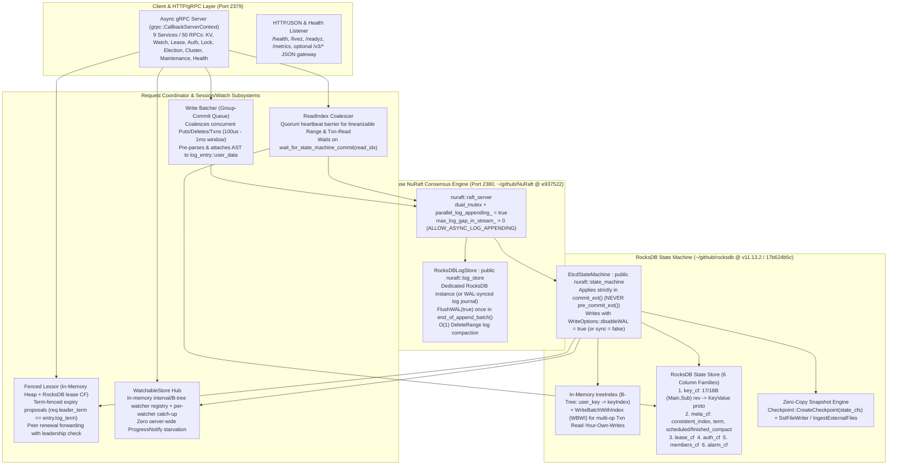

# Feasibility, Architecture, and Cost Analysis of Rewriting etcd on C++ NuRaft and RocksDB

- **Versions analyzed:**
  - `etcd`: `v3.7.3` (`0a173d0410a9`, released 2026-10-22)
  - `jetcd` (Java client): `jetcd-0.8.7` (`23b61f1499a5`, released 2026-08-27)
  - `ClickHouse/NuRaft` (ClickHouse's C++17 fork of `eBay/NuRaft` in `~/github/NuRaft`): `master` @ `e937522` (`v1.1.2-612-ge937522`, 2026-11-06; includes upstream `eBay/NuRaft` through `e38d422` plus 46 files / +4,328 lines of ClickHouse enhancements)
  - `meta/rocksdb` (in `~/github/rocksdb`): `v11.13.2` (`17b624b5c`, released 2026-10-28)
  - `jepsen-io/etcd` (in `~/github/jepsen-etcd`): `master` @ `b47cc40` (`0.2.5-SNAPSHOT`, 2026-04-17; uses `io.etcd/jetcd-core 0.8.5`)
- **Upstream references:**
  - **Prior analyses in this repository:** [`leases-agy.md`](leases-agy.md), [`watchers-agy.md`](watchers-agy.md), [`chubby-perspectives-agy.md`](chubby-perspectives-agy.md), [`storage-agy.md`](storage-agy.md), [`wal-replacement-agy.md`](wal-replacement-agy.md), [`etcd-issues-and-mitigations-agy.md`](etcd-issues-and-mitigations-agy.md)
  - **Jepsen reports:** Kyle Kingsbury, [*etcd 3.4.3*](https://jepsen.io/analyses/etcd-3.4.3) (2020-01-30) and [*jetcd 0.8.2*](https://jepsen.io/analyses/jetcd-0.8.2) (2024-08-08); [etcd#18424](https://github.com/etcd-io/etcd/issues/18424); [jetcd#1444](https://github.com/etcd-io/jetcd/issues/1444) (fixed in `05f92e0`)
  - **ClickHouse/NuRaft PRs in `e937522`:** [ClickHouse/NuRaft#46](https://github.com/ClickHouse/NuRaft/pull/46) (`leader_status_request`), [#98](https://github.com/ClickHouse/NuRaft/pull/98) & [#115](https://github.com/ClickHouse/NuRaft/pull/115) (`client_req_stream`), [#107](https://github.com/ClickHouse/NuRaft/pull/107) & [#116](https://github.com/ClickHouse/NuRaft/pull/116) (`ALLOW_ASYNC_LOG_APPENDING`), [#114](https://github.com/ClickHouse/NuRaft/pull/114) & [#126](https://github.com/ClickHouse/NuRaft/pull/126) (slow member backpressure & `max_uncommitted_log_entries_`), [#120](https://github.com/ClickHouse/NuRaft/pull/120) & [#127](https://github.com/ClickHouse/NuRaft/pull/127) (`log_entry::user_data`, `is_conf`), [#137](https://github.com/ClickHouse/NuRaft/pull/137) (`RejectedCommittedLogRollback`)
  - **etcd issues & PRs:** [#9888](https://github.com/etcd-io/etcd/issues/9888), [#10321](https://github.com/etcd-io/etcd/issues/10321), [#14758](https://github.com/etcd-io/etcd/issues/14758), [#16291](https://github.com/etcd-io/etcd/issues/16291), [PR #17119](https://github.com/etcd-io/etcd/pull/17119), [#17611](https://github.com/etcd-io/etcd/issues/17611), [#18879](https://github.com/etcd-io/etcd/issues/18879), [#19091](https://github.com/etcd-io/etcd/issues/19091), [#19597](https://github.com/etcd-io/etcd/issues/19597), [#20242](https://github.com/etcd-io/etcd/issues/20242), [#22081](https://github.com/etcd-io/etcd/issues/22081), [#22082](https://github.com/etcd-io/etcd/issues/22082), [#22094](https://github.com/etcd-io/etcd/issues/22094), [#22264](https://github.com/etcd-io/etcd/issues/22264), [#22294](https://github.com/etcd-io/etcd/issues/22294), [#22332](https://github.com/etcd-io/etcd/issues/22332), [#22649](https://github.com/etcd-io/etcd/issues/22649), [#22673](https://github.com/etcd-io/etcd/issues/22673)
  - **Design reference:** Burrows, *The Chubby lock service for loosely-coupled distributed systems*, OSDI 2006 (`doc/chubby-osdi06.md`)

---

## Scope

This document analyzes the technical feasibility, architectural design, language choice (**C++20 vs. Rust**), client compatibility strategy (**gRPC wire compatibility vs. language-API compatibility**), test-suite reuse (`etcd`, `jetcd`, and `jepsen-etcd`), and engineering cost (assuming heavy use of coding agents) of building a clean-room etcd replacement on top of ClickHouse's **`NuRaft`** (`e937522`) and Meta's **`RocksDB`** (`v11.13.2` / `17b624b5c`).

---

## Summary

1. **Overall Feasibility Verdict — Feasible and Architecturally Advantageous, Provided Five `NuRaft` Semantic Traps Are Addressed Up Front (**High confidence** on verified code mechanisms; **Moderate confidence** on unbuilt system integration):**
   Rewriting etcd's server core (~48,173 non-test Go LoC in `server/`, of which ~18,500 LoC is essential v3 server functionality once legacy v2, `grpcproxy`, and `bbolt`/`wal` plumbing are excluded) on `NuRaft` (`26,714` LoC) and `RocksDB` (`v11.13.2`) is technically feasible. Doing so eliminates etcd `v3.7.3`'s `bbolt` Copy-on-Write (CoW) compaction stalls, synchronous `UnsafeDelete` commits (`batch_tx.go:335`), stop-the-world `Defrag()`, and 64 MB WAL segment rotation stalls (`w.cut()`), while allowing the server to fix etcd's server-side lease, watcher, and lock bugs at the root. However, `NuRaft` (`e937522`) is **not** a drop-in match for `go.etcd.io/raft/v3` and contains five critical architectural traps that must be designed around (§1.2):
   - **No built-in `ReadIndex`:** `raft_server::is_leader()` (`include/libnuraft/raft_server.hxx:659-663 @ e937522`) and ClickHouse's `leader_status_request` (`src/handle_client_request.cxx:38-74 @ e937522`) check only local memory (where `leadership_expiry_` defaults to `20 * heart_beat_interval_ = 2,500 ms` while follower election timeout is `200–400 ms`, `src/raft_server.cxx:52, 661-670 @ e937522`). Serving linearizable `Range` reads from `is_leader()` will immediately violate linearizability under network partitions. A custom **`ReadIndex` quorum-heartbeat coalescer** (~150–250 LoC) is mandatory.
   - **`pre_commit` runs *before* replication and rolls back:** `NuRaft` invokes `state_machine::pre_commit_ext` inside `handle_cli_req` (`src/handle_client_request.cxx:212-213 @ e937522`) and `handle_append_entries` (`src/handle_append_entries.cxx:1194, 1229 @ e937522`) *before* quorum commit, reverting overwritten entries via `rollback_ext` (`:1161-1166`). Because etcd revisions and watch events are externally visible and irreversible, all MVCC, lease, and watch state transitions **must** execute in `state_machine::commit_ext` (`src/handle_commit.cxx:397-398 @ e937522`), using `pre_commit_ext` + ClickHouse's `log_entry::user_data` (`include/libnuraft/log_entry.hxx:138 @ e937522`) solely for immutable request pre-parsing.
   - **No automatic cross-thread group commit on `append_entries`:** Each call to `raft_server::append_entries` acquires `cli_lock_` (`src/handle_client_request.cxx:77 @ e937522`) and calls `log_store_->end_of_append_batch()` before releasing it. High write throughput requires an **application-level write batcher** in front of `append_entries(std::vector<ptr<buffer>>)` combined with `parallel_log_appending_ = true` and `max_log_gap_in_stream_ > 0` (`ALLOW_ASYNC_LOG_APPENDING`, `src/handle_append_entries.cxx:609-612, 1036-1038 @ e937522`).
   - **Coarse `raft_server::lock_` contention:** Followers hold `raft_server::lock_` across log appends unless **both** `parallel_log_appending_` and streaming (`ALLOW_ASYNC_LOG_APPENDING`) are enabled, and the leader holds `lock_` while reading `log_store_->log_entries_ext` for lagging peers (`src/handle_append_entries.cxx:536, 667-668 @ e937522`).
   - **Follower forwarding reordering:** Upstream `auto_forwarding_` (`src/handle_user_cmd.cxx:87-230 @ e937522`) pools sockets and can reorder requests on error; the replacement must use ClickHouse's `client_req_stream` (`src/client_req_stream.cxx:24-55 @ e937522`, `req_msg::CLOSE_ON_ERROR`) or forward at the gRPC layer.

2. **Language Choice — C++20 Is Strictly Superior to Rust When `NuRaft` and `RocksDB` Are Fixed as the Core Libraries (**High confidence**):**
   Both `NuRaft` (`e937522`) and `RocksDB` (`v11.13.2`) are C++ libraries, and **`NuRaft` has zero C API (`include/libnuraft/nuraft.hxx:1-53 @ e937522`)**. Integrating `NuRaft` requires subclassing three C++ abstract classes (`state_machine`, `log_store`, `state_mgr`) with 23 pure virtual methods passing `std::shared_ptr<nuraft::buffer>` (non-copyable), nested `std::shared_ptr<std::vector<std::shared_ptr<log_entry>>>` (`log_store.hxx:99`), `std::function` callbacks (`async.hxx:71`), and `std::unordered_map` (`state_machine.hxx:361`)—none of which the Rust `cxx` crate supports natively. A Rust implementation would require writing and maintaining ~1,200–1,800 lines of unsafe `extern "C"` C++ virtual-subclass trampolines, copying log payloads across the FFI boundary on the hot path, running two competing async thread pools (`tokio` for `tonic` gRPC + `Asio` inside `NuRaft`), and catching panics at every callback to prevent C++ `std::terminate` UB. Furthermore, the Rust `rocksdb` crate binds `include/rocksdb/c.h`, which **`malloc`s and copies value buffers on every `rocksdb_get_cf` / `rocksdb_writebatch_wi_get_from_batch_and_db_cf`** (`c.h:22-23, 807, 1561 @ 17b624b5c`) and **omits critical C++-only RocksDB 11.13.2 APIs**: `CompactionFilter::FilterV2` with `Decision::kRemoveAndSkipUntil` (`compaction_filter.h:191, 311 @ 17b624b5c`), `PinnableSlice` on `WriteBatchWithIndex`, Column-Family-subset `Checkpoint::CreateCheckpoint` (`checkpoint.h:184 @ 17b624b5c`), and multi-CF atomic `DB::IngestExternalFiles` with `atomic_replace_range` (`db.h:2641`, `options.h:3214 @ 17b624b5c`). Rust would only be preferable if replacing `NuRaft` with a pure-Rust Raft engine (`raft-rs`/`openraft`); with `NuRaft` + `RocksDB` mandated, **C++20 is the lower-risk, higher-performance, and coding-agent-friendlier choice**.

3. **Compatibility Strategy — Choose Approach A (gRPC Wire Compatibility) with Optional Backward-Compatible Extensions ("A-Plus"), NOT Pure Approach B (**High confidence**):**
   - **Approach A (Client gRPC Wire Compatibility):** Preserves `rpc.proto`, `v3lock.proto`, and `v3election.proto` (9 services, 50 RPCs), the 56 exact error description strings in `api/v3rpc/rpctypes/error.go:24-165 @ v3.7.3`, metadata headers (`hasleader`, `client-api-version`, `token`), and `/health`/`/livez`/`/readyz`/`/metrics`, while replacing etcd's peer protocol with `NuRaft`'s Asio protocol. This allows unmodified `kube-apiserver`, Go `client/v3`, Java `jetcd`, `etcdctl`, `tools/benchmark`, `tests/robustness`, `tests/e2e`, and `jepsen-etcd` to work immediately.
   - **Approach B (Language-API Compatibility Only via Custom Client Libraries):** While dropping gRPC wire compatibility allows redesigning the wire protocol (e.g., into a Chubby-style session-anchored protocol), it forces the project to **rewrite, test, and maintain replacement client SDKs in Go (`client/v3` = 11,279 non-test LoC), Java (`jetcd` = ~12,500 LoC), Python, Rust, and C#**, requires every downstream user (including Kubernetes) to recompile with replacement libraries, and breaks existing black-box test harnesses (`etcdctl`, `e2e`).
   - **The "A-Plus" Synthesis:** Implement full Approach A wire compatibility on the server so all unmodified clients and test suites work on Day 1, and add optional protobuf/metadata extensions (e.g., client `request_id` idempotency tokens, fenced `Unlock`, and leader-revision freshness stamps in `LeaseKeepAliveResponse`) that thin wrapper or patched clients can opt into without breaking wire compatibility.

4. **Test Suite Leverage & Jepsen Insights — 85%+ of Existing Functional, Linearizability, and Chaos Suites Can Be Reused Directly Under Approach A (**High confidence**):**
   - **Immediately reusable with zero or minimal adapters under Approach A:** `jetcd`'s 133 JUnit tests (via `ETCD_IMAGE=<image>`, `Etcd.java:40 @ jetcd-0.8.7`), `etcd/tools/benchmark` (10 gRPC subcommands), `jepsen-etcd` (`b47cc40`, all 7 workloads + nemeses by packaging the binary in a tarball and ignoring `--enable-v2`), `etcd/tests/common` (96 end-to-end tests) + ~170 of 221 `etcd/tests/e2e` tests (by supporting standard CLI flags and printing `"ready to serve client requests"`), and `etcd/tests/robustness` + `tests/antithesis` (by adding a ~150-line adapter in `tests/robustness/report/wal.go:56-97 @ v3.7.3` to read committed requests from the replacement's log instead of Go `.wal` files). Only `etcd/tests/integration` (486 tests coupled to in-process Go `*etcdserver.EtcdServer` structs) cannot run directly against an external binary, though coding agents can transpire its test scenarios into gRPC integration tests.
   - **Lessons from Jepsen (`etcd 3.4.3` and `jetcd 0.8.2`) & New `jetcd 0.8.7` Audit Findings:** Jepsen's `etcd 3.4.3` analysis proved that `waitDeletes` in lock acquisition must re-verify key existence after waiting and that TTL locks without fencing tokens (`CreateRevision` / `ModRevision`) cannot protect external state under process pauses. Jepsen's `jetcd 0.8.2` analysis proved that client auto-retry of non-idempotent `Txn`/`Put` calls on `Status.UNAVAILABLE` causes **aborted reads, lost updates, and circular information flow** in Elle. While `jetcd 0.8.7` (`05f92e0`) disabled default `UNAVAILABLE` retries on `Put`, `Delete`, and `Txn` (`KVImpl.java:69, 101, 134 @ jetcd-0.8.7`), our code audit of `jetcd-0.8.7` reveals that **`LeaseImpl.grant()` (`:88`), `LeaseImpl.revoke()` (`:110`), `LockImpl.lock()` (`:72`), and `LockImpl.unlock()` (`:86`) STILL unconditionally retry on `Status.UNAVAILABLE` (`Errors::isRetryableForSafeRedoOp`)**—meaning a retried `revoke()` returns a false `NOT_FOUND` error to the caller, and a retried unfenced `unlock()` can delete a newly re-acquired lock on the same lease!

5. **Cost & Schedule Estimate with Heavy Coding-Agent Use (**Moderate confidence** on LoC; **Low–Moderate confidence** on calendar duration):**
   - **C++20 + Approach A (Recommended):** **~22,500–29,500 non-test C++20 LoC** + **~15,000–20,000 test/harness LoC**. With 2–3 senior distributed-systems/C++ engineers heavily leveraging coding agents (which accelerate protobuf/gRPC plumbing, CLI/config parsing, auth RBAC, RocksDB boilerplate, and test generation by $3\times\text{–}5\times$, while human effort focuses on concurrency, `NuRaft` edge cases, and Jepsen/Robustness failure triage):
     - **MVP (KV, Txn, Watch, Lease, Cluster/Maintenance, passing `jetcd` + `e2e/common`):** ~2.5–4 months (**6–9 engineer-months**).
     - **Production-Ready Release (Full 50 RPCs, Auth, Lock/Election, `ReadIndex` batching, zero-copy SST snapshots, passing `tests/robustness` + `jepsen-etcd` + `LazyFS` power-loss tests):** ~6–9 months (**14–22 engineer-months**).
   - **Rust + Approach A (via C++ FFI shims):** Adds ~1,500–2,500 LoC of unsafe C++/Rust FFI glue and custom `c.h` extensions, increasing total effort by **~25%–35% (18–28 engineer-months)** due to cross-language memory/lifetime debugging and dual-runtime coordination.
   - **Approach B (Custom Protocol + Rewritten Go & Java Client SDKs):** Adds **~20,000–26,000 non-test LoC** across Go and Java client libraries plus client test suites, nearly doubling total effort to **26–40 engineer-months**.

---

## 1. Architectural Fit: Mapping etcd onto ClickHouse NuRaft (`e937522`) and Meta RocksDB (`v11.13.2`)

### 1.1 High-Level System Architecture

In etcd `v3.7.3`, write throughput and tail latency are bottlenecked by two structural layers analyzed in [`storage-agy.md`](storage-agy.md) and [`wal-replacement-agy.md`](wal-replacement-agy.md):
1. **The Consensus & WAL Layer (`server/etcdserver/raft.go:185-336`, `server/storage/wal/wal.go @ v3.7.3`):** A non-pipelined `raftNode` loop that blocks on an unbuffered `applyc` channel before sending `MsgApp` messages or starting WAL disk writes, suffers 3–4 synchronous `fsync`s on every 64 MB segment cut (`w.cut()`), pays an `ext4`/`XFS` unwritten-extent journal commit tax on every `fdatasync` into `fallocate`d blocks, and stalls `applyAll` every 10,000 entries for a 3-`fdatasync` checkpoint.
2. **The `bbolt` Storage Backend (`server/storage/backend/batch_tx.go:261-386 @ v3.7.3`):** A single-writer Copy-on-Write B+tree that forces an immediate synchronous `bbolt.Tx.Commit()` (`2x fdatasync`) on **every single `LeaseRevoke`** and **every MVCC compaction batch** because `txBuffer` lacks delete tombstones (`batch_tx.go:335`), stalls reads and writes during periodic 100ms commits, amplifies random write I/O by $10\times\text{–}50\times$ during MVCC compaction on multi-GiB datasets, and requires stop-the-world `Defrag()`.

A clean-room C++20 replacement built on `ClickHouse/NuRaft` (`e937522`) and `Meta/RocksDB` (`v11.13.2` / `17b624b5c`) replaces both layers with the following architecture:

---

### 1.2 Five Critical `NuRaft` (`e937522`) Architectural Traps & How the Replacement Must Handle Them

Directly wiring `NuRaft` (`~/github/NuRaft @ e937522`) behind an etcd gRPC facade without accounting for `NuRaft`'s internal semantics will produce a broken or slow server. Static analysis of `include/libnuraft/` and `src/` reveals five specific traps (**High confidence — verified in `e937522` source code**):

| # | `NuRaft` (`e937522`) Trap | Exact Code Mechanism (`@ e937522`) | Consequence If Unmitigated | Required Architectural Solution in Replacement |
|---|---|---|---|---|
| **T1** | **No Built-In Raft `ReadIndex` for Linearizable Reads** | `raft_server::is_leader()` (`include/libnuraft/raft_server.hxx:659-663`) and ClickHouse's `handle_leader_status_req` (`src/handle_client_request.cxx:38-74`) only check local `role_ == srv_role::leader && !write_paused_`. Local step-down (`check_leadership_validity`, `src/raft_server.cxx:1342-1404`) waits for `leadership_expiry_ = 20 * heart_beat_interval_` (`2,500 ms` default, `src/raft_server.cxx:52, 661-670`), whereas follower election timeout is `200–400 ms` (`raft_params.hxx:43-45`). | A partitioned old leader continues believing `is_leader() == true` for ~2.1 seconds after a new leader is elected and commits writes, serving **stale linearizable `Range` reads** (failing Jepsen `register`, `wr`, and `append`). | Implement a **`ReadIndex` Quorum Coalescer** (~200 LoC): 1. Verify `get_state_machine_commit_idx() >= get_log_idx_at_becoming_leader()` (`raft_server.hxx:597-599`, `raft_server.cxx:1291-1305`). 2. Latch `read_idx = get_committed_log_idx()`. 3. Broadcast a sequence-tagged heartbeat round via `request_append_entries_for_all()` (`handle_client_request.cxx:104-121`) and wait until a majority quorum (`get_quorum_for_commit()`, `raft_server.cxx:1666`) of peers ACK an RPC sent at or after that sequence number in the same term. 4. Await `wait_for_state_machine_commit(read_idx)` (`handle_client_request.cxx:471-503`) before reading `RocksDB`. |
| **T2** | **`pre_commit_ext` Executes Before Quorum Replication and Rolls Back** | On the leader (`src/handle_client_request.cxx:191-213`) and follower (`src/handle_append_entries.cxx:1188-1232`), `NuRaft` calls `state_machine_->pre_commit_ext(...)` **immediately upon appending to `log_store_`**, before quorum replication. If uncommitted entries conflict on a follower, `NuRaft` iterates backward calling `state_machine_->rollback_ext(...)` (`handle_append_entries.cxx:1156-1174`). | Mutating MVCC state, assigning revisions, or firing `Watch` events in `pre_commit_ext` exposes uncommitted state to readers/watchers and requires inverting arbitrary multi-op `Txn`s and `DeleteRange`s on rollback. | Leave `pre_commit_ext` and `rollback_ext` as **state-machine no-ops** (using `pre_commit_ext` or `cb_func::PreAppendLogLeader` at `callback.hxx:141` only to cache the parsed C++ request struct on `log_entry::user_data` at `log_entry.hxx:138`). Execute **all** MVCC `Txn`/`Put`/`DeleteRange`, revision assignment, `Lease`, and `Watch` mutations inside `state_machine::commit_ext` (`handle_commit.cxx:397-398`), whose returned `ptr<buffer>` is what `NuRaft` delivers to `cmd_result`. |
| **T3** | **No Automatic Cross-Thread Write Batching on `append_entries`** | `raft_server::append_entries(const std::vector<ptr<buffer>>&)` (`src/handle_user_cmd.cxx:48-85`) acquires `cli_lock_` (`src/handle_client_request.cxx:77`), appends only the entries in that single call, and executes `log_store_->end_of_append_batch()` (`:224`) while holding `cli_lock_`. | If $N$ gRPC worker threads call `append_entries({one_req})` concurrently, they serialize on `cli_lock_` and trigger $N$ separate `end_of_append_batch()` (`fdatasync`) calls and $N$ replication waves. | Place an **Application Write Batcher** (`WriteBatchQueue`) in front of `raft_server::append_entries`: collect incoming client write proposals over a `100 µs–1 ms` window (or up to e.g. `256` requests whenever a previous batch is in flight) and submit them as a single `std::vector<ptr<buffer>>` to one `append_entries` call, amortizing **one `FlushWAL(true)`** across the entire batch. |
| **T4** | **Follower & Leader `raft_server::lock_` Contention** | `raft_server::lock_` (`std::recursive_mutex`, `raft_server.hxx:1428`) is held across all incoming RPCs (`process_req`, `raft_server.cxx:823, 864`), peer responses (`handle_peer_resp`, `:936`), and timers. By default (`parallel_log_appending_ == false`), followers hold `lock_` across synchronous disk `fdatasync` in `handle_append_entries` (`handle_append_entries.cxx:1243`). Even with `parallel_log_appending_ == true`, followers still wait on `ea_follower_log_append_->wait_ms(...)` under `lock_` (`:1274-1290`) **unless** streaming is also enabled (`max_log_gap_in_stream_ > 0`), which sets `req_msg::ALLOW_ASYNC_LOG_APPENDING` (`:609-612, 1036-1038, 1250-1273`). | Without **both** flags enabled, follower disk `fdatasync` holds `raft_server::lock_`, blocking heartbeats and vote handling. On the leader, slow disk reads in `create_append_entries_req` (`handle_append_entries.cxx:536, 667-668`) also hold `lock_`. | 1. Configure `raft_params` with `locking_method_type_ = dual_mutex`, `return_method_ = async_handler`, `parallel_log_appending_ = true`, `max_log_gap_in_stream_ = 1000`, `max_bytes_in_flight_in_stream_ = 32 * 1024 * 1024`, and `use_bg_thread_for_snapshot_io_ = true`. 2. Maintain an in-memory ring buffer of recent Raft log entries (e.g., last 64 MiB / 10,000 entries) inside `RocksDBLogStore` so `log_entries_ext` on the leader never hits disk under `lock_` for normal followers. |
| **T5** | **`auto_forwarding_` Can Reorder Follower-Forwarded Writes** | Upstream `NuRaft`'s `auto_forwarding_` (`raft_params.hxx:91, 572`) forwards client requests from a follower to the leader over a connection pool (`rpc_clients_`, `src/handle_user_cmd.cxx:87-230`), which can reorder pipelined requests on transient errors or leader backpressure. | Out-of-order execution of sequential writes from the same client connected to a follower. | Disable `auto_forwarding_ = false` and either (a) use ClickHouse's ordered `client_req_stream` (`include/libnuraft/client_req_stream.hxx:1-117`, `src/client_req_stream.cxx:24-55`), which pins a single connection with `req_msg::CLOSE_ON_ERROR`, or (b) forward write/read/lease RPCs at the gRPC layer over a persistent leader channel stamped with the expected Raft term. |

> [!IMPORTANT]
> **ClickHouse Fork Advantage (`#137`, `973408f`):** Using `ClickHouse/NuRaft` (`e937522`) rather than upstream `eBay/NuRaft` is critical. Upstream `eBay/NuRaft` allowed a follower receiving a conflicting `append_entries` RPC (e.g., under asymmetric network partitions or disk corruption bugs) to roll back log entries at indices `<= sm_commit_index_`. ClickHouse PR [#137](https://github.com/ClickHouse/NuRaft/pull/137) (`src/handle_append_entries.cxx:1078-1126 @ e937522`) explicitly blocks rolling back any entry at `log_idx <= sm_commit_index_ || log_idx <= quick_commit_index_`, fires `cb_func::RejectedCommittedLogRollback`, and prevents resetting the follower's election timer.

---

### 1.3 Co-Designed `RocksDB` (`v11.13.2` / `17b624b5c`) Persistence Architecture

Drawing directly on the two-store vs. single-store findings from [`storage-agy.md`](storage-agy.md) and [`wal-replacement-agy.md`](wal-replacement-agy.md), the replacement should **never** sync both the Raft log and the MVCC state store on the hot write path (which would cause double-WAL `fdatasync` amplification), nor should it allow state-machine LSM compactions to stall Raft log appends.

#### A. Two-Engine Co-Design: `RocksDBLogStore` + `EtcdStateMachine` (`RocksDB`)
1. **`RocksDBLogStore` (Consensus Log Store — 1 `fdatasync` per Batch):**
   - Backed either by a dedicated `RocksDB` instance (`raft_db`) with `DBOptions::manual_wal_flush = true` (`include/rocksdb/options.h:1587 @ 17b624b5c`), `DBOptions::recycle_log_file_num = 8` (`:1002`, eliminating `ext4`/`XFS` unwritten-extent journal commits on WAL rotation), and `WriteOptions::memtable_insert_hint_per_batch = true` (`:2741`), **or** by a standalone recycled-segment WAL file using RocksDB's `log::Writer` / `log::Reader`.
   - `log_store::append(ptr<log_entry>& entry)` (`include/libnuraft/log_store.hxx:67 @ e937522`) writes the 8-byte big-endian `index` key to an in-memory `WriteBatch` (and inserts `entry` into an in-memory ring-buffer cache so leader replication never blocks on disk reads).
   - `log_store::end_of_append_batch(ulong start, ulong cnt)` (`include/libnuraft/log_store.hxx:87 @ e937522`) submits the `WriteBatch` to a background I/O worker (when `parallel_log_appending_ = true`) that calls `raft_db->Write(WriteOptions{sync=false}, &batch)` followed by `raft_db->FlushWAL(true)` (`include/rocksdb/db.h:2333 @ 17b624b5c`), updates `last_durable_index_`, and invokes `raft_server::notify_log_append_completion(true)` (`src/handle_append_entries.cxx:2100 @ e937522`).
   - `log_store::compact(ulong last_log_index)` (`include/libnuraft/log_store.hxx:189 @ e937522`) calls `raft_db->DeleteRange(WriteOptions{}, default_cf, EncodeU64(0), EncodeU64(last_log_index + 1))` (`include/rocksdb/db.h:676-691 @ 17b624b5c`), truncating compacted Raft log entries in **$O(1)$ time**.
   - `log_store::is_conf(ulong index)` (`include/libnuraft/log_store.hxx:150 @ e937522`, added by ClickHouse) is served in **$O(1)$ without disk I/O** by maintaining a tiny `std::set<uint64_t> conf_indices_` in memory (populated on append and startup scan).

2. **`EtcdStateMachine` (MVCC + Lease + Auth State Store — Zero `fdatasync` on Apply):**
   - Backed by a separate `RocksDB` instance (`state_db`) organized into **6 Column Families** (`ColumnFamilyDescriptor`, `include/rocksdb/db.h:70-78 @ 17b624b5c`), eliminating the bucket-prefix collision bug (`"auth"` vs `"authUsers"`, `"members"` vs `"members_removed"`) identified in [`storage-agy.md` Summary #5](storage-agy.md):
     - `key_cf`: Maps 17-byte big-endian `(Main, Sub)` revision keys (or 18-byte `(Main, Sub, 't')` tombstones, matching `server/storage/mvcc/revision.go:34-98 @ v3.7.3`) $\to$ serialized `mvccpb.KeyValue` protobuf. Configured with `WriteOptions::memtable_insert_hint_per_batch = true` (`options.h:2741 @ 17b624b5c`) because revision keys increase strictly monotonically!
     - `meta_cf`: Stores `consistent_index` (`last_commit_index()`), `term`, `scheduled_compact`, and `finished_compact`.
     - `lease_cf`: Stores persisted `Lease` records (`lease_id -> TTL, remaining_ttl`).
     - `auth_cf`: Stores RBAC enabled state, `auth_revision`, users, and roles.
     - `members_cf`: Stores cluster member metadata (`id, name, peer_urls, client_urls, is_learner`).
     - `alarm_cf`: Stores active cluster alarms (`NOSPACE`, `CORRUPT`).
   - **Zero-Sync Apply Path:** Inside `state_machine::commit_ext(const ext_op_params& params)` (`include/libnuraft/state_machine.hxx:82-83 @ e937522`), the state machine updates the in-memory `treeIndex` (`user_key -> keyIndex`, degree-32 B-tree) and commits the `WriteBatch` (containing the new `key_cf` revision entries, any `lease_cf`/`auth_cf` updates, and `meta_cf/consistent_index = params.log_idx`) to `state_db` with **`WriteOptions{sync = false, disableWAL = false}`** (or `disableWAL = true` with `DBOptions::atomic_flush = true` at `options.h:1617 @ 17b624b5c`).
   - **Crash Recovery Invariant:** Before `RocksDBLogStore::compact(compact_idx)` is allowed to delete Raft log entries $\le \text{compact\_idx}$ (during `create_snapshot` at `src/handle_commit.cxx:866-930 @ e937522`), `EtcdStateMachine` calls `state_db->FlushWAL(true)` (`db.h:2333 @ 17b624b5c`, if `disableWAL = false`) or `state_db->Flush(FlushOptions{wait=true}, all_cfs)` (if `disableWAL = true`). On restart, `EtcdStateMachine::last_commit_index()` (`state_machine.hxx:303 @ e937522`) reads `meta_cf/consistent_index`, and `NuRaft` automatically replays any committed Raft log entries $> \text{last\_commit\_index}()$ (`src/raft_server.cxx:249 @ e937522`).

#### B. Multi-Op `Txn` Read-Your-Own-Writes via `WriteBatchWithIndex`
In etcd v3, a `TxnRequest` can contain arbitrarily nested `Txn`s, `Put`s, `DeleteRange`s, and `Range` queries in its `Success` (`Then`) or `Failure` (`Else`) list, where a `Range` operation inside the transaction must observe uncommitted `Put` and `DeleteRange` mutations made earlier in the same `Txn` (`server/etcdserver/txn/txn.go:138-240 @ v3.7.3`).
- In `RocksDB v11.13.2`, `WriteBatchWithIndex` (`WBWI`, `include/rocksdb/utilities/write_batch_with_index.h:106-440 @ 17b624b5c`) with `overwrite_key = true` (`:121`) + staged `treeIndex` delta provides exact read-your-own-writes without touching `bbolt`'s broken `txBuffer` (`server/storage/backend/tx_buffer.go @ v3.7.3`):
  - **Because deletions in etcd `key_cf` are appended as 18-byte `(Main, Sub, 't')` MVCC tombstone puts (`WBWI::Put`), `EtcdStateMachine` never calls `WBWI::DeleteRange`** (which is unsupported in `WBWI`, `write_batch_with_index.h:183-199 @ 17b624b5c`) and **never triggers a synchronous backend `fdatasync` on `LeaseRevoke` or `Compact`!**
  - Point lookups within an executing `Txn` use `WBWI::GetFromBatchAndDB(state_db, read_opts, key_cf, rev_slice, &pinnable_slice)` (`write_batch_with_index.h:280-284 @ 17b624b5c`).
  - Once the `Txn` finishes, `state_db->Write(WriteOptions{sync=false}, wbwi.GetWriteBatch())` (`:208`) atomically publishes all mutations across all Column Families at a single RocksDB sequence number.

#### C. Why RocksDB User-Defined Timestamps (UDT) Should *Not* Be Used for etcd MVCC
RocksDB `v11.13.2` includes User-Defined Timestamps (`Comparator(size_t ts_sz)`, `include/rocksdb/comparator.h:53, 134-214 @ 17b624b5c`, `ReadOptions::timestamp` at `options.h:2305`). However, static analysis confirms **RocksDB UDT is a structural mismatch for etcd's MVCC model (High confidence)**:
1. **Broken `Watch` Catch-Up Ordering:** UDT orders keys primarily by `user_key` and secondarily by descending `timestamp` (`comparator.h:35-38 @ 17b624b5c`). When an etcd watcher reconnects at `start_revision = R`, the server must stream all events in `[R, current_rev]` **strictly ordered by `(Main, Sub)` revision across all watched keys**. A UDT-ordered CF would require scanning every key in the range and sorting all historical versions in memory.
2. **Missing `CreateRevision`, `Version`, and `Lease` Semantics:** etcd's `mvccpb.KeyValue` requires tracking `create_revision` (set on creation, reset after delete), `mod_revision`, `version` (incremented on each update), and `lease`—none of which RocksDB UDT computes automatically.
3. **Disabled RocksDB 11.13.2 Optimizations:** Enabling UDT disables `DB::NewMultiScan` (`include/rocksdb/db.h:1378-1379 @ 17b624b5c`), wide-column entities (`:912-915`), `WBWI::Merge` (`write_batch_with_index.h:163-167`), and `IngestExternalFileArg::atomic_replace_range` (`options.h:3207 @ 17b624b5c`).

By keeping etcd's proven dual layout—an in-memory `treeIndex` (`user_key -> keyIndex`) + `key_cf` indexed by 17/18-byte big-endian `(Main, Sub)` revision—and adding the **Revision-Order Permutation (`TrySeekUsingNext` / `MultiGet`)** optimization from [`wal-replacement-agy.md` Summary #4](wal-replacement-agy.md) (sorting the $N$ revision keys returned by `treeIndex.Revisions()` in ascending `(Main, Sub)` order and fetching them via `state_db->MultiGet` or a single forward iterator), the replacement gets:
- Sequential append-only writes in `key_cf` (`memtable_insert_hint_per_batch = true`),
- Sequential $O(\text{events})$ `Watch` catch-up scans over `key_cf`,
- Exact byte-for-byte compatibility with `Maintenance.HashKV`'s Castagnoli CRC-32C calculation (`server/storage/mvcc/hash.go:49-90 @ v3.7.3`), and
- Fast parallelized/batched `Range` reads using `DB::MultiGet` (`include/rocksdb/db.h:1113-1116 @ 17b624b5c`) with `ReadOptions::async_io = true` (`options.h:2383 @ 17b624b5c`) and `pin_data = true` (`:2496`).

#### D. Zero-Copy Raft Snapshots via `Checkpoint` and `IngestExternalFiles`
Instead of etcd `v3.7.3`'s 3-`fdatasync` snapshot stall on `applyAll` (`server/etcdserver/server.go:1215-1228, 2083-2137 @ v3.7.3`), the replacement combines `NuRaft`'s asynchronous `create_snapshot` + `use_bg_thread_for_snapshot_io_ = true` (`src/snapshot_sync_ctx.cxx:442-468 @ e937522`) with RocksDB `v11.13.2`:
- **Leader Snapshot Creation (`create_snapshot`):** Calls `Checkpoint::CreateCheckpoint(checkpoint_dir, state_cfs, /*log_size_for_flush=*/0, &seq_no)` (`include/rocksdb/utilities/checkpoint.h:184-187 @ 17b624b5c`), which hard-links immutable SST files in $O(1)$ without copying data.
- **Leader-to-Follower Transfer (`read_logical_snp_obj` / `save_logical_snp_obj`):** Transfers the SST files from `checkpoint_dir` as logical snapshot objects (`include/libnuraft/state_machine.hxx:213-271 @ e937522`) on `NuRaft`'s background `nuraft_snp_io` thread without holding `raft_server::lock_`.
- **Follower Installation (`apply_snapshot`):** Atomically installs all received SST files across all 6 Column Families in a single MANIFEST edit using `DB::IngestExternalFiles(args)` (`include/rocksdb/db.h:2641-2642 @ 17b624b5c`) with `IngestExternalFileOptions::move_files = true` (`options.h:3018`) and `allow_db_generated_files = true` (`:3144`), then rebuilds `treeIndex` via a fast sequential scan of `key_cf` with `ReadOptions::fill_cache = false` (`options.h:2367`).

---

### 1.4 How the Rewrite Resolves the Server-Side Bugs Identified in Prior Analyses

A major return on investment of a clean-room server rewrite is eliminating the server-side correctness and performance bugs cataloged in [`leases-agy.md`](leases-agy.md), [`watchers-agy.md`](watchers-agy.md), [`chubby-perspectives-agy.md`](chubby-perspectives-agy.md), [`storage-agy.md`](storage-agy.md), and [`wal-replacement-agy.md`](wal-replacement-agy.md) (**High confidence — all fixes below are 100% compatible with the unmodified v3 gRPC wire protocol**):

| Subsystem | etcd `v3.7.3` Bug / Bottleneck | Root Cause in Go `etcd v3.7.3` | Clean-Room Fix in `NuRaft` + `RocksDB` Server |
|---|---|---|---|
| **Leases** | **Premature Revocation Across Leader Stall/Step-Down (`R1`, `R2`, `#14758`)** | `lessor.runLoop` expires leases on wall-clock time while `CheckQuorum` uses Raft ticks (frozen during WAL stalls), and emits term-less `LeaseRevokeRequest` proposals that followers forward to the new leader. | Stamp internal expiry-driven `LeaseRevoke` Raft entries with `proposer_term = raft_server->get_term()`. In `commit_ext(params)`, where `NuRaft` passes `params.log_term` (`state_machine.hxx:49 @ e937522`), **reject any internal expiry revoke where `req.proposer_term != params.log_term`** ([`chubby-perspectives-agy.md` §6 `B5`](chubby-perspectives-agy.md)). Also check `ReadIndex` / peer ACK age on monotonic wall clock before expiring. |
| **Leases** | **Stale Renewal on Follower Forwarding (`R3`) & Revoke/Renew Race (`R4`)** | `leasehttp.RenewHTTP` calls `lessor.Renew` without `ensureLeadership()`, and `lessor.Revoke` drops `le.mu` before deleting keys. | Forward follower renewals to the leader stamped with the expected leader term; verify leadership before renewing; hold lease state transition (`REVOKING`) atomically so concurrent `Renew` returns `ErrLeaseNotFound`. |
| **Leases** | **`LeaseCheckpoint` Silent Error Drop (`#22649`)** | `SetCheckpointer` (`server.go:401-402`) discards the Raft error when clearing `remainingTTL = 0` on renewal, leaving a shorter server timer than returned to the client. | Only clear in-memory `remainingTTL` after the checkpoint-clear entry commits in `commit_ext`, or await the `cmd_result` before returning the extended TTL. |
| **Leases & Storage** | **Synchronous `bbolt` `fdatasync` on Every `LeaseRevoke` (`batch_tx.go:335`, PR `#17119`)** | `txBuffer` cannot represent delete tombstones in `lease` bucket, forcing `bbolt.Tx.Commit()` (`2x fdatasync`) on every `LeaseRevoke` (up to 1,000/sec). | `RocksDB` `WriteBatchWithIndex` and `lease_cf` natively represent deletion tombstones in memory; `LeaseRevoke` writes to `state_db` with `sync = false`, paying **zero backend `fdatasync`s**. |
| **Watchers** | **Server-Wide `ProgressNotify` Starvation (`#20242`) & Compacted Unsynced Leak (`#22294`)** | `progressIfSync()` (`watchable_store.go:515-539`) checks global `len(s.unsynced) == 0`, starving all clients if *any* watcher on the server is catching up; `chooseAll()` (`watcher_group.go:258`) deletes compacted watchers from temporary `ret` instead of `s.unsynced`. | Track `is_synced` **per watch stream / `watch_id`** rather than server-wide. When a catching-up watcher hits `start_rev < compact_rev`, remove it directly from the primary unsynced registry and emit `Canceled: true, CompactRevision: compact_rev`. |
| **Watchers** | **Unbounded `syncWatchers` Scan Under Exclusive Write Lock (`#22264`, `#16839`)** | `syncWatchers()` holds `watchableStore.mu.Lock()` (blocking Raft apply) while scanning `bbolt` across `[minRev, curRev+1)`. | Catch up unsynced watchers asynchronously on a reader thread pool using a lock-free `RocksDB::Snapshot` iterator over `key_cf` without holding any lock that blocks `commit_ext`! |
| **Watchers** | **Canceled Watch `pending[wid]` Leak (`#22673`), Silent `PrevKv == nil` (`#10681`), `startRev == 0` Race, and 4-Way Cancel Deadlock (`#18879`)** | `sendLoop` forgets `delete(pending, wid)`; ignores `ErrCompacted` when fetching `ModRevision - 1` for `WithPrevKV`; reads `Created.Header.Revision` outside lock; and uses unbuffered `respc` + 16-slot `ctrlStream`. | Atomically bind `startRev == 0` to `current_rev + 1` and populate `Created.Header.Revision = current_rev` under the same snapshot; cancel the watch with `CompactRevision` if `WithPrevKV` hits `< compact_rev`; purge `pending[wid]` on cancel; and use non-blocking per-stream output queues with gRPC callback reactor backpressure. |
| **Locks & Elections** | **`v3lock` / `v3election` Orphaned-Session Leak & `chanStream` Deadlock (`#18879`/`#20716`, `#19597`)** | `v3lock` and `v3election` wrap loopback `v3client.New(s)`, creating/orphaning a `Session` on every RPC and routing watches through in-process `chanStream`. | Implement `Lock` (`v3lockpb`) and `Election` (`v3electionpb`) **natively inside the server coordinator** subscribed directly to `WatchableStore` and `Lessor` (watching both predecessor keys and the waiter's own lease expiration `#19597`), with zero loopback gRPC streams! |
| **Storage & WAL** | **100ms Commit Lock Stalls, Compaction CoW Amplification, Stop-the-World `Defrag()`, and 64 MB `w.cut()` Stalls** | `bbolt` single-writer B+tree rebalance/spill/2x-fsync under `batchTx.Lock()` + `readTx.mu.Lock()`; `wal.cut()` 4-fsync rotation and `fallocate` unwritten-extent journal commits. | Eliminated by `RocksDBLogStore` (recycled WAL files, 1 async `FlushWAL(true)` per batch) + `RocksDB` `state_db` (`sync = false` apply, lock-free `Snapshot` reads, background SST compaction, and $O(1)$ `DeleteRange` / `CompactRange` physical compaction). |

---

## 2. Programming Language Evaluation: C++20 vs. Rust Interfacing with C++ NuRaft and RocksDB

The prompt specifies that the rewrite must use the C++ `NuRaft` library (`~/github/NuRaft @ e937522`) and the C++ `RocksDB` library (`~/github/rocksdb @ v11.13.2`), with **C++** and **Rust interfacing with these C++ libraries** as the candidate implementation languages.

While Rust provides compile-time borrow checking for pure-Rust code, static analysis of `~/github/NuRaft/include/libnuraft/` (`e937522`) and `~/github/rocksdb/include/rocksdb/` (`17b624b5c`) demonstrates that **interfacing Rust with both C++ `NuRaft` and C++ `RocksDB` imposes severe FFI impedance, runtime allocation overhead, missing storage APIs, and dual-executor complexity that a native C++20 implementation completely avoids (High confidence).**

### 2.1 Why `NuRaft` (`e937522`) Is Structurally Hostile to Rust FFI

Unlike `RocksDB` (which maintains an official `extern "C"` wrapper in `include/rocksdb/c.h`), **`NuRaft` (`e937522`) has zero C API (`include/libnuraft/nuraft.hxx:1-53 @ e937522`)**. It is an object-oriented C++17 framework built around virtual class inheritance, `std::shared_ptr` (`nuraft::ptr<T>`, `include/libnuraft/ptr.hxx:28-29 @ e937522`), `std::function` callbacks, and custom non-copyable buffer objects (`nuraft::buffer`, `include/libnuraft/buffer.hxx:32-34 @ e937522`).

1. **Mandatory C++ Virtual Subclassing Across 3 Abstract Base Classes (23 Pure Virtual Methods):**
   To instantiate `nuraft::raft_server`, application code must inherit from and implement:
   - **`nuraft::state_machine` (`include/libnuraft/state_machine.hxx:38-377 @ e937522`):** 4 pure virtual methods (`apply_snapshot`, `last_snapshot`, `last_commit_index`, `create_snapshot`) plus 10 virtual hooks (`commit_ext`, `pre_commit_ext`, `rollback_ext`, `save_logical_snp_obj`, `read_logical_snp_obj`, `free_user_snp_ctx`, `commit_config`, `rollback_config`, etc.).
   - **`nuraft::log_store` (`include/libnuraft/log_store.hxx:35-232 @ e937522`):** **12 pure virtual methods** (`next_slot`, `start_index`, `last_entry`, `append`, `write_at`, `log_entries`, `entry_at`, `is_conf`, `term_at`, `pack`, `apply_pack`, `compact`, `flush`) plus 5 virtual performance hooks (`end_of_append_batch`, `log_entries_ext`, `entry_at_ext`, `compact_async`, `last_durable_index`).
   - **`nuraft::state_mgr` (`include/libnuraft/state_mgr.hxx:33-97 @ e937522`):** **7 pure virtual methods** (`load_config`, `save_config`, `save_state`, `read_state`, `load_log_store`, `server_id`, `system_exit`).

2. **Why the Rust `cxx` Crate Cannot Bind `NuRaft` Directly:**
   - `cxx` does **not** allow a Rust struct to inherit from a C++ abstract class with pure virtual methods.
   - `NuRaft`'s virtual method signatures use C++ types that `cxx` expressly rejects:
     - **Nested `std::shared_ptr` containers:** `log_store::log_entries(ulong start, ulong end)` must return `nuraft::ptr<std::vector<nuraft::ptr<nuraft::log_entry>>>` (`std::shared_ptr<std::vector<std::shared_ptr<log_entry>>>`, `include/libnuraft/log_store.hxx:99 @ e937522`).
     - **`std::function` with template reference arguments:** `state_machine::create_snapshot` takes `async_result<bool>::handler_type& when_done` (`state_machine.hxx:312-313 @ e937522`), which aliases `std::function<void(bool&, ptr<std::exception>&)>` (`include/libnuraft/async.hxx:65, 315 @ e937522`), and `cmd_result::when_ready` takes `std::function<void(cmd_result<ptr<buffer>, ptr<std::exception>>&, ptr<std::exception>&)>` (`async.hxx:71, 157-164 @ e937522`).
     - **Out-references to `std::shared_ptr` and `void*`:** `state_machine::read_logical_snp_obj` takes `void*& user_snp_ctx` and `ptr<buffer>& data_out` (`state_machine.hxx:263-267 @ e937522`).
     - **`std::unordered_map` in structs:** `adjust_commit_index_params` contains `std::unordered_map<int, uint64_t> peer_index_map_` (`state_machine.hxx:361 @ e937522`).
     - **Type-erased `std::shared_ptr<void>`:** ClickHouse's `log_entry::user_data` (`include/libnuraft/log_entry.hxx:138 @ e937522`) is `ptr<void>`.

3. **What a Rust Implementation Must Build Instead (and Its Costs):**
   - A Rust project must write **~1,200–1,800 lines of custom C++17 trampoline code** (`RustStateMachine : public nuraft::state_machine`, `RustLogStore : public nuraft::log_store`, `RustStateMgr : public nuraft::state_mgr`) exposing a manual `extern "C"` vtable of function pointers and raw `void*` contexts.
   - **Per-Entry FFI Copy Penalty:** Every time `NuRaft` replicates or commits log entries (`log_store::log_entries_ext` at `log_store.hxx:118`, `entry_at_ext` at `:137`), the Rust side reads bytes from `rust-rocksdb`, passes them across `extern "C"` to the C++ trampoline, which calls `nuraft::buffer::alloc(size)` (`buffer.hxx:43 @ e937522`), `memcpy`s the payload, wraps it in `cs_new<log_entry>`, and pushes it into a heap-allocated `std::shared_ptr<std::vector<...>>`. In C++20, `RocksDBLogStore` reads a `rocksdb::PinnableSlice` and constructs `nuraft::buffer` in a single step with zero FFI marshaling.
   - **Cross-Language Unwind Undefined Behavior Hazard:** All 23+ virtual callbacks in `RustStateMachine`, `RustLogStore`, and `RustStateMgr` are invoked on `NuRaft`'s C++ `Asio` and `nuraft_commit` threads. If any Rust code inside a callback panics and unwinds across the C++ stack frame (`raft_server`), the program triggers **immediate C++ Undefined Behavior (`std::terminate`)**. Every single trampoline callback must be wrapped in `std::panic::catch_unwind` and translated into C++ error returns or `system_exit`.

---

### 2.2 What Rust's `rocksdb` Crate (`include/rocksdb/c.h`) Loses vs. Native C++ `RocksDB` (`v11.13.2`)

Rust's ecosystem bindings (`rust-rocksdb` / `librocksdb-sys`) wrap RocksDB's C API (`include/rocksdb/c.h`, `6,814` lines at `17b624b5c`) rather than the C++ headers (`include/rocksdb/*.h`). Inspecting `include/rocksdb/c.h @ 17b624b5c` against the C++ headers reveals five concrete regressions that directly hurt an etcd replacement:

| RocksDB `v11.13.2` Feature | Native C++ API (`include/rocksdb/*.h @ 17b624b5c`) | C API (`include/rocksdb/c.h @ 17b624b5c`) Used by Rust | Impact on etcd Replacement |
|---|---|---|---|
| **1. `WriteBatchWithIndex` (`WBWI`) Reads in `Txn`** | `WBWI::GetFromBatchAndDB(..., PinnableSlice* value)` (`write_batch_with_index.h:280-284`) and batched `WBWI::MultiGetFromBatchAndDB(...)` (`:319-323`) pin memory directly from the memtable/block cache with **zero heap allocation**. | `rocksdb_writebatch_wi_get_from_batch_and_db_cf` (`c.h:1561-1566`) has **no `PinnableSlice` and no `MultiGet` overload**. Every single read calls `malloc()` + `memcpy()` (`c.h:22-23`), requiring `rocksdb_free()`. | Slows down multi-op `Txn`s (`Then`/`Else` reads) and increases allocator contention. |
| **2. `CompactionFilter` Range Skipping (`kRemoveAndSkipUntil`)** | `CompactionFilter::FilterV2` / `FilterV3` (`compaction_filter.h:311-379`) returns `Decision::kRemoveAndSkipUntil` (`:191`), skipping entire contiguous ranges of obsolete MVCC revisions in one step. | `rocksdb_compactionfilter_create` (`c.h:1671-1676`) **only binds legacy `Filter()`** (boolean keep/remove). `FilterV2` and `kRemoveAndSkipUntil` are **completely absent** from `c.h`. | In Rust, a compaction filter must cross the C FFI boundary and allocate on *every single key* instead of skipping obsolete ranges. |
| **3. Column-Family-Subset `Checkpoint` & Multi-threaded `CheckpointEngine`** | `Checkpoint::CreateCheckpoint(dir, const std::vector<ColumnFamilyHandle*>&, ...)` (`utilities/checkpoint.h:184-187`) and `CheckpointEngine` (`:105-139`) snapshot only state-machine CFs in parallel. | `rocksdb_checkpoint_create` (`c.h:4258-4260`) **only binds the whole-DB overload**. Neither CF-subset checkpoints nor `CheckpointEngine` are in `c.h`. | Forces whole-DB checkpoints (preventing single-DB `raft_cf` exclusion) and single-threaded hard-linking. |
| **4. Multi-CF Atomic SST Ingestion & `atomic_replace_range`** | `DB::IngestExternalFiles(const std::vector<IngestExternalFileArg>&)` (`db.h:2641-2642`) with `atomic_replace_range = true` (`options.h:3214`) atomically installs snapshot SSTs across all 6 CFs in one MANIFEST edit. | `rocksdb_ingest_external_file_cf` (`c.h:4006-4010`) **only ingests into a single CF** and omits `atomic_replace_range` and `PrepareFileIngestion`. | A crash during follower snapshot installation across 6 CFs in `c.h` leaves Column Families partially ingested and inconsistent unless extra C++ wrapper code is written. |
| **5. Zero-Allocation `Status` & Async `MultiScan` / `GetAsync`** | `rocksdb::Status` (`status.h`) is a stack value (`Code`, `SubCode`) with zero allocation when `ok()`, and `Status::Incomplete()` (`WriteOptions::no_slowdown`) is a cheap enum check. Also provides `GetAsync`, `MultiGetAsync` (`db.h:1464-1564`), and `NewMultiScan` (`:1388-1391`). | Every non-OK status in `c.h` (`char** errptr`, `c.h:16-19`) calls `strdup`/`malloc` to format a string and loses `Status::SubCode`. `GetAsync`, `MultiGetAsync`, and `NewMultiScan` are absent from `c.h`. | Extra heap allocations on expected non-fatal statuses (`kIncomplete` / `kTryAgain`) and inability to use C++20 coroutine `MultiGetAsync` / `NewMultiScan`. |

---

### 2.3 Threading, Async Runtimes, and Coding-Agent Ergonomics: C++20 vs. Rust

| Evaluation Axis | C++20 Native (`grpc++` + `NuRaft` + `RocksDB`) | Rust (`tonic` + `tokio` + FFI Shims over C++ `NuRaft` & `RocksDB`) | Winner & Rationale |
|---|---|---|---|
| **FFI & Glue Complexity** | **0 lines of FFI.** Direct C++ inheritance (`class EtcdStateMachine : public nuraft::state_machine`) and direct `#include <rocksdb/db.h>`. | **~1,500–2,500 lines of unsafe C++/C/Rust FFI glue** (`extern "C"` vtables for `NuRaft`, plus custom `c.h` patches for RocksDB `IngestExternalFiles` / `Checkpoint`). | **C++20 (High confidence).** Eliminates the most fragile, bug-prone layer of the system. |
| **Runtime & Thread Pool Model** | **Unified C++ process:** `grpc::ServerCompletionQueue` / `CallbackServerContext` threads submit directly to `WriteBatchQueue` / `NuRaft` (`asio_service` + `nuraft_commit`) and `RocksDB` background pools. | **Dual competing async runtimes:** `tokio` work-stealing runtime (for `tonic` gRPC) + `NuRaft`'s C++ `asio_service` pool + `nuraft_commit`/`nuraft_append` threads + `RocksDB` threads. Every RPC crosses `tokio` $\leftrightarrow$ FFI $\leftrightarrow$ `Asio`. | **C++20 (High confidence).** Avoids cross-runtime context switching and blocking `tokio` workers on C++ mutexes (`raft_server::lock_`). |
| **Memory & Concurrency Safety** | Application logic written in modern C++20 (RAII, `std::shared_ptr`, `std::span`) verified continuously with **ASan, TSan, UBSan, and Valgrind**. | Pure-Rust logic is borrow-checked, **but >60% of the execution path (`NuRaft` + `RocksDB` + 2,000-line FFI shim) is C++ / `unsafe` Rust** where borrow checking does not reach and cross-FFI ASan/TSan instrumentation is harder to configure (`-Zsanitizer=address` with mixed C++/Rust stdlibs). | **Tie / Slight Edge to C++20 for Mixed Stack (Moderate confidence).** Rust's safety advantage is largely neutralized when both stateful engines underneath are C++ with 23 virtual callbacks. |
| **Coding-Agent Productivity** | Coding agents generate self-contained C++20 classes directly against the headers in `~/github/NuRaft/include` and `~/github/rocksdb/include` and debug with a single compiler/debugger (`clang++` + `lldb`/`gdb` + `asan`/`tsan`). | Coding agents frequently hallucinate `cxx` capabilities (attempting to subclass C++ virtual classes in `#[cxx::bridge]`) or introduce subtle pointer-lifetime / unwind bugs across `Box::into_raw` C callbacks (`rocksdb_readoptions_set_iterate_upper_bound`, `c.h:3345`). | **C++20 (High confidence).** Single-language compilation and sanitizer feedback loops are significantly faster and cleaner for coding agents. |

> **Condition Under Which Rust Would Be Preferable:**
> If the architectural constraint were relaxed so that `NuRaft` were replaced by a pure-Rust Raft library (such as `tikv/raft-rs` or `databendlabs/openraft`), eliminating the C++ `NuRaft` virtual-inheritance FFI barrier entirely, then Rust (`tonic` + `raft-rs` + `rust-rocksdb`) would be a strong contender (as demonstrated by the open-source `xline-kv/Xline` project). **Given the fixed requirement to use C++ `NuRaft` and C++ `RocksDB`, C++20 is the clear technical winner.**

---

## 3. Compatibility Architecture: gRPC Wire Compatibility (Approach A) vs. Language-API Compatibility (Approach B)

The prompt distinguishes two compatibility strategies:
- **Approach A (Client-Facing gRPC Wire Compatibility):** Preserve etcd's client-facing gRPC protobuf API (`rpc.proto`, `v3lock.proto`, `v3election.proto`) so unmodified clients (`client/v3`, `jetcd`, `kube-apiserver`, `etcdctl`) work against the replacement server without recompilation, while freely replacing the server-to-server peer protocol with `NuRaft`'s native protocol.
- **Approach B (Programming-Language API Compatibility Only):** Drop gRPC/protobuf wire compatibility, design a new client-server wire protocol, and provide replacement client libraries (e.g., a replacement Go `clientv3` package and a replacement Java `jetcd` JAR) that preserve language-level interfaces when applications re-link against them.

### 3.1 What Approach A (gRPC Wire Compatibility) Actually Requires

Our audit of `~/github/etcd @ v3.7.3` and `~/github/jetcd @ jetcd-0.8.7` shows that **wire compatibility with unmodified `client/v3` and `jetcd` requires four specific contracts** (while the entire server-to-server `/raft`, `/leases`, `/members` peer HTTP layer in `server/etcdserver/api/etcdhttp/peer.go:64-110 @ v3.7.3` is discarded and replaced by `NuRaft`'s Asio port `2380`):

1. **The 9 gRPC Services and 50 RPC Methods (`v3.7.3`):**
   - `api/etcdserverpb/rpc.proto` (6 services, 42 RPCs): `KV` (6 RPCs: `Range`, `RangeStream`, `Put`, `DeleteRange`, `Txn`, `Compact`), `Watch` (1 bidi stream: `Watch`), `Lease` (5 RPCs: `LeaseGrant`, `LeaseRevoke`, `LeaseKeepAlive` bidi stream, `LeaseTimeToLive`, `LeaseLeases`), `Cluster` (5 RPCs: `MemberAdd`, `MemberRemove`, `MemberUpdate`, `MemberList`, `MemberPromote`), `Maintenance` (8 RPCs: `Alarm`, `Status`, `Defragment`, `Hash`, `HashKV`, `Snapshot`, `MoveLeader`, `Downgrade`), and `Auth` (17 RPCs).
   - `server/etcdserver/api/v3lock/v3lockpb/v3lock.proto` (1 service, 2 RPCs): `Lock.Lock`, `Lock.Unlock` (used directly by `jetcd`'s `LockImpl.java:61-87 @ jetcd-0.8.7` and `jepsen-etcd`'s `lock.clj:571-579 @ b47cc40`!).
   - `server/etcdserver/api/v3election/v3electionpb/v3election.proto` (1 service, 5 RPCs): `Election.Campaign`, `Proclaim`, `Leader`, `Observe`, `Resign` (used directly by `jetcd`'s `ElectionImpl.java @ jetcd-0.8.7`).
   - `grpc.health.v1.Health` (1 service, 2 RPCs): `Check`, `Watch` (required by `tests/robustness/failpoint/failpoint.go:130-131 @ v3.7.3` and Kubernetes gRPC probes).

2. **The 56 Exact gRPC Error Description Strings (`api/v3rpc/rpctypes/error.go:24-165 @ v3.7.3`):**
   - **Critical Non-Obvious Requirement:** Neither Go `client/v3` nor Java `jetcd` relies on gRPC status codes (`codes.Code`) alone!
   - In Go `client/v3`, `rpctypes.Error(err)` (`api/v3rpc/rpctypes/error.go:256-272 @ v3.7.3`) looks up `status.FromError(err).Message()` in a **hardcoded 56-entry string map (`errStringToError`, lines `100-165`)** to convert gRPC errors into typed Go errors (`ErrCompacted`, `ErrFutureRev`, `ErrLeaseNotFound`, `ErrNoLeader`, `ErrInvalidAuthToken`, `ErrAuthOldRevision`, etc.). If a replacement server returns `codes.OutOfRange` with `"revision compacted"` instead of the exact byte string `"etcdserver: mvcc: required revision has been compacted"` (`error.go:32`), `errors.Is(err, rpctypes.ErrCompacted)` in `client/v3` and `kube-apiserver` **fails**!
   - Similarly, `jetcd 0.8.7` (`Errors.java:22-24, 48-69 @ jetcd-0.8.7`) and `jepsen-etcd` (`client.clj:303-363 @ b47cc40`) match exact substrings in `Status.getDescription()`: `"etcdserver: no leader"`, `"etcdserver: invalid auth token"`, `"etcdserver: revision of auth store is old"`, `"etcdserver: requested lease not found"` (`LeaseImpl.java:165`), `"duplicate key"`, and `"revision has been compacted"`.
   - Copying the 56 `(grpc::StatusCode, const char*)` constants from `api/v3rpc/rpctypes/error.go:24-99 @ v3.7.3` into a single C++ header (`rpctypes_errors.hpp`, ~120 LoC) guarantees 100% error compatibility.

3. **Incoming & Outgoing gRPC Metadata Headers (`api/v3rpc/rpctypes/md.go @ v3.7.3`):**
   - `hasleader: true` (`MetadataRequireLeaderKey` / `MetadataHasLeader`, `md.go:18-19 @ v3.7.3`, `interceptor.go:68-72, 239-258 @ v3.7.3`): When present on unary or streaming RPCs, if the node knows no leader (`raft_server->get_leader() == -1`), return `ErrGRPCNoLeader` (`UNAVAILABLE`, `"etcdserver: no leader"`).
   - `client-api-version` (`md.go:21 @ v3.7.3`, `interceptor.go:59-65 @ v3.7.3`): Must validate UTF-8 or return `ErrGRPCInvalidClientAPIVersion`.
   - `token` (`auth/store.go @ v3.7.3`): Carries the authentication token on authenticated RPCs.

4. **Lightweight HTTP Endpoints on the Client Port (`2379`):**
   - `GET /health` (`{"health":"true","reason":""}`, required by `jetcd-launcher` `EtcdContainer.java:147 @ jetcd-0.8.7` and `etcdctl endpoint health`), `GET /livez`, `GET /readyz`, `GET /version`, and `GET /metrics` (Prometheus exposition).

---

### 3.2 Head-to-Head Comparison: Approach A (gRPC Wire) vs. Approach B (Language-API Only)

Why would one consider Approach B (dropping gRPC wire compatibility and shipping replacement client libraries)? Because as shown in [`leases-agy.md`](leases-agy.md), [`watchers-agy.md`](watchers-agy.md), [`chubby-perspectives-agy.md`](chubby-perspectives-agy.md), and the Jepsen `jetcd 0.8.2` report, **several etcd failure modes live inside the official `client/v3` and `jetcd` client libraries or the wire protocol**:
- Client-side lease bugs: optimistic `receipt_time + TTL` deadlines (`#19091`), 500ms overdue-reply resend floods (`2 req/s` per lease), `WithRequireLeader` zombie renewals (`#22094`, `#22081`), and `jetcd` post-`onError` zombie renewals (`LeaseImpl.java:273`).
- Client-side watch bugs: `jetcd` overwriting `this.revision` on `Created` (`WatchImpl.java:267`, dropping historical events `[R, H-1]` on disconnect), Go `client/v3` dropping the final `ErrNoLeader` error after `250ms`, and `round_robin` placing `LeaseKeepAlive` and `Watch` on different nodes so a follower watch hangs silently while the lease stays alive on the leader (`k8s#59848`).
- Client-side retry bugs: `jetcd 0.8.2` retrying non-idempotent `Txn`/`Put` calls on `UNAVAILABLE` (Jepsen `jetcd 0.8.2` report), and `jetcd 0.8.7` still retrying `Lease.grant`, `Lease.revoke`, `Lock.lock`, and `Lock.unlock` on `UNAVAILABLE` (`LeaseImpl.java:88, 110`, `LockImpl.java:72, 86`).
- Protocol-level gaps: `UnlockRequest` (`v3lock.proto:37`) only passes `key` (`<pfx>/<leaseID>`) without `create_revision` (`#22082`), and mutating RPCs (`PutRequest`, `DeleteRangeRequest`, `TxnRequest`) lack an idempotency `(client_id, request_seq)` field for safe at-most-once retries across network drops.

However, compare the cost and ecosystem consequences of **pure Approach A**, **pure Approach B**, and **Approach A-Plus (Wire-Compatible Server + Backward-Compatible Protobuf Extensions + Patched/Wrapper Clients)**:

| Dimension | Approach A: gRPC Wire Compatibility | Approach B: Language-API Compatibility Only (Custom Wire Protocol) | Approach A-Plus (Recommended Hybrid): gRPC Wire Compatibility + Optional Proto Extensions |
|---|---|---|---|
| **Unmodified Clients (`kube-apiserver`, `etcdctl`, `client/v3`, `jetcd`, Python/Rust/C#)** | **Works out-of-the-box with zero client changes.** Drop-in replacement binary/container. | **Broken.** Every application must recompile and relink against a custom client SDK; `etcdctl` and third-party language clients cannot connect. | **Works out-of-the-box with zero client changes**, AND applications that link the optional enhanced client/fork get full client-side fixes. |
| **Client SDK Engineering & Maintenance Scope** | **0 LoC required.** | Must implement and maintain at least **Go `client/v3` (`11,279` non-test LoC in `v3.7.3`)** and **Java `jetcd` (`~12,500` LoC in `0.8.7`)** = **~20,000–26,000 additional LoC** across two languages, including complex streaming/balancer/retry/concurrency APIs. | **~500–1,200 LoC of targeted patches** to existing open-source `client/v3` and `jetcd` (or a thin wrapper), reusing 95% of their existing code! |
| **Reuse of Existing Test Suites (`e2e`, `robustness`, `jepsen-etcd`, `jetcd`, `benchmark`)** | **100% of black-box gRPC test suites run unmodified** (plus 150-line WAL reader adapter for `robustness`). | Breaks `etcdctl`-based `e2e` tests, `tools/benchmark`, and `tests/robustness` unless they are recompiled against the replacement Go client SDK. | **100% of black-box test suites run unmodified** against the wire-compatible API, plus new tests for the extended features. |
| **Server-Side Bug Elimination (`#22649`, `#20242`, `#22294`, `#22673`, `#22264`, `R1–R4`, `bbolt`/`WAL` stalls)** | **Fixes 100% of server-side bugs and storage/WAL bottlenecks (§1.4).** | Fixes 100% of server-side bugs and storage/WAL bottlenecks. | **Fixes 100% of server-side bugs and storage/WAL bottlenecks.** |
| **Client-Side & Protocol-Level Bug Elimination (Zombie renewals, `jetcd` `Created` skip, idempotent `Txn` retries, watch liveness)** | Server can mitigate several issues (e.g., stamping leader revision in `LeaseKeepAliveResponse.Header`, closing follower streams on partition via server-side quorum check), but cannot fix client-internal bugs in an unpatched client binary. | Can redesign the wire protocol from scratch (e.g., Chubby-style session RPCs, mandatory `(client_id, seq_no)` idempotency). | **Achieves 100% of Approach B's benefits without breaking wire compatibility** by adding optional protobuf fields (`idempotency_key`, `expected_create_revision`, `leader_commit_rev`) and a ~500-line patch set for `client/v3` and `jetcd`! |

### 3.3 How "Approach A-Plus" Solves Protocol and Client Flaws Without Breaking gRPC Wire Compatibility

Protobuf v3 wire encoding is inherently extensible: adding new optional fields with high field numbers (e.g., field tags `100+`) or gRPC metadata headers (`x-etcd-*`) is **100% backward-compatible on the wire** with unmodified etcd clients. Furthermore, the server itself can enforce safety properties that Go `etcd v3.7.3` leaves broken:

1. **Server-Enforced Watch Liveness on Partitioned Followers (Fixing `k8s#59848` Without Client Changes!):**
   - Why do default etcd watches hang forever on a minority-partitioned follower (`watchers-agy.md` §2.1)? Because Go `etcd v3.7.3` only checks for leader loss on a watch stream if the client explicitly sent `hasleader: true` (`WithRequireLeader`, `interceptor.go:239-258 @ v3.7.3`)!
   - In our `NuRaft` + `RocksDB` replacement, the server can enforce a **configurable server-side quorum-staleness lease on all `Watch` streams** (e.g., `--watch-close-on-quorum-loss-timeout=5s`): if a follower or partitioned leader has not received a valid `append_entries` / heartbeat from an active Raft quorum within $T$, the server actively closes its open gRPC `Watch` streams with `UNAVAILABLE`, forcing even **unmodified** `client/v3` and `jetcd` clients (which automatically reconnect closed `Watch` streams on `UNAVAILABLE` when `WithRequireLeader` was *not* set!) to fail over to a healthy quorum member!
   - This single server-side behavior resolves the central `Watch` eventual-consistency vs. `WithRequireLeader` dilemma analyzed in [`watchers-agy.md`](watchers-agy.md) and [`etcd-issues-and-mitigations-agy.md` §2](etcd-issues-and-mitigations-agy.md) (**High confidence**).

2. **Optional At-Most-Once Idempotency Metadata (`x-etcd-request-id: <client_uuid>:<seq_no>`):**
   - To eliminate the Jepsen `jetcd 0.8.2` non-idempotent retry hazard (`Txn`, `Put`, `DeleteRange`, `LeaseGrant`), the server can inspect an optional gRPC metadata header `x-etcd-request-id` (or optional protobuf field) and maintain a bounded in-memory/RocksDB deduplication table of recent `(client_uuid, seq_no) -> serialized_response` entries inside `EtcdStateMachine`. If a client retries a timed-out `Txn` that already committed, `commit_ext` returns the cached `TxnResponse` without re-executing the transaction.

3. **Server-Side Idempotent `LeaseRevoke` Option and Fenced `Unlock`:**
   - In `v3lock.Unlock`, if `UnlockRequest.key` encodes `<prefix>/<lease_id>/<create_revision>` (returned by `LockResponse.key`), the server's `Unlock` handler can verify `CreateRevision == myRev` in a `Txn` (`chubby-perspectives-agy.md` §6 `B6`), fixing `#22082` even for unmodified callers that simply pass `LockResponse.key` back into `Unlock(LockRequest.key)`!

---

## 4. Leveraging Existing Test Suites and Lessons from Jepsen (`etcd 3.4.3` & `jetcd 0.8.2`)

A critical question for any database rewrite is how to verify linearizability, watch prefix/liveness guarantees, crash recovery, and API edge cases without spending years writing tests from scratch. Because Approach A preserves the v3 gRPC wire protocol, the replacement can directly leverage **seven existing test and verification suites** across `~/github/etcd`, `~/github/jetcd`, and `~/github/jepsen-etcd`.

### 4.1 Reusability Matrix Across Existing Test Suites

| Test Suite & Path | Size (`@ v3.7.3` / `0.8.7` / `b47cc40`) | How It Connects to the Server | Coupling to Go etcd Internals | Adaptation Effort for C++20 Replacement (Approach A) | Reusability Verdict |
|---|---|---|---|---|---|
| **1. `jetcd` Test Suite** (`~/github/jetcd/jetcd-core/src/test`, `jetcd-launcher`) | **31 files / 133 `@Test` methods** (21 Testcontainers files + 10 unit/mock files) | Spawns Docker containers via `EtcdContainer.java:119-227 @ jetcd-0.8.7`; waits for `GET /health` on port `2379` (`:147`). | **Zero.** `Etcd.java:40 @ jetcd-0.8.7` reads `System.getenv("ETCD_IMAGE")` to override `quay.io/coreos/etcd:v3.5.14`. | **0 LoC.** Package replacement binary as `etcd` in a Docker image supporting standard `--name`, `--listen-client-urls`, `--listen-peer-urls`, `--initial-cluster*`, and TLS flags, then run `ETCD_IMAGE=<image> ./gradlew test`. | **100% Out-of-the-Box** |
| **2. `etcd/tools/benchmark`** (`~/github/etcd/tools/benchmark`) | **16 files / 1,928 LoC** (10 network subcommands: `put`, `range`, `txn-put`, `txn-mixed`, `stm`, `lease-keepalive`, `watch*`, `liner`) | Pure v3 gRPC via `clientv3.Client` (`cmd/root.go:61-78 @ v3.7.3`). | **Zero** for all 10 network subcommands (only `mvcc` subcommand is in-process Go). | **0 LoC.** Point `--endpoints` at the replacement cluster. | **100% Out-of-the-Box** |
| **3. `jepsen-etcd`** (`~/github/jepsen-etcd @ b47cc40`) | **16 Clojure files + Antithesis Docker setup** (`append`, `wr`, `register`, `set`, `watch`, `lock-set`, `lock-etcd-set`; nemeses: `pause`, `kill`, `partition`, `clock`, `member`, `admin`, `lazyfs`, `bitflip*`) | Installs tarball into `/opt/etcd` (`db.clj:198-204 @ b47cc40`), launches `/opt/etcd/etcd` daemon (`db.clj:72-101`), and drives v3 gRPC via `io.etcd/jetcd-core 0.8.5` (`project.clj:13`, `client.clj:18-70`). | Minimal: `db.clj:84` passes `--enable-v2` unconditionally; `:admin` nemesis runs `etcdctl defrag` (`nemesis.clj:95`); `:bitflip-wal`/`:bitflip-snap` target `member/{wal,snap}` (`nemesis.clj:152-153`). | **~10 LoC (or CLI no-op flag).** Accept/ignore `--enable-v2`, `--logger zap`, `--log-outputs stderr`, and `--snapshot-count` in the replacement's CLI parser; ship standard `etcdctl` alongside the replacement `etcd` binary in the tarball. | **~100% Reusable** |
| **4. `etcd/tests/common` & `etcd/tests/e2e`** (`~/github/etcd/tests/e2e`, `tests/common`) | **`tests/common`: 21 files / 96 tests** **`tests/e2e`: 59 files / 221 tests** (12,298 LoC) | Spawns external binary at `--bin-dir` via `NewEtcdProcessCluster` (`tests/framework/e2e/etcd_process.go:173-189 @ v3.7.3`) and talks v3 gRPC / `etcdctl`. | 1. Waits for stdout/stderr line `"ready to serve client requests"` (`etcd_process.go:41, 257-264`) and `<bin> --version` (`"etcd Version: ..."` at `:505-530`). 2. 12 of 59 `e2e` files assert specific `zap` log lines; 4 of 59 invoke offline `etcdutl` on `bbolt` files. | **~100 LoC in server CLI/startup.** Print `"etcd Version: 3.7.3"` on `--version` and `"ready to serve client requests"` when gRPC listener starts. All **96 `tests/common` tests** and **~170 of 221 `tests/e2e` tests** can then run directly via `go test ./tests/e2e/... --bin-dir=...`. | **~85% Direct Reuse (~265 of 317 tests)** |
| **5. `etcd/tests/robustness`** (`~/github/etcd/tests/robustness`) | **36 non-test files (7,962 LoC) + 19 test files (7,441 LoC)** (`etcdTraffic`, `kubernetesTraffic`, Porcupine linearizability, Watch & Serializable validators, `LazyFS`, peer proxy failpoints) | Spawns external binary via `e2e.NewEtcdProcessCluster` (`main_test.go:82 @ v3.7.3`), checks `grpc.health.v1.Health/Check` (`failpoint.go:130`), and drives `clientv3` traffic. | **One key coupling:** At test end, `main_test.go:111` calls `report.PersistedRequestsCluster` (`report/wal.go:56-97 @ v3.7.3`), which decodes `<data-dir>/member/wal/*.wal` using Go's `wal.NewDecoder` to patch timed-out writes and build `model.NewReplay` for 4 of 9 watch checks. (If `len(persistedRequests) == 0`, `validate.go:51-54` skips `validateWatch`!) | **~150–200 LoC adapter.** Add a small CLI subcommand or dump flag to the replacement (or a 150-line reader in `report/wal.go`) that reads committed `InternalRaftRequest` entries from `RocksDBLogStore` and feeds them into `persistedRequests`. Optionally expose a 50-line HTTP handler on `GOFAIL_HTTP` for panic/sleep failpoint injection. | **100% Reusable with ~150-Line `report/wal.go` Adapter** |
| **6. `etcd/tests/antithesis`** (`~/github/etcd/tests/antithesis`) | **4 Go files (483 LoC) + Docker Compose** (`entrypoint`, `singleton_driver_traffic`, `finally_validation`) | Runs 3 `etcd-server:latest` containers + 1 `etcd-client:latest` container (`docker-compose-3-node.yml:23-124 @ v3.7.3`). | Same `report.PersistedRequests` call in `finally/main.go:59 @ v3.7.3` as `tests/robustness`. | Swap `etcd-server:latest` image + use the same 150-line `report/wal.go` adapter. | **100% Reusable** |
| **7. `etcd/tests/integration`** (`~/github/etcd/tests/integration`) | **84 test files / 486 tests** (25,750 LoC) | Directly instantiates in-process Go `*etcdserver.EtcdServer` (`integration/cluster.go:580 @ v3.7.3`) and accesses private Go struct fields/channels. | **Total in-process Go coupling.** Cannot run against an external C++/Rust binary. | Cannot run directly; however, **coding agents can systematically translate** the gRPC-level test logic of these 486 tests into standalone black-box Go or C++ gRPC tests. | **0% Direct Execution; High Agent Translation Value** |

---

### 4.2 Deep Dive: How to Unlock `etcd/tests/robustness` and `LazyFS` Power-Loss Verification

`etcd/tests/robustness` (`~/github/etcd/tests/robustness @ v3.7.3`) is the highest-value correctness suite in the etcd repository: it combines `etcdTraffic` (`traffic/etcd.go:34-237`, exercising `Range`, `RangeStream`, `Put`, `DeleteRange`, multi-op `Txn`, `PutWithLease`, `LeaseRevoke`, `Compact`, `Defragment`) and `kubernetesTraffic` (`traffic/kubernetes.go:39-260`, exercising `kube-apiserver` optimistic-concurrency `Txn`s and `WithRequireLeader` watches) with **Porcupine** linearizability checking (`validate/operations.go:34-84`), **9 Watch guarantee validators** (`validate/watch.go:54-95`), **Serializable read validation**, **end-of-test `HashKV` verification across all nodes** (`client/kvhash.go:28-68`), and **`LazyFS` power-loss simulation** (`tests/framework/e2e/lazyfs.go:40-114`).

Our inspection of `tests/robustness/validate/validate.go:32-60 @ v3.7.3` and `tests/robustness/report/wal.go:56-97, 206-225 @ v3.7.3` uncovered a subtle trap that would blind `robustness` if overlooked:
1. When a write RPC (`Put`, `DeleteRange`, `Txn`, `LeaseGrant`, `LeaseRevoke`) times out or returns an unknown network error during a fault (such as `KillFailpoint` or `BlackholePeerNetwork`), the client does not know whether the Raft cluster committed it or not.
2. In `model/non_deterministic.go:180-193 @ v3.7.3`, every unpatched failed write forces the Porcupine state model to **fork into two parallel states** (one where the write took effect, and one where it did not). Under heavy fault injection, $k$ ambiguous writes create $2^k$ states, causing Porcupine to time out after 5 minutes!
3. To prevent this state explosion—and to construct the authoritative revision history (`model.NewReplay(persistedRequests)`) needed by `validateWatch` and `validateSerializableOperations` (`validate.go:51-58 @ v3.7.3`)—`report.PersistedRequestsCluster` (`report/wal.go:56-97 @ v3.7.3`) opens each node's `<data-dir>/member/wal/*.wal` files after the test ends and extracts the committed `etcdserverpb.InternalRaftRequest` entries.
4. **How the C++20 replacement plugs cleanly into `report/wal.go`:**
   - **Option 1 (Zero changes to `etcd/tests/robustness`):** Serialize Raft log payloads in `EtcdStateMachine` using etcd's own `etcdserverpb.InternalRaftRequest` protobuf (`api/etcdserverpb/raft_internal.proto @ v3.7.3`), and provide a 100-line shutdown hook (enabled when `--robustness-export-wal` or `ETCD_ROBUSTNESS_EXPORT_WAL=1` is set) that writes a valid `.wal` file containing the committed `raftpb.Entry` records on `SIGTERM`, or
   - **Option 2 (30-line patch in `tests/robustness/report/wal.go`):** Have `PersistedRequestsForNode` invoke `<replacement-bin> dump-wal --data-dir <dir>` to emit the committed `InternalRaftRequest` protobufs as JSON/length-prefixed records.
   - With either option, **all 100% of `tests/robustness`—including Porcupine linearizability, all 9 Watch checks, Serializable read validation, `HashKV`, and `LazyFS` unsynced-write-drop power-loss tests—runs at full fidelity against the C++20 replacement!**

---

### 4.3 Deep Dive: `jepsen-etcd` (`b47cc40`), the Jepsen `etcd 3.4.3` & `jetcd 0.8.2` Reports, and Residual `jetcd 0.8.7` Bugs

Inspecting `~/github/jepsen-etcd` (`b47cc40`) alongside Jepsen's two published analyses ([*etcd 3.4.3*](https://jepsen.io/analyses/etcd-3.4.3) and [*jetcd 0.8.2*](https://jepsen.io/analyses/jetcd-0.8.2)) and `~/github/jetcd` (`jetcd-0.8.7` = `23b61f1499a5`) yields four critical insights for the rewrite:

#### 1. What `jepsen-etcd` (`b47cc40`) Tests and How It Connects
- Unlike the 2020 `etcd 3.4.3` Jepsen suite, the current `jepsen-etcd` repository (`b47cc40`, `0.2.5-SNAPSHOT` in `project.clj:1 @ b47cc40`) uses **Java `jetcd-core 0.8.5`** (`project.clj:13`, `src/jepsen/etcd/client.clj:18-70 @ b47cc40`) as its default client (`--client-type jetcd`, `etcd.clj:177`), plus an experimental `--client-type etcdctl`.
- It implements **7 workloads** (`src/jepsen/etcd.clj:36-48 @ b47cc40`):
  - **`append` (`src/jepsen/etcd/append.clj:1-260 @ b47cc40`):** Multi-key read-then-conditional-write `Txn`s guarded by `mod-revision` (`=` for existing keys, `<` against `read-revision` for absent keys, `append.clj:88-100`), checked for **Strict Serializability** by **Elle's `list-append`** cycle detector (`append.clj:256-258`).
  - **`wr` (`src/jepsen/etcd/wr.clj:1-94 @ b47cc40`):** Single-shot multi-key `Txn`s interleaving `Get` and `Put` (`wr.clj:38-46`), checked for **Strict Serializability** (`:wfr-keys true`) by **Elle's `rw-register`** checker (`wr.clj:88-93`).
  - **`register` (`src/jepsen/etcd/register.clj:1-119 @ b47cc40`):** Per-key linearizable `:read`, `:write`, and `:cas` (comparing `version`), checked by **Knossos** against a `VersionedRegister` `[version value]` model (`register.clj:55-96`).
  - **`set` (`src/jepsen/etcd/set.clj:1-47 @ b47cc40`):** CAS-loop additions on an EDN set stored in a single key.
  - **`watch` (`src/jepsen/etcd/watch.clj:1-379 @ b47cc40`):** Writers append sequential integers to key `"w"` while watchers stream updates from `inc revision` (`watch.clj:151`), asserting strict revision monotonicity (`:nonmonotonic-watch`, `watch.clj:166-177`) and end-of-test log convergence across all threads (`watch.clj:328-357`).
  - **`lock-set` & `lock-etcd-set` (`src/jepsen/etcd/lock.clj:1-268 @ b47cc40`):** Exercises `Lease.grant` (`TTL = 2s`), `Lease.keepAlive`, `Lock.lock`, and `Lock.unlock`.

#### 2. Lessons from the Jepsen `etcd 3.4.3` Report (January 2020)
- **Strict Serializability of Core KV:** Jepsen verified that etcd 3.4.3's `ReadIndex`-backed linearizable reads and Raft-committed `Txn`s prevented the stale reads that plagued etcd 0.4.1. **Implication for Rewrite:** As established in §1.2 Trap `T1`, our `NuRaft` replacement *must* implement a true quorum-heartbeat `ReadIndex` barrier rather than relying on `NuRaft`'s local `is_leader()` timer (`2,500 ms`), or `jepsen-etcd`'s `register`, `append`, and `wr` workloads under `--nemesis partition` will immediately catch stale reads.
- **Why `lock-set` Fails by Design While `lock-etcd-set` Passes (Once `waitDeletes` Is Fixed):**
  - `lock-set` (`lock.clj:139-179 @ b47cc40`) uses an etcd lock to protect an *external* in-memory Clojure atom (`@set`) without a fencing token. When the lock holder is paused (`SIGSTOP` via `--nemesis pause`) longer than `lease-ttl` (`2s`), its lease expires, another client acquires the lock, and the resumed first client overwrites `@set`. `etcd.clj:54-56 @ b47cc40` explicitly excludes `:lock-set` from `workloads-expected-to-pass`.
  - In etcd 3.4.3, Jepsen *also* found a bug in `v3lock` / `concurrency.Mutex`: after `waitDeletes` finished waiting for predecessor keys to be deleted, etcd returned the lock without re-checking whether the waiter's *own* lock key/lease had expired while waiting!
  - In `lock-etcd-set` (`lock.clj:185-228 @ b47cc40`), the client guards its `Put` inside an etcd `Txn` with `(t/> (:lock-key lease+lock) (t/version 0))` (`lock.clj:214-216`). **Implication for Rewrite:** Our native server-side `v3lock.Lock` implementation must: (a) watch both predecessor keys and the waiter's own key (`#19597`), (b) verify inside a linearizable `ReadIndex` / `Txn` after `waitDeletes` that the waiter's own key `<pfx>/<leaseID>` still exists (`Version > 0`) before returning `LockResponse`, and (c) fence `v3lock.Unlock` by `CreateRevision` (`#22082`).

#### 3. Lessons from the Jepsen `jetcd 0.8.2` Report (August 2024) & Residual Bugs in `jetcd 0.8.7` (`23b61f1499a5`)
- **The Jepsen `jetcd 0.8.2` Finding:** When testing `jepsen-etcd`'s `wr` and `append` workloads against `jetcd 0.8.2` under `--nemesis kill`, Elle detected **Strict Serializability violations** (aborted reads, lost updates, duplicate revisions, and circular information flow, e.g., `txn1` writes `k2=20` $\to$ connection drops before reply (`UNAVAILABLE`) $\to$ `txn2` reads `k2=20` and writes `k1=10` $\to$ `jetcd` automatically retries `txn1`, which now reads `k1=10` and writes `k2=20` a second time at a higher revision!). Notice that `jepsen-etcd` still contains the exact helper function Kyle Kingsbury wrote to diagnose this bug: `duplicate-revisions` in `src/jepsen/etcd.clj:325-369 @ b47cc40`!
- **What `jetcd 0.8.7` Fixed (`05f92e0` / `#1444`) — and What It Missed:**
  Our inspection of `~/github/jetcd` at `jetcd-0.8.7` (`23b61f1499a5`) shows that commit `05f92e0` split `Errors.java:29-37 @ jetcd-0.8.7` into:
  - `isRetryableForSafeRedoOp(Status)`: retries on `Status.UNAVAILABLE` or auth token refresh (`Errors.java:30-32`).
  - `isRetryableForNoSafeRedoOp(Status)`: retries *only* on invalid/expired auth token, **not** on `Status.UNAVAILABLE` (`Errors.java:35-37`).
  While `KVImpl.java:69, 101, 134 @ jetcd-0.8.7` changed `put()`, `delete()`, and `txn()` to default to `autoRetry = false` (`isRetryableForNoSafeRedoOp`), **four non-idempotent methods in `jetcd 0.8.7` STILL unconditionally use `isRetryableForSafeRedoOp` (retrying on `Status.UNAVAILABLE`)**:
  1. **`LeaseImpl.grant(long ttl)` (`LeaseImpl.java:80-89 @ jetcd-0.8.7`):** Calls `execute(..., true)`. If `grant` commits on the server before a connection drop, `jetcd` retries and leaks an unreferenced lease on the server.
  2. **`LeaseImpl.revoke(long leaseId)` (`LeaseImpl.java:102-111 @ jetcd-0.8.7`):** Calls `execute(..., true)`. If the first `LeaseRevoke` committed on the server before the connection dropped (`UNAVAILABLE`), `jetcd` automatically retries `LeaseRevoke(leaseId)`. The server then returns `ErrGRPCLeaseNotFound` (`codes.NotFound`), which is **not** retryable—so `revoke(leaseId)` throws `EtcdException(NOT_FOUND)` to the caller even though that very `revoke()` call succeeded!
  3. **`LockImpl.lock(ByteSequence name, long leaseId)` (`LockImpl.java:61-73 @ jetcd-0.8.7`):** Uses `Errors::isRetryableForSafeRedoOp`.
  4. **`LockImpl.unlock(ByteSequence lockKey)` (`LockImpl.java:75-87 @ jetcd-0.8.7`):** Uses `Errors::isRetryableForSafeRedoOp`. Because `v3lock.Unlock` in Go `etcd v3.7.3` deletes `<name>/<leaseId>` without checking `CreateRevision` (`#22082`), if `unlock()` commits before a network blip and is retried asynchronously while another thread using the same session/lease re-acquires the lock, the retried `unlock()` deletes the newly acquired lock! (Encoding `CreateRevision` into `LockResponse.key` and checking it in our replacement server's `v3lock.Unlock` makes `unlock()` genuinely idempotent and safe under `jetcd 0.8.7`'s retry policy!)

---

## 5. Cost, Complexity, and Schedule Estimation (With Heavy Coding-Agent Leverage)

### 5.1 Reference Codebase Size Breakdown (`etcd v3.7.3`)

In `~/github/etcd @ v3.7.3` (`0a173d0410a9`), `server/` contains `48,173` non-test Go LoC (excluding generated `.pb.go`/`.gw.go` files) and `32,235` test LoC. However, a large fraction of `server/` is legacy v2 compatibility, `bbolt`/`wal` plumbing, or in-process `rafthttp` transport that `NuRaft` and `RocksDB` replace:
- **Replaced by `NuRaft` (`26,714` C++ LoC) and `RocksDB`:** `server/storage/wal` (`2,362` LoC), `server/storage/backend` (`1,958` LoC), `server/etcdserver/api/rafthttp` (`~4,100` LoC), `server/etcdserver/api/snap` (`~750` LoC), and `go.etcd.io/raft/v3` + `go.etcd.io/bbolt`.
- **Omitted legacy / optional components:** `v2store` & `v2http` (`~5,800` LoC), `server/proxy/grpcproxy` (`3,390` LoC), downgrade/version migration scaffolding (`~2,200` LoC).
- **Essential v3 Server Semantics to Re-Implement:** `server/storage/mvcc` (`3,972` LoC), `server/lease` (`1,522` LoC), `server/auth` (`2,208` LoC), `server/etcdserver` core/apply/txn/read (`9,348` LoC), `server/etcdserver/api/v3rpc` + `v3lock` + `v3election` + `membership` + `v3alarm` (`~5,100` LoC), and `embed`/CLI/HTTP health & metrics (`~2,800` LoC) = **~24,950 non-test Go LoC**.

---

### 5.2 Subsystem-by-Subsystem LoC and Effort Estimates (C++20, Approach A / A-Plus)

The table below estimates the non-test C++20 LoC, unit/component test LoC, coding-agent acceleration factor, and human-reviewed engineering effort for each subsystem (**Moderate confidence** on LoC ranges; **Low–Moderate confidence** on schedule estimates, which assume 2–3 senior distributed-systems/C++ engineers proficient with agentic workflows):

| # | Replacement Subsystem (C++20) | Key Responsibilities & Critical Invariants | Estimated Non-Test C++20 LoC | Estimated Unit/Component Test LoC | Coding-Agent Acceleration & Human Bottleneck | Effort (Engineer-Weeks, Agent-Assisted) |
|---|---|---|---:|---:|---|---:|
| **1** | **Protobuf / gRPC Server Shell, Interceptors & Error Mapping** | Compile `rpc.proto`, `kv.proto`, `auth.proto`, `v3lock.proto`, `v3election.proto`, `health.proto`; async `grpc::CallbackServerContext` dispatch; `rpctypes` 56 error strings; `hasleader`, `client-api-version`, and `token` metadata interceptors; TLS/mTLS reload. | 3,000 – 3,800 | 2,000 | **High agent leverage ($4\times\text{–}5\times$).** Boilerplate-heavy; agents translate `v3rpc/*.go` & `rpctypes/error.go` almost 1:1. | 2.5 – 3.5 |
| **2** | **`NuRaft` Integration (`RocksDBLogStore`, `RocksDBStateMgr`, `WriteBatchQueue`, `ReadIndex` Coalescer)** | Implement `nuraft::log_store` (17 methods, in-memory ring cache, async `FlushWAL(true)` in `end_of_append_batch`, $O(1)$ `DeleteRange` compact, `is_conf`), `nuraft::state_mgr` (7 methods), group-commit `WriteBatchQueue`, and quorum-heartbeat `ReadIndex` coalescer (§1.2 `T1`–`T5`). | 3,200 – 4,200 | 3,000 | **Moderate agent leverage ($2\times$).** Concurrency, `NuRaft` lock ordering (`lock_`, `cli_lock_`, `commit_lock_`), and `ReadIndex` correctness under partitions require careful human review and fault testing. | 5.0 – 7.5 |
| **3** | **MVCC Engine (`treeIndex`, `RocksDB` `key_cf`, `Txn` Engine, Compactor, `HashKV`)** | In-memory B-tree (`user_key -> keyIndex` generations); 17/18B `(Main, Sub)` revision encoding; `Range` / `RangeStream` with Revision-Order `MultiGet`; nested `Txn` (`Compare` + `Then`/`Else`) over `WriteBatchWithIndex`; physical/logical `Compact`; Castagnoli CRC-32C `HashKV`; startup `restore()`. | 4,500 – 5,800 | 4,000 | **High agent leverage ($3.5\times$).** `server/storage/mvcc/*.go` (`3,972` LoC) has clean, deterministic data structures (`keyIndex`, `revision`) and 6,228 LoC of unit tests that agents can port directly to GoogleTest. | 4.5 – 6.5 |
| **4** | **`WatchableStore` & Async `Watch` Stream Engine** | Per-watcher synced/unsynced registry (interval/B-tree); lock-free `RocksDB::Snapshot` catch-up worker; `Filter`, `PrevKV` (with compaction cancel fix `#10681`), `Fragment`, `ProgressNotify` (fixing `#20242`), `CreatedNotify`, server-enforced quorum-loss stream close. | 2,800 – 3,600 | 2,500 | **Moderate agent leverage ($2.5\times$).** Bidirectional gRPC streaming state machines, backpressure, cancellation cleanup (`#18879`, `#22673`), and synced-transition atomicity require careful concurrency review. | 4.0 – 6.0 |
| **5** | **Fenced `Lessor` & `LeaseKeepAlive` Stream Engine** | `LeaseGrant`, `LeaseRevoke`, `LeaseTimeToLive`, `LeaseLeases`, `LeaseKeepAlive` bidi stream; follower-to-leader renewal forwarding; `Promote()` TTL extension; `LeaseCheckpoint` (fixing `#22649`); term-fenced expiry proposals (`req.proposer_term == params.log_term`, fixing `R1`/`R2`). | 2,000 – 2,600 | 1,800 | **High agent leverage ($3.5\times$).** Clear specification from `leases-agy.md`; agents generate heap/timer/proto logic and port lease tests. | 2.5 – 3.5 |
| **6** | **Native Server-Side `Lock` (`v3lock`) & `Election` (`v3election`)** | Implement `Lock`/`Unlock` (with `CreateRevision` fencing `#22082` and own-key watch `#19597`) and `Campaign`/`Proclaim`/`Leader`/`Observe`/`Resign` directly against `EtcdStateMachine` + `WatchableStore` (no loopback gRPC). | 1,200 – 1,600 | 1,200 | **High agent leverage ($4\times$).** Small, well-defined state machines; immediately verifiable via `jetcd` `LockTest`/`ElectionTest` and `jepsen-etcd` `lock-etcd-set`. | 1.5 – 2.5 |
| **7** | **Zero-Copy Snapshot Engine (`Checkpoint` + `IngestExternalFiles` + `Maintenance.Snapshot`)** | `create_snapshot` via `Checkpoint::CreateCheckpoint(state_cfs)`; logical SST object streaming (`read_logical_snp_obj` / `save_logical_snp_obj`); atomic multi-CF `IngestExternalFiles`; 512-byte padded `Maintenance.Snapshot` gRPC stream with SHA-256 trailer (`storage-agy.md` Summary #5). | 1,500 – 2,000 | 1,200 | **Moderate agent leverage ($2.5\times$).** Must coordinate `treeIndex`, `Lessor`, and `AuthStore` reload atomically during `apply_snapshot` while `NuRaft` pauses `commit_ext`. | 2.5 – 4.0 |
| **8** | **Auth & RBAC Subsystem (`Auth` Service, 17 RPCs)** | `bcrypt` password hashing, JWT / simple token manager, user/role/permission interval trees, `auth_revision` checks (`ErrGRPCAuthOldRevision`), `auth_cf` persistence. | 2,200 – 2,800 | 1,500 | **Very high agent leverage ($4.5\times$).** Self-contained RBAC CRUD + permission checks (`server/auth/*.go` = `2,208` LoC). | 2.0 – 3.0 |
| **9** | **Cluster Membership, Alarms, CLI Flags, HTTP (`/health`, `/livez`, `/readyz`, `/metrics`), & Test Adapters** | `MemberAdd`/`Remove`/`Update`/`List`/`Promote` mapped to `NuRaft` `add_srv`/`remove_srv`/`flip_learner_flag`; `NOSPACE` quota & `CORRUPT` alarms; etcd-compatible CLI flags; Prometheus `/metrics`; 150-line `tests/robustness` WAL export adapter. | 2,400 – 3,100 | 1,500 | **High agent leverage ($4\times$).** Agents excel at CLI flag compatibility, Prometheus metrics, and test harness adapters. | 2.5 – 3.5 |
| **—** | **System Integration, `tests/robustness`, `jepsen-etcd`, `LazyFS` Crash Testing & TSan/ASan Hardening** | Running continuous chaos/linearizability testing (`robustness`, `jepsen-etcd`, `e2e`, `jetcd`), diagnosing race schedules, fixing RocksDB/NuRaft corner cases. | *(Included above)* | *(Reuses >60k existing LoC)* | **Human + Agent Triage ($2\times$).** Distributed fault reproduction and linearizability debugging dominate the second half of the schedule. | 8.0 – 14.0 |
| | **TOTAL (C++20, Approach A / A-Plus)** | | **22,800 – 29,500 LoC** | **17,700 LoC** *(+ >60k reused)* | **Overall ~3x Agent Acceleration vs. Pre-Agent Baseline (~50–75 eng-months)** | **35 – 54 Engineer-Weeks (~8.5 – 13.5 Eng-Months; 14 – 22 Eng-Months with full production burn-in)** |

---

### 5.3 Cost Comparison Across All Four Strategy Combinations

| Strategy Combination | Server Non-Test LoC | FFI / Client SDK Non-Test LoC | Total New Non-Test LoC | Estimated Effort to Production-Ready (Engineer-Months, Agent-Assisted) | Key Risk / Cost Driver |
|---|---:|---:|---:|---:|---|
| **1. C++20 + Approach A / A-Plus (Recommended)** | 22,800 – 29,500 | 0 – 1,000 *(optional client patches)* | **22,800 – 30,500** | **14 – 22 eng-months** *(~5–8 calendar months with 3 engineers)* | Lowest risk. Native C++ access to `NuRaft` & `RocksDB`; 100% reuse of `robustness`, `jepsen-etcd`, `e2e`, and `jetcd` tests. |
| **2. Rust + Approach A (via C++ FFI Shims)** | 21,000 – 27,000 (Rust) | 1,500 – 2,500 (C++ FFI shims for `NuRaft` & `c.h` gaps) | **22,500 – 29,500** | **18 – 28 eng-months** *(+25%–35% overhead)* | Cross-language virtual callback lifetimes, unwind UB guards, dual `tokio`/`Asio` runtimes, and patching `rocksdb/c.h`. |
| **3. C++20 + Approach B (Custom Wire Protocol + Rewritten Client SDKs)** | 21,500 – 28,000 | **20,000 – 26,000** (Go `client/v3` + Java `jetcd` rewrites + CLI) | **41,500 – 54,000** | **26 – 40 eng-months** *(nearly $2\times$ Approach A)* | Rewriting and maintaining multi-language client libraries (balancers, retries, streams, locks) and breaking drop-in compatibility. |
| **4. Rust + Approach B** | 20,000 – 26,000 (Rust) | **21,500 – 28,500** (FFI shims + Go/Java client SDKs) | **41,500 – 54,500** | **30 – 46 eng-months** | Combines both the C++ FFI penalty and the multi-language client SDK rewrite burden. |

---

### 5.4 Phased Execution Plan & Verification Gates

To maximize coding-agent velocity and catch architectural errors early, development should proceed through four gated phases:

1. **Phase 1 — Storage & Consensus Core (`Weeks 1–5`):**
   - Implement `RocksDBLogStore`, `RocksDBStateMgr`, `WriteBatchQueue`, `ReadIndex` Quorum Coalescer, and `EtcdStateMachine` (`treeIndex` + `RocksDB` `key_cf`/`meta_cf` + `WriteBatchWithIndex` for `Range`, `Put`, `DeleteRange`, `Txn`, `Compact`, `HashKV`).
   - **Gate 1:** Pass ported C++ GoogleTest suite (translated by coding agents from `server/storage/mvcc/*_test.go` and `server/etcdserver/txn/*_test.go`) under **ASan + TSan**, and verify 3-node `NuRaft` replication + `ReadIndex` linearizability under simulated network partitions.

2. **Phase 2 — gRPC Wire Surface, Watchers, Leases, Locks & Snapshots (`Weeks 6–12`):**
   - Wire up the 9 gRPC services (50 RPCs), exact `rpctypes` error strings, `WatchableStore` (with per-watcher `ProgressNotify` and lock-free `Snapshot` catch-up), `Lessor` (with term-fenced expiry proposals), native `v3lock`/`v3election`, and `Checkpoint` + `IngestExternalFiles` snapshots.
   - **Gate 2:** Package as a Docker container and pass **100% of `jetcd`'s 133 tests** (`ETCD_IMAGE=<image> ./gradlew test`) and **all 96 `etcd/tests/common` tests**.

3. **Phase 3 — Auth, Cluster Reconfiguration, CLI/HTTP & `e2e` Compatibility (`Weeks 13–17`):**
   - Implement `Auth` (17 RPCs), `Cluster` (`MemberAdd`/`Remove`/`Promote` learners), `/health`, `/livez`, `/readyz`, `/metrics`, and the 150-line `tests/robustness` WAL export adapter.
   - **Gate 3:** Pass compatible `etcd/tests/e2e` suite (~170+ tests) and `tools/benchmark` load tests.

4. **Phase 4 — Chaos, Linearizability & Power-Loss Hardening (`Weeks 18–26`):**
   - Run continuous `etcd/tests/robustness` (with `etcdTraffic`, `kubernetesTraffic`, peer proxy blackholes/delays, and **`LazyFS` power-loss cache drops**) and `jepsen-etcd` (`append`, `wr`, `register`, `set`, `watch`, `lock-etcd-set` under `kill`, `pause`, `partition`, `clock`, `member`, `admin`, and `lazyfs` nemeses).
   - **Gate 4:** Zero linearizability, Elle strict-serializability, Watch guarantee, or `HashKV` violations across 1,000+ `tests/robustness` and `jepsen-etcd` runs.

---

## 6. Verification vs. Inference Matrix

| Claim / Finding | Verification Status | Primary Evidence (`@ v3.7.3`, `@ jetcd-0.8.7`, `@ e937522`, `@ 17b624b5c`, `@ b47cc40`) | Condition Under Which Conclusion Fails |
|---|---|---|---|
| `NuRaft` (`e937522`) lacks built-in `ReadIndex`; `is_leader()` (`raft_server.hxx:659`) and `leader_status_request` (`handle_client_request.cxx:38`) check local state with a `20 * HB` (`2,500 ms`) expiry while follower election timeout is `200–400 ms`. | **Verified** in `NuRaft` source. | `~/github/NuRaft` `include/libnuraft/raft_server.hxx:597-599, 659-663`, `include/libnuraft/raft_params.hxx:43-45`, `src/raft_server.cxx:52, 661-670, 1342-1404`, `src/handle_client_request.cxx:38-74 @ e937522`. | None for `e937522`; linearizable reads require adding a quorum heartbeat coalescer. |
| `NuRaft` executes `pre_commit_ext` before quorum replication and rolls back uncommitted conflicts via `rollback_ext`; `parallel_log_appending_` on followers still holds `raft_server::lock_` unless streaming (`ALLOW_ASYNC_LOG_APPENDING`) is also enabled. | **Verified** in `NuRaft` source. | `~/github/NuRaft` `src/handle_client_request.cxx:191-226`, `src/handle_append_entries.cxx:609-612, 1036-1038, 1156-1290`, `src/handle_commit.cxx:397-501 @ e937522`. | None for `e937522`. |
| `ClickHouse/NuRaft` (`e937522`) adds 46 changed files (+4,328 / -1,001 lines) over `eBay/NuRaft` (`e38d422`), including refusal to roll back committed entries (`#137`), `client_req_stream` (`#98`/`#115`), `ALLOW_ASYNC_LOG_APPENDING` (`#107`), `log_entry::user_data` (`#120`), and slow-member backpressure (`#114`). | **Verified** via `git diff e38d422..e937522` and source inspection. | `~/github/NuRaft` `src/handle_append_entries.cxx:1078-1126, 1250-1273, 1982-2098`, `src/client_req_stream.cxx:1-120`, `include/libnuraft/log_entry.hxx:133-138 @ e937522`. | None for `e937522`. |
| `NuRaft` has zero C API (`nuraft.hxx`), and `RocksDB`'s C API (`include/rocksdb/c.h @ 17b624b5c`) `malloc`s on `rocksdb_get_cf` / `wbwi_get` and omits `CompactionFilter::FilterV2` (`kRemoveAndSkipUntil`), CF-subset `Checkpoint`, and multi-CF `IngestExternalFiles` (`atomic_replace_range`). | **Verified** in `NuRaft` and `RocksDB` headers. | `~/github/NuRaft/include/libnuraft/{nuraft,state_machine,log_store,state_mgr}.hxx @ e937522`; `~/github/rocksdb/include/rocksdb/{c.h,db.h,options.h,compaction_filter.h}` and `utilities/{checkpoint.h,write_batch_with_index.h} @ 17b624b5c`. | Fails only if the team replaces `NuRaft` with a native Rust Raft library and extends `rocksdb/c.h` in C++. |
| RocksDB User-Defined Timestamps (UDT) order keys by `(user_key, timestamp)` and disable `NewMultiScan`, wide-column entities, `WBWI::Merge`, and `atomic_replace_range`. | **Verified** in `RocksDB v11.13.2` headers. | `~/github/rocksdb/include/rocksdb/{comparator.h:35-53, db.h:912-915, 1378-1379, 2584-2591, options.h:3207}`, `utilities/write_batch_with_index.h:163-167 @ 17b624b5c`. | None for `v11.13.2`. |
| Go `client/v3` (`rpctypes/error.go:100-165, 256-272`) and Java `jetcd` (`Errors.java:22-24`) match exact server error description strings, not just gRPC status codes. | **Verified** in `etcd` and `jetcd` source. | `~/github/etcd/api/v3rpc/rpctypes/error.go:24-279 @ v3.7.3`; `~/github/jetcd/jetcd-core/src/main/java/io/etcd/jetcd/support/Errors.java:22-69 @ jetcd-0.8.7`. | None for `v3.7.3` / `jetcd-0.8.7`. |
| While `jetcd 0.8.7` (`05f92e0`) disabled default `UNAVAILABLE` retries on `KV.put`, `KV.delete`, and `KV.txn` after the Jepsen `0.8.2` report, `LeaseImpl.grant` (`:88`), `LeaseImpl.revoke` (`:110`), `LockImpl.lock` (`:72`), and `LockImpl.unlock` (`:86`) still unconditionally retry on `Status.UNAVAILABLE`. | **Verified** in `jetcd-0.8.7` source. | `~/github/jetcd/jetcd-core/src/main/java/io/etcd/jetcd/impl/{KVImpl.java:69,101,134, LeaseImpl.java:80-111, LockImpl.java:61-87, Impl.java:90-97} @ jetcd-0.8.7`. | None for `jetcd-0.8.7`. |
| `etcd/tests/robustness` skips `validateWatch` and `validateSerializableOperations` (`validate.go:51-54`) if `report.PersistedRequestsCluster` (`report/wal.go:56-97`) returns an empty slice because `.wal` files are absent. | **Verified** in `etcd` test source. | `~/github/etcd/tests/robustness/{main_test.go:111, validate/validate.go:32-58, report/wal.go:56-97, 206-225} @ v3.7.3`. | Resolved by adding a ~150-line WAL export/reader adapter (§4.2). |
| Engineering effort and LoC forecasts (22.8k–29.5k non-test C++20 LoC; 14–22 engineer-months with coding agents for Approach A vs. 26–40 engineer-months for Approach B). | **Forecast / Engineering Estimate (Moderate confidence on LoC; Low–Moderate confidence on schedule).** | Derived from `etcd v3.7.3` subsystem LoC counts (§1.1, §5.1) and `NuRaft`/`RocksDB` interface surface. | Fails if team lacks C++/distributed-systems experience, or if scope expands to include legacy v2 APIs and offline `bbolt` binary tooling (`etcdutl`). |

---

## Conclusions

1. **A Clean-Room Rewrite on `ClickHouse/NuRaft` (`e937522`) and `Meta/RocksDB` (`v11.13.2`) Is Both Feasible and Architecturally Sound (**High confidence** on technical feasibility):**
   It eliminates etcd's two deepest performance bottlenecks—the synchronous, non-recycling 64 MB Raft WAL pipeline and `bbolt`'s single-writer CoW B+tree / synchronous-delete stalls—while providing the opportunity to fix etcd's server-side lease (`#22649`, `R1–R4`), watcher (`#20242`, `#22264`, `#22294`, `#22673`, `#10681`, `#18879`), and lock (`#19597`, `#22082`) defects at the root. To succeed, the implementation must explicitly address `NuRaft`'s five semantic differences from `go.etcd.io/raft/v3`: adding a quorum-heartbeat `ReadIndex` coalescer (`T1`), executing state-machine mutations exclusively in `commit_ext` rather than `pre_commit_ext` (`T2`), placing a group-commit write batcher in front of `append_entries` (`T3`), enabling both `parallel_log_appending_` and streaming (`ALLOW_ASYNC_LOG_APPENDING`) with an in-memory log cache (`T4`), and using `client_req_stream` or gRPC-layer forwarding (`T5`).
2. **Choose C++20 Over Rust When `NuRaft` and `RocksDB` Are the Fixed Foundation (**High confidence**):**
   Because `NuRaft` is a pure-C++ virtual-inheritance library with no C API and `RocksDB`'s C API (`c.h`) incurs per-read heap allocations (`malloc`/`memcpy`) while omitting `FilterV2` (`kRemoveAndSkipUntil`), `WBWI` `PinnableSlice`, CF-subset `Checkpoint`, and multi-CF `IngestExternalFiles`, writing the server in C++20 avoids ~1,500–2,500 lines of fragile `unsafe` FFI trampolines, eliminates dual `tokio`/`Asio` runtime contention, and gives coding agents a unified, sanitizer-verifiable single-language codebase.
3. **Preserve Client-Facing gRPC Wire Compatibility (Approach A / "A-Plus") Rather Than Dropping Wire Compatibility (Approach B) (**High confidence**):**
   Preserving the v3 gRPC wire protocol (9 services, 50 RPCs, 56 `rpctypes` error strings, metadata headers, and `/health`) while replacing the server-to-server protocol with `NuRaft` cuts total engineering scope nearly in half (saving ~20,000–26,000 LoC of Go and Java client SDK rewrites), allows unmodified `kube-apiserver`, `client/v3`, `jetcd`, and `etcdctl` to connect immediately, and unlocks direct reuse of `etcd/tests/robustness`, `etcd/tests/e2e`, `jetcd` Testcontainers, and `jepsen-etcd`. All protocol-level improvements envisioned under Approach B—such as server-enforced watch stream closure on follower quorum loss (`k8s#59848`), fenced `Unlock` (`#22082`), and optional `x-etcd-request-id` idempotency tokens fixing the Jepsen `jetcd 0.8.2` retry anomaly—can be delivered as backward-compatible extensions on top of Approach A.
